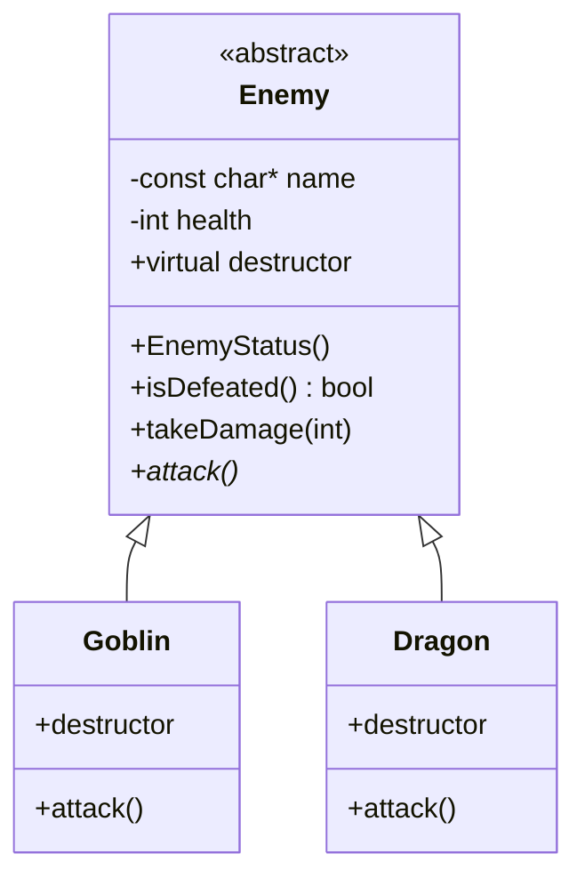
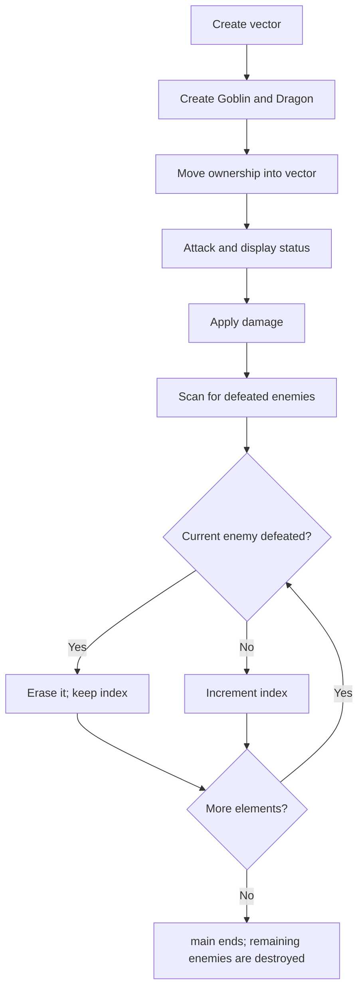

# Polymorphic Enemies, Ownership, and Cleanup

> **Type:** C++ implementation checkpoint  
> **Status:** Core exercise completed  
> **Purpose:** Document the design, debugging journey, and lessons from extending the polymorphism assignment with `std::vector`, `std::unique_ptr`, move semantics, and safe removal.

This note complements [[Polymorphism-Assignment]] and [[Cpp-Polymorphism-and-OOP-Design]].

---

## 1. Assignment overview

The arena contains a **Goblin** (150 health) and a **Dragon** (300 health). Both derive from the abstract `Enemy` base class, which stores shared state (`name` and `health`), implements common damage handling, and declares `attack()` as pure virtual.

The program demonstrates how to:

- Store different derived enemy types in one collection.
- Call overridden behavior through a shared base-class interface.
- Apply damage while keeping health from falling below zero.
- Remove defeated enemies from a dynamic collection.
- Let smart pointers manage enemy lifetimes.

## 2. Class structure



`Enemy` is abstract because `attack()` is pure virtual. It provides shared data and behavior; each concrete enemy supplies its own attack.

## 3. One collection for different enemy types

```cpp
std::vector<std::unique_ptr<Enemy>> enemies;
```

This combines two ideas:

- `std::vector` is a resizable collection.
- `std::unique_ptr<Enemy>` is an owning smart pointer to an object accessible through the `Enemy` interface.

The vector stores smart pointers rather than storing `Goblin` and `Dragon` objects directly. This lets it contain different derived types through one common element type.

### Creating enemies and transferring ownership

```cpp
auto gob = std::make_unique<Goblin>();
auto dragg = std::make_unique<Dragon>();

enemies.push_back(std::move(gob));
enemies.push_back(std::move(dragg));
```

`std::make_unique` creates an object managed by a smart pointer. `std::unique_ptr` is move-only, so `std::move` enables its ownership to be transferred into the vector. `std::move` itself does not perform the move; the receiving operation (`push_back`) does.

After a successful move, `gob` and `dragg` remain valid but empty. The vector's smart pointers now own the enemies.

## 4. Runtime polymorphism

```cpp
for (const auto& enemy : enemies) {
    enemy->attack();
    enemy->EnemyStatus();
}
```

The range-based loop visits every element. `const auto&` avoids copying each smart pointer, and `->` accesses a member through the pointer-like object.

Because `attack()` is virtual, the Goblin iteration calls `Goblin::attack()` and the Dragon iteration calls `Dragon::attack()`. The loop doesn't need to identify each concrete type.

## 5. Damage and state invariants

The `takeDamage(int damage)` method enforces these rules:

1. Negative damage is invalid and is rejected.
2. An already-defeated enemy is not damaged again.
3. Damage greater than current health sets health to zero instead of allowing negative health.
4. Otherwise, damage is subtracted from health.

The expression `health == 0` already returns a Boolean, so this method can be concise:

```cpp
bool isDefeated() const {
    return health == 0;
}
```

The trailing `const` promises that checking defeat does not modify the object's state.

### Health in this run

| Enemy | Starting health | Damage | Result |
|---|---:|---|---:|
| Goblin | 150 | 50, then 120 | 0 |
| Dragon | 300 | 200 | 100 |

The Goblin has 100 health after the first hit. The next 120 damage is greater than its remaining health, so health is clamped to zero. The subsequent damage attempt prints the message about an already-defeated Goblin and leaves health unchanged.

## 6. Removing defeated enemies safely

```cpp
int i = 0;

while (i < enemies.size()) {
    if (enemies[i]->isDefeated()) {
        enemies.erase(std::next(enemies.begin(), i));
    } else {
        ++i;
    }
}
```

The loop checks the current enemy.

- **Defeated:** erase it and keep `i` unchanged.
- **Alive:** increment `i` to inspect the next element.
- **Empty vector:** `i < enemies.size()` becomes false and the loop ends.

### Why the index stays the same after erasure

Suppose the vector contains:

```text
Index 0: defeated Goblin A
Index 1: defeated Goblin B
Index 2: living Dragon
```

After erasing index zero:

```text
Index 0: defeated Goblin B
Index 1: living Dragon
```

Goblin B shifts into index zero. If the loop increments `i`, it skips Goblin B. Keeping `i` unchanged means the new occupant of that index is checked next.

`std::next(enemies.begin(), i)` advances an iterator `i` positions from the beginning. Because a vector has random-access iterators, `enemies.begin() + i` is also valid.

### Ownership consequence

Erasing an element destroys its `std::unique_ptr`, which then destroys the enemy it owns. No manual `delete` is needed.

## 7. Lifetime and destruction

The base class has a virtual destructor:

```cpp
virtual ~Enemy() {
    std::cout << "Enemy Destroyed\n";
}
```

This ensures the derived destructor runs correctly when an enemy is destroyed through the `Enemy` interface.

For each enemy, destruction proceeds from derived to base:

```text
Goblin::~Goblin()
Enemy::~Enemy()

Dragon::~Dragon()
Enemy::~Enemy()
```

The Goblin is destroyed when the cleanup loop erases it. The Dragon remains in the vector and is destroyed when the vector goes out of scope at the end of `main()`.

This is **RAII** (Resource Acquisition Is Initialization): object lifetime manages resource lifetime. The smart pointers own the enemies and release them automatically during destruction.

## 8. Program flow



## 9. Output and interpretation

The completed run produced:

```text
Goblin stabs with a dagger !
Goblin's health is 150
Dragon breathes fire at the player
Dragon's health is 300
Goblin took damage of 50
Dragon took damage of 200
Goblin stabs with a dagger !
Goblin took damage of 120
Goblin stabs with a dagger !
Don't toy around with a dead Goblin body too much..
Goblin Destroyed
Enemy Destroyed
Dragon Destroyed
Enemy Destroyed
```

What this confirms:

- Virtual dispatch selects the correct attack for each enemy.
- The Goblin reaches zero health and ignores the later damage attempt.
- The cleanup loop erases and destroys the Goblin.
- The Dragon remains at 100 health after combat.
- The Dragon is destroyed when `main()` ends and the vector releases its ownership.

The Dragon's destructor running does **not** mean it was defeated. It means its owner is being destroyed as the program exits.

## 10. Debugging lessons

### 10.1 Indices shift after erasure

After removing the Goblin at index zero, the Dragon shifts from index one to index zero. An index is a current position, not a permanent identity.

### 10.2 Out-of-bounds access is not reliably diagnosed

Accessing `enemies[1]` when the vector contains only one element is out of bounds. `operator[]` does not check bounds. The behavior is undefined: the program may crash, appear to work, or behave unpredictably. A compiler is not required to diagnose it.

### 10.3 Erasure can cause skipped elements

Incrementing the index immediately after erasing an element skips the next element that shifts into the erased position.

### 10.4 Erase the element being inspected

`enemies.erase(enemies.begin())` always erases the first element. To erase the current index, use an iterator for that element, such as `std::next(enemies.begin(), i)`.

### 10.5 The vector may become empty

After cleanup, accessing `enemies[0]` is unsafe if the vector is empty. Check first:

```cpp
if (!enemies.empty()) {
    enemies[0]->attack();
}
```

### 10.6 Attacking after defeat is a gameplay rule

The current `attack()` methods don't check health, so the program can call an attack on a defeated enemy. This is a design choice not yet enforced, rather than inherently a memory-safety error.

## 11. Concepts practised

| Concept | Where it appears |
|---|---|
| Abstract class / pure virtual function | `Enemy::attack()` |
| Inheritance | `Goblin` and `Dragon` derive from `Enemy` |
| Runtime polymorphism | Virtual calls through `std::unique_ptr<Enemy>` |
| Constructor initializer list | Derived constructors initialize the base |
| Encapsulation | `name` and `health` are private |
| `const` member function | `isDefeated()` |
| `std::vector` | Resizable enemy roster |
| `std::unique_ptr` | Exclusive ownership of enemies |
| `std::make_unique` | Creation under smart-pointer ownership |
| Move semantics | Ownership transfer into the vector |
| Virtual destructor | Correct destruction through the base |
| RAII | Automatic cleanup at scope exit |
| Iteration and erasure | Remove defeated enemies without skipping |
| State invariants | Damage rules prevent negative health |

## 12. Self-review questions

Try answering these before reading the short answers.

1. Why can one vector hold both Goblins and Dragons?
2. What does `std::move(gob)` enable, and what happens to `gob` after the move?
3. Why does `enemy->attack()` call different implementations?
4. Why is a virtual destructor important here?
5. What happens to the Dragon's index when the Goblin is erased?
6. Why does the cleanup loop leave `i` unchanged after erasure?
7. What does `std::next(enemies.begin(), i)` identify?
8. Why does erasing a `unique_ptr` element destroy the enemy?
9. Why is `enemies[0]` unsafe when `enemies.empty()` is true?
10. Why does the Dragon's destructor run even though it has 100 health?
11. What is the difference between being defeated in the game and being destroyed in memory?
12. Which edge cases should be tested in `takeDamage()`?

### Short answers

1. Both can be owned through the common `Enemy` base type.
2. It enables ownership transfer; the moved-from pointer is valid but empty.
3. Virtual dispatch selects the actual object's override.
4. It ensures derived destruction when deleting through the base interface.
5. The Dragon shifts from index one to index zero.
6. The next element shifts into the erased element's index.
7. The iterator `i` positions from the vector's beginning.
8. The owning smart pointer destroys the object it owns.
9. An empty vector has no element at index zero.
10. The vector is destroyed at the end of `main()` and releases its ownership.
11. Defeat is game state; destruction is the end of the object's lifetime.
12. Negative damage, zero damage, lethal damage, overkill, and damage to a defeated enemy.

## 13. Limitations and future improvements

These are possible future changes, not requirements for this checkpoint:

- Separate combat actions from the cleanup phase.
- Avoid hardcoded indices when targeting enemies.
- Decide whether defeated enemies can attack.
- Consider `std::string` if names need to be owned or changed; `const char*` works for the string literals used here.
- Consider `std::size_t` for an index compared with `vector::size()`, since `size()` returns an unsigned size type.
- Extract responsibilities into functions as the program grows.
- Test negative, zero, lethal, and excessive damage, as well as an empty vector and consecutive defeated enemies.

Don't add complexity just because it is possible. Add features when they teach the next intended concept or create meaningful gameplay.

## 14. Related notes

- [[Polymorphism-Assignment]] — the earlier polymorphism assignment.
- [[Cpp-Polymorphism-and-OOP-Design]] — abstraction, encapsulation, virtual functions, and virtual destructors.
- [[Cpp-Inheritance-Foundations]] — inheritance and base/derived construction and destruction.
- [[Cpp-Constructors-and-Destructors]] — initialization and object lifetime.

## Final takeaway

The achievement was combining polymorphism with ownership and a dynamic collection. The arena now stores different enemy types through a common interface, manages their lifetimes with smart pointers, and removes defeated enemies without skipping shifted elements.

The next natural milestone is to apply a different C++ skill—arrays and two-dimensional arrays—to represent the farming RPG's 3×3 farm grid.
