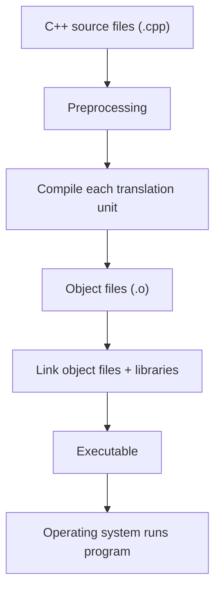
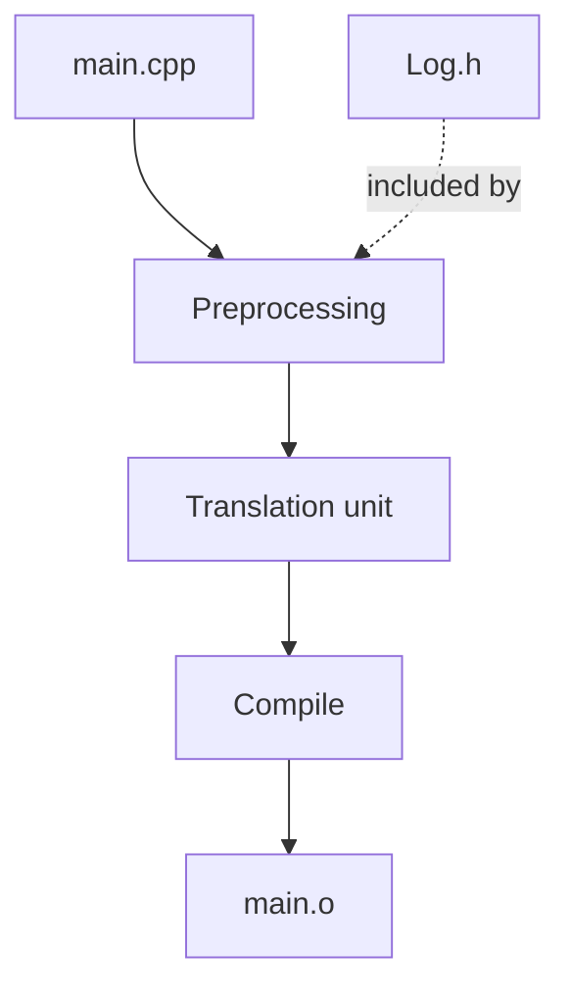
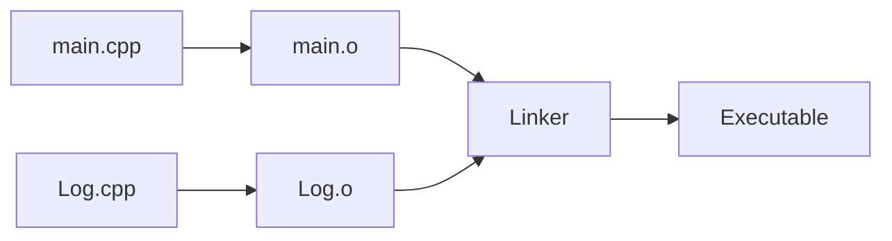
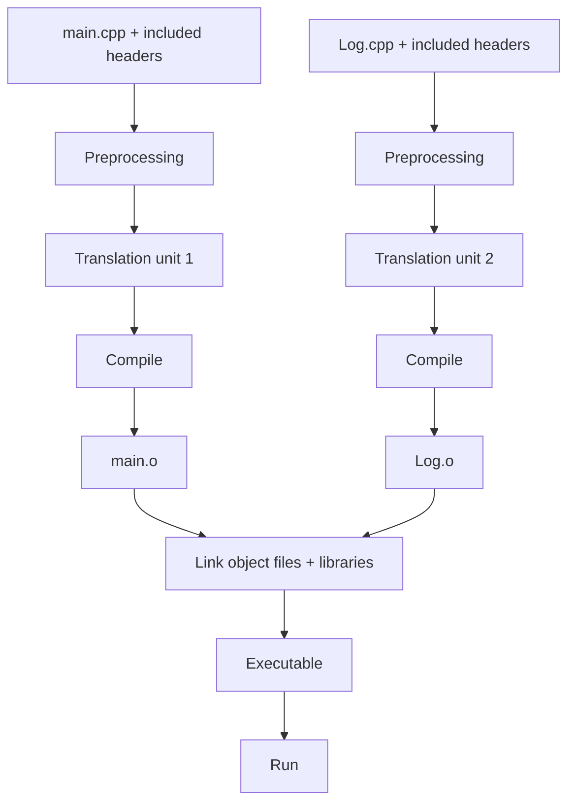

# C++ Compilation and Execution — The Basics

These notes introduce the C++ build process with a Linux/GCC workflow. They focus on the essentials: how source files become an executable, how declarations and definitions fit into multi-file projects, and how to debug common build problems.

Related notes: [[Cpp-Compiler-Works]], [[Cpp-Linker]], [[Cpp-Header-Files]], [[Cpp-Debugging-GDB]].

---

## 1. The build workflow

A typical build follows this simplified pipeline:



The main distinction:

- **Compilation** turns each preprocessed source file (translation unit) into object code.
- **Linking** combines object files and required libraries into an executable or another library.

On Linux, GCC and Clang commonly use `.o` for object files. MSVC commonly uses `.obj`. A Linux executable often has no filename extension.

---

## 2. The preprocessor and headers

Preprocessor directives begin with `#`. Common examples include `#include`, `#define`, `#if`, and `#ifdef`.

```cpp
#include <iostream>
#include "Log.h"
```

`#include` makes the header's contents part of the translation unit being preprocessed. This lets the compiler see declarations and type definitions that the source needs. It does **not** compile the corresponding `.cpp` file or link an implementation.

Headers are not normally compiled independently. Instead, each `.cpp` file that includes a header gets its own translation unit containing the included content.



A header commonly contains declarations, type definitions, templates, and sometimes inline function definitions. `#pragma once` or include guards prevent repeated processing of a header within one translation unit.

```cpp
#ifndef LOG_H
#define LOG_H

void Log(const char* message);

#endif
```

`#pragma once` is widely supported and convenient, while include guards use standard preprocessor directives.

---

## 3. The `main()` function

For a normal hosted C++ executable, `main()` is the program's entry point.

```cpp
#include <iostream>

int main()
{
    std::cout << "Hello World\n";
    return 0;
}
```

Execution begins in `main()` and generally proceeds in order unless control flow changes it. In C++, reaching the closing brace of `main()` is equivalent to returning `0`, so an explicit `return 0;` is optional.

A return value of `0` conventionally indicates success to the operating system; a nonzero status commonly indicates some kind of failure.

---

## 4. Understanding `std::cout <<`

```cpp
std::cout << "Hello World";
```

Here, `<<` is the stream insertion operator, overloaded to send values to an output stream. With integer operands, `<<` can instead mean bit shifting:

```cpp
int result = 3 << 1; // Bit shift: result is 6
```

The operator's meaning depends on the operand types. `std::cout << value` is ordinary C++ operator syntax with an overload provided by the standard library, not a special output-only language construct.

---

## 5. Separate compilation

Suppose the project contains:

```text
Project/
├── main.cpp
├── Log.cpp
└── Log.h
```

Each `.cpp` file is typically compiled independently:

```text
main.cpp  → main.o
Log.cpp   → Log.o
```

The compiler sees each translation unit on its own. It does not automatically combine every `.cpp` file into one giant source file. The linker later connects references between the resulting object files.

---

## 6. Declarations versus definitions

A **declaration** tells the compiler about a function's name and signature:

```cpp
void Log(const char* message);
```

A **definition** provides the function body:

```cpp
#include <iostream>
#include "Log.h"

void Log(const char* message)
{
    std::cout << message << '\n';
}
```

It is common to put the declaration in `Log.h`, include that header from both `.cpp` files, and put the non-inline definition in `Log.cpp`.

**`Log.h`**

```cpp
#pragma once

void Log(const char* message);
```

**`main.cpp`**

```cpp
#include "Log.h"

int main()
{
    Log("Hello World");
}
```

**`Log.cpp`**

```cpp
#include <iostream>
#include "Log.h"

void Log(const char* message)
{
    std::cout << message << '\n';
}
```

When compiling `main.cpp`, the compiler needs the declaration to validate the call. It does not need the function's implementation in that translation unit. The definition must still be available to the linker when creating the final executable.

---

## 7. The linker and build errors

The linker combines object files and libraries, resolving references between them.



### Compilation error versus linker error

- **Compilation error:** a source file cannot be compiled because of a syntax error, type error, or another compile-time issue.
- **Linker error:** compilation produced object files, but the linker cannot resolve a required symbol or otherwise build the requested output.

For example, if `main.cpp` declares and calls `Log()` but no matching definition is linked, Linux toolchains commonly report an `undefined reference` error.

When a build fails, identify the stage that failed before changing code. A missing definition is not fixed by changing unrelated syntax.

---

## 8. Debug-friendly and optimized builds

On Linux, you generally choose compiler flags rather than relying on a particular IDE's Debug/Release buttons.

A useful development command is:

```bash
g++ -std=c++20 -Wall -Wextra -Wpedantic -g -O0 main.cpp Log.cpp -o main
```

- `-std=c++20`: select C++20 language mode.
- `-Wall -Wextra -Wpedantic`: enable useful warnings.
- `-g`: include debugging information.
- `-O0`: disable most optimization to make debugging more straightforward.

An optimized build might use:

```bash
g++ -std=c++20 -Wall -Wextra -Wpedantic -O2 main.cpp Log.cpp -o main
```

`Debug` and `Release` are common build-configuration names, not C++ language features. The actual flags depend on the project and build system. Optimization can rearrange operations, keep variables in registers, or eliminate unused calculations, which can make stepping through optimized code less intuitive.

---

## 9. Debugging with GDB and VS Code

GDB is a common debugger on Linux. Build with `-g`, then launch:

```bash
gdb ./main
```

Useful commands:

| Command | Purpose |
|---|---|
| `break main` | Set a breakpoint at `main()` |
| `break file.cpp:10` | Set a breakpoint at a source line |
| `run` | Start the program |
| `next` | Execute the next source line without stepping into a function |
| `step` | Step into a function call |
| `continue` | Continue until another breakpoint or program stop |
| `print x` | Print the value of `x` |
| `backtrace` | Show the call stack |
| `list` | Show nearby source code |
| `quit` | Exit GDB |

VS Code's C/C++ extensions can provide a graphical debugging interface while using GDB underneath. The IDE is the interface; GDB performs the debugging work.

---

## 10. Useful Linux tools to learn over time

You do not need to master every tool at once.

| Tool | Role |
|---|---|
| `g++` | C++ compiler driver; coordinates build stages |
| GDB | Debugger |
| Make or Ninja | Build execution tools |
| CMake | Configure/generate a build for tools such as Make or Ninja |
| Git | Version control |
| AddressSanitizer | Detect certain memory errors at runtime |
| Valgrind | Dynamic analysis, including some memory-error checks |

For your current learning stage, GCC, GDB, and VS Code are enough to follow The Cherno's C++ material. CMake and other tools become more useful as projects grow.

### AddressSanitizer example

AddressSanitizer can detect certain memory bugs, including many out-of-bounds accesses and use-after-free errors.

```bash
g++ -std=c++20 -Wall -Wextra -Wpedantic -g \
    -fsanitize=address \
    main.cpp Log.cpp \
    -o main
./main
```

It is runtime instrumentation, not a guarantee that every memory bug will be found.

---

## 11. Compile and link manually

Given `main.cpp`, `Log.cpp`, and `Log.h`, compile each source file separately:

```bash
g++ -std=c++20 -Wall -Wextra -Wpedantic -g -c main.cpp -o main.o
g++ -std=c++20 -Wall -Wextra -Wpedantic -g -c Log.cpp -o Log.o
```

The `-c` option tells GCC to compile without performing the final link.

Then link the object files:

```bash
g++ main.o Log.o -o main
```

Run the executable:

```bash
./main
```

For a small project, you can normally let the `g++` driver handle all the stages:

```bash
g++ -std=c++20 -Wall -Wextra -Wpedantic -g main.cpp Log.cpp -o main
```

The driver orchestrates preprocessing, compilation, assembly, and linking as needed.

---

## 12. The complete mental model



## Key takeaways

1. Each `.cpp` source file is normally preprocessed and compiled independently.
2. Headers provide declarations and other shared definitions to translation units; they are not normally compiled as separate units.
3. A declaration tells the compiler what exists; a definition supplies the implementation.
4. The compiler and linker have different jobs.
5. A missing function definition can cause a linker error even when the call compiled successfully.
6. `-g` adds debug information; `-O0` and `-O2` control optimization.
7. GDB can be used directly or through VS Code's debugging interface.
8. Sanitizers can help detect some runtime errors but do not prove a program is bug-free.

## Self-check

1. What is the difference between compilation and linking?
2. Why does `main.cpp` need to see the declaration of `Log()`?
3. Why can a function call compile but fail during linking?
4. What do `-g`, `-O0`, and `-c` do?
5. How can you use GDB through VS Code?
6. What kinds of bugs can AddressSanitizer help detect?

## Related notes

- [[Cpp-Compiler-Works]] — deeper explanation of preprocessing, translation units, ASTs, and optimization
- [[Cpp-Linker]] — symbols, unresolved references, and the One Definition Rule
- [[Cpp-Header-Files]] — header organization and declarations
- [[Cpp-Debugging-GDB]] — practical debugging workflow
