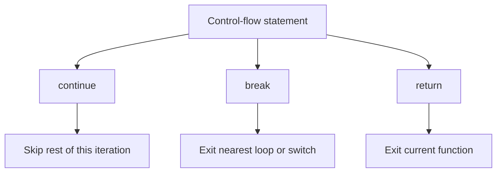
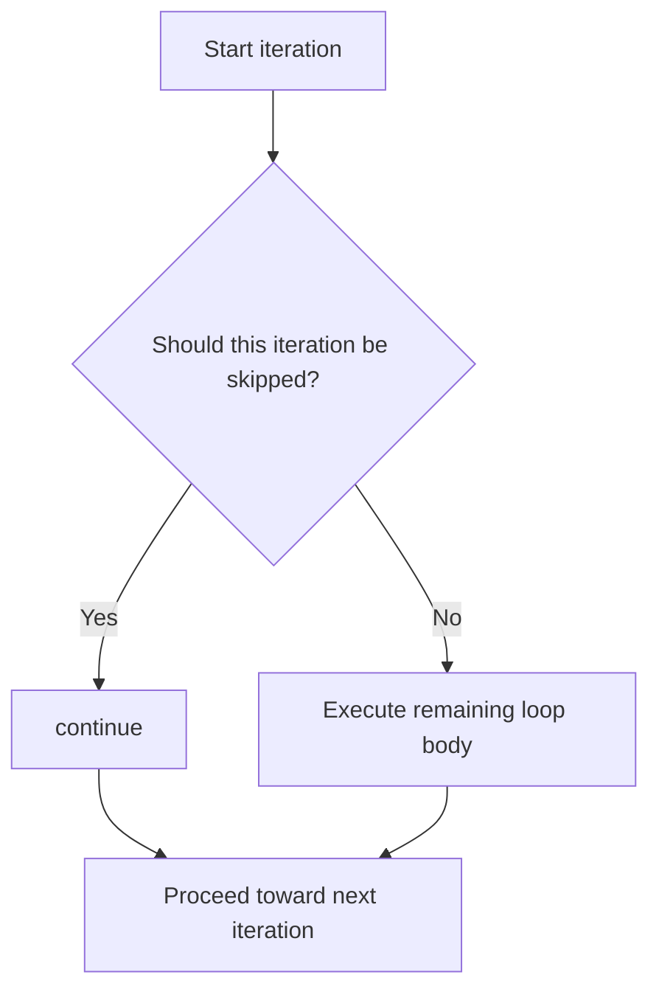
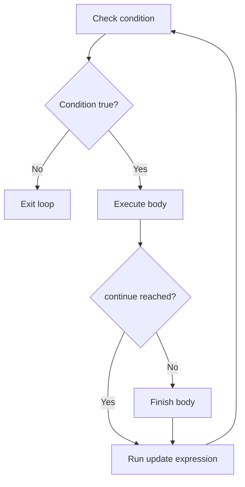
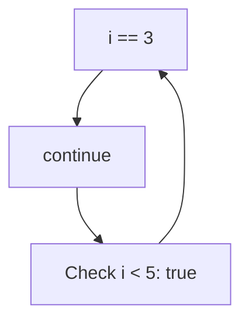
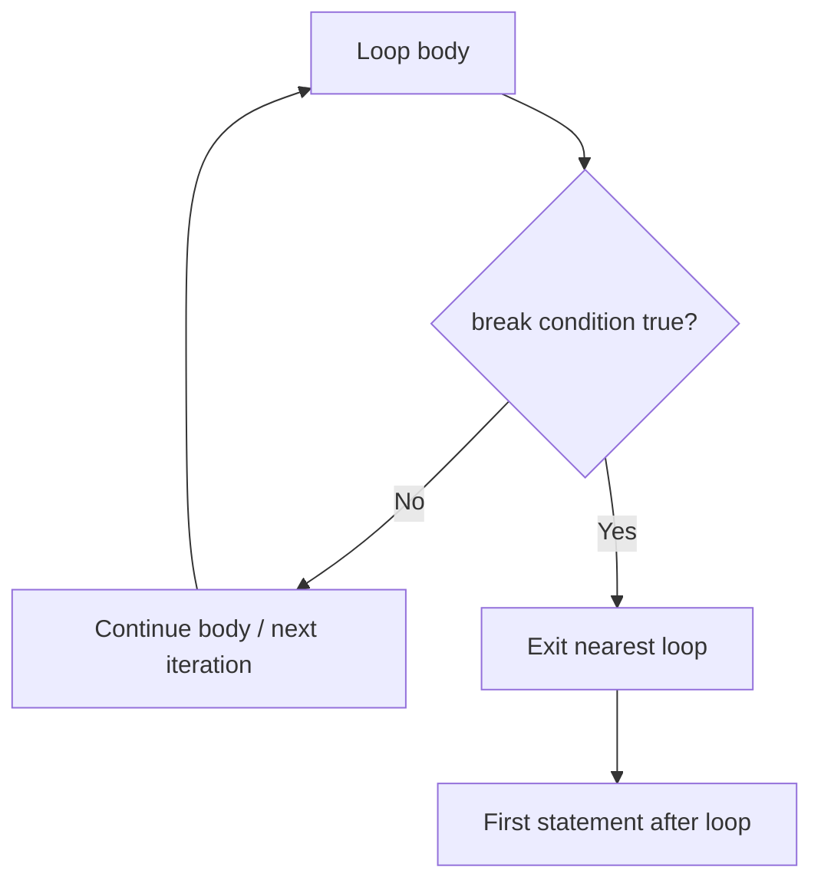
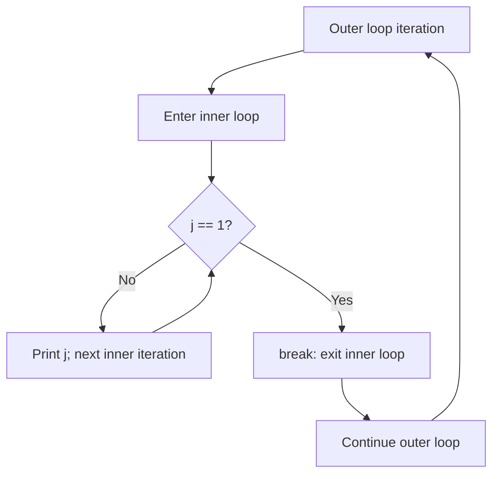
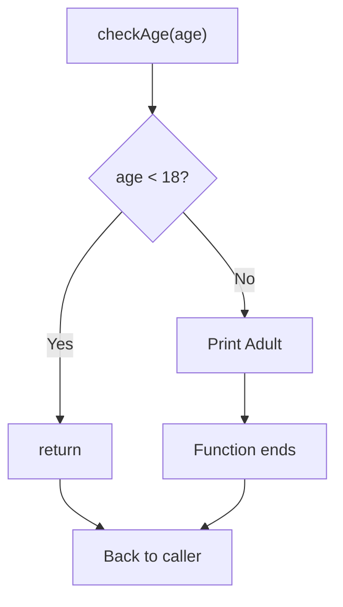
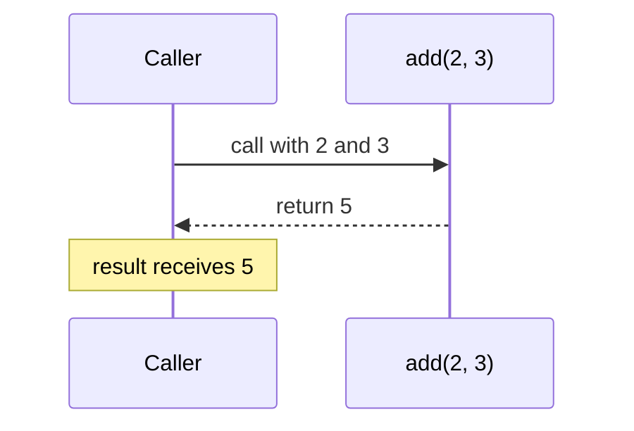
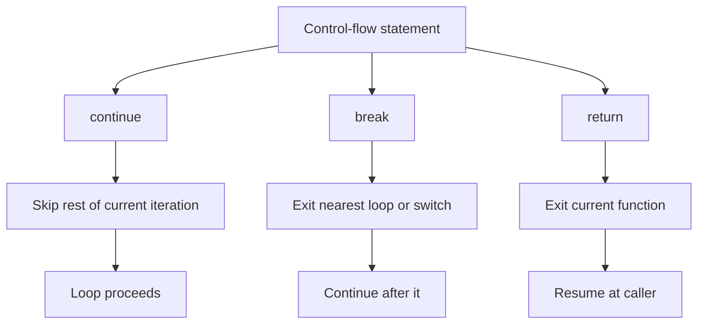

# C++ Control Flow: `continue`, `break`, and `return`

These notes explain how the three statements change execution, with flowcharts and traces to make their differences easier to visualize.

## Contents

1. [Control flow](#1-control-flow)
2. [`continue`](#2-continue)
3. [`continue` in different loops](#3-continue-in-different-loops)
4. [`break`](#4-break)
5. [`break` in `switch` and nested loops](#5-break-in-switch-and-nested-loops)
6. [`return`](#6-return)
7. [Returning values and early returns](#7-returning-values-and-early-returns)
8. [Comparing all three](#8-comparing-all-three)
9. [Common mistakes](#9-common-mistakes)
10. [Summary and self-check](#10-summary-and-self-check)

---

## 1. Control flow

**Control flow** is the order in which a program's statements execute. Without branches or jumps, statements normally execute in sequence:

```cpp
std::cout << "A";
std::cout << "B";
std::cout << "C";
```

Output:

```text
ABC
```

Conditions, loops, and control-flow statements let a program choose paths, repeat work, skip an iteration, stop a loop, or leave a function.

The central distinction:

| Statement | Effect | Execution continues... |
|---|---|---|
| `continue` | Skips the rest of the current loop iteration | At the next iteration |
| `break` | Exits the nearest enclosing loop or `switch` | After that loop or `switch` |
| `return` | Exits the current function | At the caller |



A useful shorthand is: **skip an iteration, exit a loop/switch, or exit a function.**

## 2. `continue`

`continue` skips the remaining statements in the current iteration. It does **not** terminate the loop.

```cpp
for (int i = 0; i < 5; i++) {
    if (i % 2 == 0)
        continue;

    std::cout << i << '\n';
}
```

Output:

```text
1
3
```

Trace:

| `i` | Action |
|---:|---|
| 0 | Even, so skip printing |
| 1 | Print `1` |
| 2 | Even, so skip printing |
| 3 | Print `3` |
| 4 | Even, so skip printing |



`continue` can be used inside `for`, `while`, and `do-while` loops. It cannot be used outside a loop.

## 3. `continue` in different loops

The key detail is where execution goes next.

### `for` loop

A `for` loop has initialization, a condition, a body, and an update expression:

```cpp
for (initialization; condition; update) {
    // body
}
```

When `continue` executes in a `for` loop, the update expression still runs before the next condition check.



For example, `continue` does not make this loop stuck at `i == 2`:

```cpp
for (int i = 0; i < 5; i++) {
    if (i == 2)
        continue;

    std::cout << i << '\n';
}
```

### `while` loop

A `while` loop has no automatic update expression. When `continue` executes, control returns to the condition check.

```cpp
int i = 0;

while (i < 5) {
    i++;

    if (i == 3)
        continue;

    std::cout << i << '\n';
}
```

Output:

```text
1
2
4
5
```

Be careful to update the loop state before `continue` if that update is needed for termination. Otherwise, you may create an infinite loop:

```cpp
int i = 0;

while (i < 5) {
    if (i == 3)
        continue; // i stays 3 forever

    i++;
}
```

When `i` becomes `3`, execution repeatedly checks the still-true condition and continues before incrementing `i`.



### `do-while` loop

A `do-while` executes the body before checking the condition. `continue` proceeds to the condition check.

```cpp
int i = 0;

do {
    i++;

    if (i == 3)
        continue;

    std::cout << i << '\n';
} while (i < 5);
```

Output:

```text
1
2
4
5
```

## 4. `break`

`break` immediately exits the **nearest enclosing loop or `switch`**.

```cpp
for (int i = 0; i < 5; i++) {
    if (i == 3)
        break;

    std::cout << i << '\n';
}

std::cout << "Loop finished\n";
```

Output:

```text
0
1
2
Loop finished
```

When `i == 3`, the loop ends. Execution resumes at the first statement after the loop; the function itself does not end.



## 5. `break` in `switch` and nested loops

### In a `switch`

`break` commonly prevents execution from falling through into the next `case`:

```cpp
int number = 2;

switch (number) {
    case 1:
        std::cout << "One";
        break;
    case 2:
        std::cout << "Two";
        break;
    case 3:
        std::cout << "Three";
        break;
}
```

This prints `Two`. Without the `break` after `case 2`, execution could continue into `case 3`; this is called **fallthrough**. C++ also supports intentional fallthrough, so not every switch case must always end with `break`.

### In nested loops

`break` exits only the nearest enclosing loop, not every nested loop:

```cpp
for (int i = 0; i < 3; i++) {
    for (int j = 0; j < 3; j++) {
        if (j == 1)
            break;

        std::cout << j << '\n';
    }
}
```

Each inner loop stops when `j == 1`, but the outer loop continues with the next `i`.



Likewise, `continue` affects only the nearest enclosing loop. In nested loops, a `continue` inside the inner loop skips that inner iteration; it does not skip the outer iteration.

## 6. `return`

`return` exits the **current function**, whether or not the function contains a loop.

```cpp
void checkAge(int age) {
    if (age < 18)
        return;

    std::cout << "Adult\n";
}
```

Calling `checkAge(15)` returns before printing. Calling `checkAge(25)` prints `Adult` and then reaches the end of the function.



A function can contain multiple `return` statements. This is often called an **early return** when a function exits early for a particular condition.

```cpp
int clampToRange(int value) {
    if (value < 0)
        return 0;

    if (value > 100)
        return 100;

    return value;
}
```

The function returns `0` for negative inputs, `100` for inputs above `100`, and the original value otherwise.

## 7. Returning values and early returns

A non-`void` function returns a value compatible with its declared return type:

```cpp
int add(int a, int b) {
    return a + b;
}

int result = add(2, 3); // result is 5
```



A `void` function does not return a value, but `return;` can still exit it early:

```cpp
void printMessage(bool shouldPrint) {
    if (!shouldPrint)
        return;

    std::cout << "Hello\n";
}
```

A function with a non-`void` return type must not flow off the end without returning a value, except for the special rule that reaching the end of `main` is equivalent to `return 0;`.

```cpp
int main() {
    std::cout << "Hello\n";
} // equivalent to return 0;
```

Returning `0` from `main` conventionally indicates successful termination.

### Early returns can simplify code

Instead of nesting the main logic inside a condition:

```cpp
void processNumber(int number) {
    if (number >= 0) {
        std::cout << "Processing " << number << '\n';
        // More processing...
    }
}
```

you can reject an unwanted case immediately:

```cpp
void processNumber(int number) {
    if (number < 0)
        return;

    std::cout << "Processing " << number << '\n';
    // More processing...
}
```

The normal path is less nested and easier to follow.

### Unreachable code

Statements after an unconditional `return` cannot execute along that path:

```cpp
int getValue() {
    return 10;

    // std::cout << "Hello"; // unreachable
}
```

This is unreachable code; compilers or static-analysis tools may warn about it.

## 8. Comparing all three



A combined example:

```cpp
void example() {
    for (int i = 0; i < 10; i++) {
        if (i == 2)
            continue;

        if (i == 5)
            break;

        std::cout << i << '\n';
    }

    std::cout << "After loop\n";
}
```

Output:

```text
0
1
3
4
After loop
```

- `continue` skips printing `2`.
- `break` stops the loop when `i == 5`.
- Execution then prints `After loop`.

If the `break` were replaced with `return`, the function would end at `i == 5` and `After loop` would not print.

## 9. Common mistakes

### Mistake 1: Treating `continue` as loop termination

`continue` skips only the current iteration. The loop can run again.

### Mistake 2: Confusing `break` and `return`

- `break;` exits the nearest loop or `switch`.
- `return;` exits the current function.
- Code after a `break` can still execute within the function.

### Mistake 3: Creating an infinite loop

With `while`, ensure the condition can eventually become false. If `continue` skips the only statement that updates the loop state, the loop may never progress.

### Mistake 4: Assuming nested `break` exits all loops

A plain `break` exits only the nearest enclosing loop or `switch`. To exit multiple nested loops, use a deliberate design—for example, a flag, a helper function with `return`, or a suitable algorithmic restructure.

### Mistake 5: Forgetting that `return` ends the whole function

Any statement after an executed `return` in that function is skipped, including code after the loop containing the `return`.

## 10. Summary and self-check

### Summary table

| Keyword | Where it can be used | Effect | Next execution point |
|---|---|---|---|
| `continue` | Inside a loop | Skip remaining body of current iteration | Next iteration (via the loop's appropriate update/check path) |
| `break` | Inside a loop or `switch` | Exit nearest loop or `switch` | First statement after it |
| `return` | Inside a function | Exit the current function, optionally returning a value | Caller |

### Quick mental model

```text
continue  -> skip this iteration
break     -> stop this loop/switch
return    -> leave this function
```

### Self-check

1. In a `for` loop, does `continue` skip the update expression?
2. Why can `continue` cause an infinite loop in some `while` loops?
3. What does `break` exit when used inside a nested loop?
4. What happens to code after `break`? What about code after `return`?
5. Why is reaching the end of `main` different from reaching the end of an ordinary non-`void` function?

## Related notes

- [[Cpp-Pointers]] — pointers, addresses, and indirection.
- [[Cpp-References]] — references and function parameters.
- [[Classes-and-Structs]] — functions, interfaces, and encapsulation.
