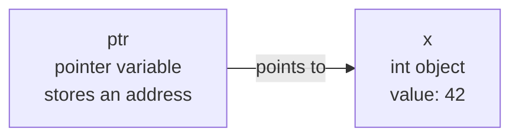
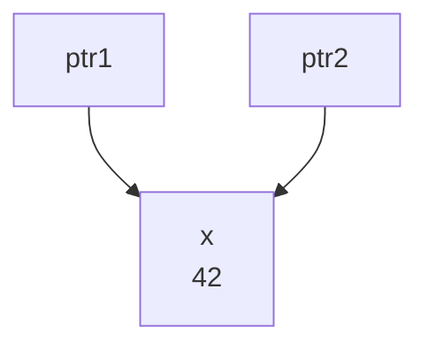
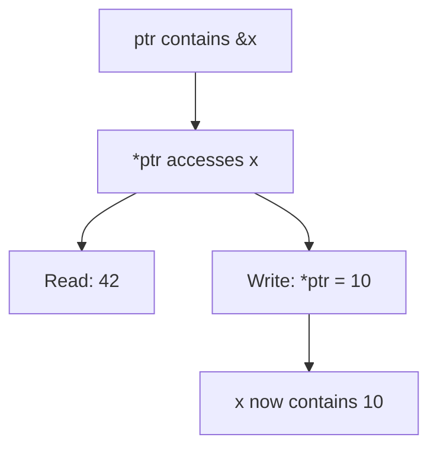
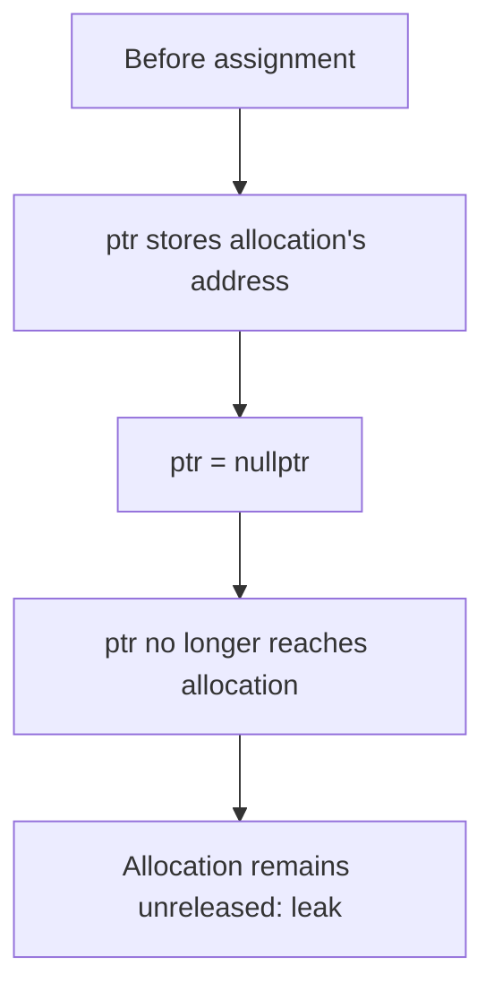
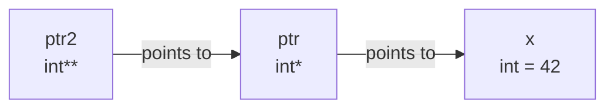
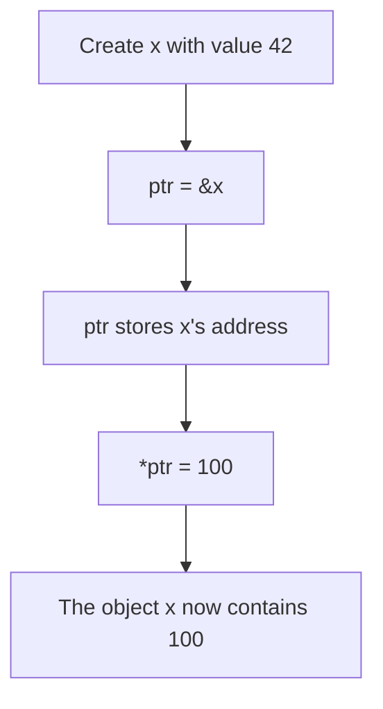

# C++ Pointers — Detailed Notes

> Based on The Cherno’s **“Pointers in C++”** video. These notes keep the core explanations and examples while adding diagrams for memory, indirection, arrays, and object lifetime.

## Contents

1. [Memory and the pointer mental model](#1-memory-and-the-pointer-mental-model)
2. [Creating pointers](#2-creating-pointers)
3. [`void*`: a generic pointer](#3-void-a-generic-pointer)
4. [The address-of operator `&`](#4-the-address-of-operator-)
5. [`nullptr` and invalid pointers](#5-nullptr-and-invalid-pointers)
6. [Dereferencing and modifying objects](#6-dereferencing-and-modifying-objects)
7. [Why pointer types matter](#7-why-pointer-types-matter)
8. [Pointer arithmetic and arrays](#8-pointer-arithmetic-and-arrays)
9. [Automatic storage, dynamic storage, and `new`](#9-automatic-storage-dynamic-storage-and-new)
10. [`delete`, `delete[]`, and memory leaks](#10-delete-delete-and-memory-leaks)
11. [Pointers are objects too](#11-pointers-are-objects-too)
12. [Pointers to pointers](#12-pointers-to-pointers)
13. [A complete example](#13-a-complete-example)
14. [Common safety rules](#14-common-safety-rules)
15. [Key takeaways and self-check](#15-key-takeaways-and-self-check)

---

## 1. Memory and the pointer mental model

Computer memory is **byte-addressable**: each byte has an address. However, an object may occupy multiple bytes.

```text
Illustrative memory addresses (not real addresses)

Address:  1000   1001   1002   1003   1004   1005
Memory:   [byte] [byte] [byte] [byte] [byte] [byte] ...
```

A **pointer is an object that stores an address**. It does not contain a duplicate copy of the object it points to.

```cpp
int x = 42;
int* ptr = &x;
```

Conceptually, there are two objects: `x`, which contains `42`, and `ptr`, which stores the address of `x`.



Keep these expressions separate:

| Expression | Meaning |
|---|---|
| `x` | The value of `x` (here, `42`) |
| `&x` | The address of `x` |
| `ptr` | The address stored in `ptr` |
| `*ptr` | The object reached through the address in `ptr` |
| `&ptr` | The address of the pointer variable itself |

If `ptr == &x`, then `ptr` and `&x` represent the same address. But `ptr` and `&ptr` are different: one is the address of `x`, the other is the address of the pointer variable.

### A pointer does not duplicate the data

```cpp
int x = 42;
int* ptr1 = &x;
int* ptr2 = &x;
```

Both pointers refer to the same object:



There is still only one `x`. If `*ptr1 = 100;` executes, then `x` becomes `100`, and reading `*ptr2` also produces `100`.

---

## 2. Creating pointers

The `*` in a declaration indicates a pointer type:

```cpp
int* intPtr;       // pointer to int
char* charPtr;     // pointer to char
float* floatPtr;   // pointer to float
double* doublePtr; // pointer to double
bool* boolPtr;     // pointer to bool
```

The pointed-to type tells the compiler how to interpret the object reached through the pointer and what typed operations are permitted.

**Initialize pointers before using them.** An uninitialized local pointer does not automatically point to a valid object:

```cpp
int* ptr = nullptr; // initialized, currently points to no object
```

A declaration detail worth remembering:

```cpp
int* p, q;
```

This declares `p` as a pointer to `int`, but `q` as an ordinary `int`. Prefer one declaration per line to make the types obvious.

---

## 3. `void*`: a generic pointer

A `void*` can hold an object address without specifying the object's type:

```cpp
int x = 42;
void* raw = &x;
```

You cannot dereference `raw` directly because the compiler does not know the pointed-to type. Convert it back to a suitable type before accessing the object:

```cpp
int* intPtr = static_cast<int*>(raw);
std::cout << *intPtr; // 42
```

The conversion is only appropriate because `raw` actually holds the address of an `int`. Casting an address does not magically make the object at that address a different type.

In ordinary modern C++, templates and type-safe abstractions are usually preferable to `void*`.

---

## 4. The address-of operator `&`

The unary `&` operator obtains an object's address:

```cpp
int x = 42;
int* ptr = &x;
```

Read `int* ptr = &x;` as: “Take the address of `x` and store it in `ptr`.”

You can print an object's address:

```cpp
std::cout << &x;
```

The output may look like `0x7ffe1234abcd`, but the actual address varies between executions and systems. The useful fact is the relationship—`ptr` holds the address of `x`—not the particular hexadecimal number.

> **Syntax note:** `&` has more than one use in C++. Here it is the unary *address-of* operator. In a declaration such as `int& ref = x;`, it instead participates in declaring a reference.

---

## 5. `nullptr` and invalid pointers

Use `nullptr` to represent a null pointer—a pointer that does not point to an object.

```cpp
int* ptr = nullptr;

if (ptr == nullptr) {
    std::cout << "ptr points to no object\n";
}
```

Prefer `nullptr` over legacy `NULL` or `0`: `nullptr` has a dedicated type and behaves more reliably with overload resolution.

**Never dereference a null pointer:**

```cpp
int* ptr = nullptr;
// *ptr = 10; // Undefined behavior
```

A pointer can also be invalid for other reasons: it may be uninitialized, dangling after an object's lifetime ends, or point outside the valid range of an array. A non-null pointer is not automatically a valid pointer.

---

## 6. Dereferencing and modifying objects

The unary `*` operator dereferences a pointer: it gives access to the object at the address stored in the pointer.

```cpp
int x = 42;
int* ptr = &x;

std::cout << *ptr; // 42
```



Because `*ptr` refers to `x`, assigning through it modifies the original object:

```cpp
*ptr = 10;
std::cout << x; // 10
```

For a valid object, address-of and dereference are conceptually complementary:

```cpp
*(&x) // refers to x
```

They are not universal inverses for arbitrary pointer expressions: dereferencing still requires a valid pointer.

---

## 7. Why pointer types matter

A pointer type tells the compiler what kind of object it is intended to point to. This affects dereferencing, type checking, and pointer arithmetic.

For example, a typical `int` occupies multiple bytes (often 4, but the language does not require every implementation to use exactly 4 bytes):

```cpp
std::cout << sizeof(int);
```

The result is the size of an `int` in bytes on the current implementation. An object may span several consecutive byte addresses:

```text
Illustration only: if sizeof(int) == 4

Addresses:  1000  1001  1002  1003
            ┌─────────────────────┐
int object: │       one int       │
            └─────────────────────┘
             ^
             int* points to object
```

This is one reason a `void*` cannot be dereferenced directly: it does not specify a pointed-to type. Pointer types are not just labels; they determine how typed operations are interpreted.

---

## 8. Pointer arithmetic and arrays

Pointer arithmetic is scaled by the pointed-to type. Incrementing an `int*` advances it to the next `int` element, not merely to the next byte.

```cpp
int values[] = {10, 20, 30};
int* ptr = values; // points to values[0]

++ptr;
std::cout << *ptr; // 20
```

Conceptually, if each `int` occupies 4 bytes:

```text
values:  [10] [20] [30]
          ^    ^
          |    └── ptr after ++ptr
          └─────── ptr before ++ptr
```

The actual byte distance depends on `sizeof(int)`. Pointer arithmetic is defined within an array and permits forming a pointer one past the last element, but that one-past pointer must not be dereferenced.

Array indexing is closely related to pointer arithmetic:

```cpp
values[2]        // third element
*(values + 2)    // same element
```

Do not treat pointer arithmetic as unrestricted arithmetic on numeric addresses.

---

## 9. Automatic storage, dynamic storage, and `new`

### Automatic storage

A typical local variable has automatic storage duration:

```cpp
void function() {
    int x = 10;
} // x's lifetime ends when execution leaves its scope
```

You normally do not manually release the storage for an ordinary local variable. The stack is a common implementation mechanism for such local variables, but the C++ language rules concern storage duration and lifetime—not a requirement that every local variable physically reside on a machine stack.

### Dynamic allocation

`new` dynamically allocates storage and creates an object:

```cpp
int* ptr = new int(42);
```

The pointer variable `ptr` stores the address of the dynamically allocated `int`.


The pointer and the allocated object have distinct lifetimes. The pointer variable can go out of scope while the allocated object remains alive; the allocation must still be managed.

You can also allocate an `int` without giving it an initial value in the same way:

```cpp
int* ptr = new int;
```

For a scalar `int`, this default-initialization does not give the integer a defined numeric value. Initialize it before reading it. Prefer explicit initialization, such as `new int(0)`, when demonstrating raw allocation.

### Dynamically allocated arrays

```cpp
char* buffer = new char[8];
```

This creates an array of eight `char` elements; `buffer` points to the first element.

```text
buffer
  |
  v
+------+------+------+------+------+------+------+------+
| [0]  | [1]  | [2]  | [3]  | [4]  | [5]  | [6]  | [7]  |
+------+------+------+------+------+------+------+------+
```

You can access elements using `buffer[0]`, `buffer[1]`, and so on. As above, indexing is related to pointer arithmetic.

---

## 10. `delete`, `delete[]`, and memory leaks

A dynamic allocation must be released with the matching deallocation form:

```cpp
int* one = new int(42);
delete one;

int* many = new int[10];
delete[] many;
```

| Allocation | Matching deallocation |
|---|---|
| `new T` | `delete ptr` |
| `new T[n]` | `delete[] ptr` |

Using the wrong form results in undefined behavior. Do not use a pointer to access an object after it has been deleted, and do not delete the same allocation more than once.

After deletion, assigning `nullptr` can help avoid accidentally reusing that pointer:

```cpp
delete one;
one = nullptr;
```

This does not make other aliases to the deleted object safe; any other pointers to it are dangling too.

### Memory leaks

A leak occurs when dynamically allocated storage is no longer properly reachable for release. For example:

```cpp
int* ptr = new int(42);
ptr = nullptr; // the allocation is still outstanding: leaked
```



Setting the pointer to `nullptr` changes the pointer; it does not release the allocation.

### Prefer RAII in modern C++

Raw `new` and `delete` are important to understand, but ordinary modern C++ code should generally prefer abstractions that manage resource lifetime automatically.

```cpp
#include <memory>

auto ptr = std::make_unique<int>(42);
// the int is automatically released when ptr is destroyed
```

Use `std::vector<T>` for a dynamically sized sequence of elements. Use `std::unique_ptr<T>` when you need exclusive ownership of a dynamically allocated object. These techniques reduce the chance of leaks and mismatched deallocation.

---

## 11. Pointers are objects too

A pointer is itself an object and occupies storage. Therefore, you can take the address of a pointer:

```cpp
int x = 42;
int* ptr = &x;

int** ptrToPtr = &ptr;
```

`&ptr` is the address of the pointer variable, not the address of `x`.

---

## 12. Pointers to pointers

A pointer to an `int*` has type `int**`:

```cpp
int x = 42;
int* ptr = &x;
int** ptr2 = &ptr;
```



Each `*` follows one level of indirection:

```cpp
ptr       // address of x
*ptr      // x
ptr2      // address of ptr
*ptr2     // ptr
**ptr2    // x
```

Therefore:

```cpp
**ptr2 = 100; // changes x to 100
```

### Why use a pointer to a pointer?

A function receiving an `int*` receives a copy of the pointer:

```cpp
void changePointer(int* ptr) {
    ptr = nullptr; // changes only this local copy
}
```

Reassigning that parameter does not reassign the caller's pointer. A pointer to a pointer can let a function access the caller's pointer object:

```cpp
void changePointer(int** ptr) {
    *ptr = nullptr; // changes the caller's pointer, if ptr is valid
}
```

In modern C++, a reference to a pointer can express this more directly when appropriate:

```cpp
void changePointer(int*& ptr) {
    ptr = nullptr;
}
```

These are different interfaces, and which is best depends on the surrounding API.

---

## 13. A complete example

```cpp
#include <iostream>

int main() {
    int x = 42;
    int* ptr = &x;

    std::cout << "x: " << x << '\n';
    std::cout << "Address of x: " << &x << '\n';
    std::cout << "Address stored in ptr: " << ptr << '\n';
    std::cout << "Value reached through ptr: " << *ptr << '\n';

    *ptr = 100;

    std::cout << "x after modification: " << x << '\n';
}
```

The important sequence is:



The address printed by the program is implementation-dependent. The relationship between `ptr` and `x` is what matters.

---

## 14. Common safety rules

Before dereferencing a pointer, ask:

- **Initialized?** Was the pointer assigned a meaningful value?
- **Non-null?** Does it represent an address rather than `nullptr`?
- **Alive?** Is the pointed-to object's lifetime still active?
- **Correct type?** Is the pointer being used consistently with the actual object?
- **In bounds?** For arrays, is the pointer within the valid element range? A one-past pointer can be formed but not dereferenced.
- **Ownership managed?** If the pointer is responsible for a dynamic allocation, will that allocation be released correctly?

A non-null address alone does not prove that dereferencing it is valid.

---

## 15. Key takeaways and self-check

### Key takeaways

- A pointer stores an address; it does not copy the pointed-to object.
- `&object` obtains an address; `*pointer` accesses the pointed-to object.
- The pointer itself is an object and has its own address.
- Pointer types matter for type checking, dereferencing, and arithmetic.
- `nullptr` represents no object. Never dereference a null or invalid pointer.
- Pointer arithmetic is constrained by array boundaries.
- Match `new` with `delete`, and `new[]` with `delete[]`.
- Prefer RAII, standard containers, and smart pointers for ordinary modern C++ code.

### Self-check

1. Given `int x = 7; int* p = &x;`, what do `p`, `*p`, and `&p` represent?
2. What changes when you write `*p = 9`?
3. Why can't a `void*` be dereferenced directly?
4. Why doesn't `p = nullptr;` release an allocation previously pointed to by `p`?
5. What is the difference between `ptr` and `&ptr`?
6. Why can a pointer one past the end of an array be formed but not dereferenced?

## Related notes

- [[Cpp-References]] — references as aliases and alternatives to pointer parameters.
- [[Classes-and-Structs]] — classes, encapsulation, and object interfaces.
- [[Static-Members]] / [[Static-Linkage]] / [[Static-Storage-Duration]] — related distinctions around storage and linkage.
