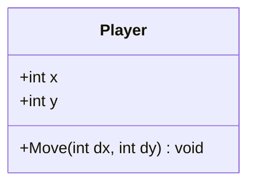
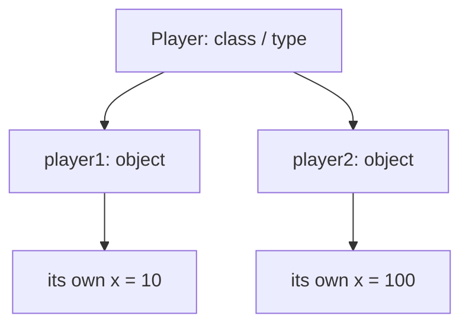
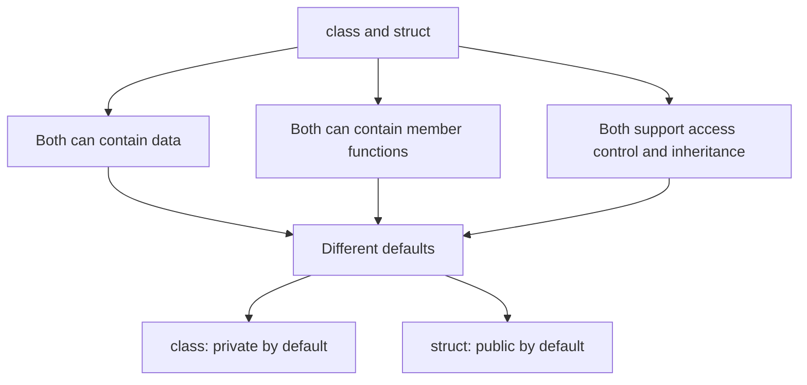
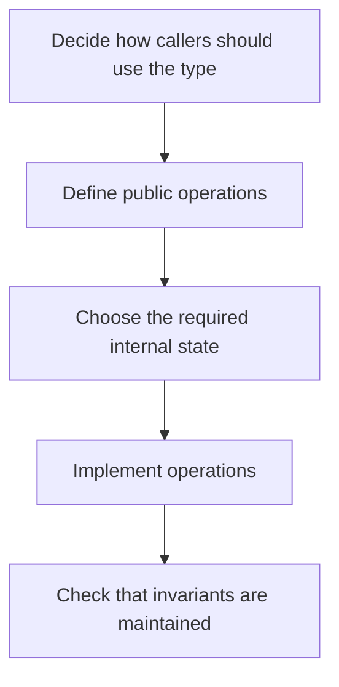
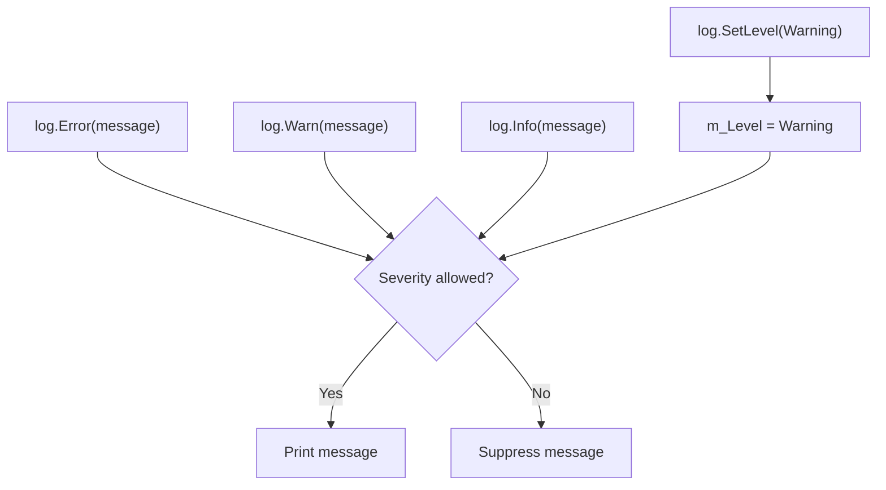

# C++ Classes and Structs

*Notes for The Cherno's videos on classes, structs, and class design.*

These diagrams are here to clarify relationships that are easy to blur together: **type vs. object**, **public interface vs. private implementation**, and **class vs. struct**.

Related notes: [[Cpp-Functions]] · [[Cpp-References]] · [[Cpp-Variables-and-Data-Types]]

---

## 1. What is a class?

A **class** is a user-defined type that groups related data and functions together.

- **Member variables** represent an object's state.
- **Member functions** define operations associated with that type.
- An **object** is an instance of the type.

For example, instead of keeping a player's coordinates and movement operation separate:

```cpp
int playerX = 0;
int playerY = 0;

void Move(int& x, int& y, int dx, int dy)
{
    x += dx;
    y += dy;
}
```

we can group them:

```cpp
class Player
{
public:
    int x = 0;
    int y = 0;

    void Move(int dx, int dy)
    {
        x += dx;
        y += dy;
    }
};

int main()
{
    Player player;
    player.Move(1, -1);
}
```

This makes the relationship between a player's state and behavior explicit. Classes are especially useful for organization, abstraction, and controlling how state can be changed.

### Diagram: a class groups state and behavior



The diagram is conceptual: `x` and `y` are data members, while `Move` is a member function.

---

## 2. Classes and objects

A class defines a type. Declaring a variable of that type creates an object:

```cpp
class Player
{
public:
    int x = 0;
};

Player player1;
Player player2;

player1.x = 10;
player2.x = 100;
```

`player1` and `player2` are separate objects. Each has its own ordinary, non-static `x` member.



A useful way to think about it:

- The **class** describes the shape and behavior of objects.
- Each **object** has its own state.
- `.` accesses a member through a particular object.

```cpp
player1.x = 20;
// player1.Move(1, 0); // Valid if Player defines Move()
```

---

## 3. Member variables and member functions

A variable declared in a class is a **member variable** (or *data member*). A function declared in a class is a **member function** (often called a *method*).

```cpp
class Player
{
public:
    int x = 0;
    int y = 0;

    void Move(int dx, int dy)
    {
        x += dx;
        y += dy;
    }
};
```

When `player.Move(1, 0)` is called, `Move()` operates on that particular object. It can access that object's `x` and `y` directly.

A similar operation could be written as a free function receiving a `Player&`; the member-function form makes the relationship to `Player` explicit.

---

## 4. `public`, `private`, and encapsulation

Access specifiers control which code can access a class's members.

- `public`: accessible to code using the class, subject to the language's rules.
- `private`: accessible to the class's member functions and friends, but not directly to unrelated outside code.

```cpp
class Player
{
private:
    int health = 100;

public:
    void TakeDamage(int amount)
    {
        if (amount > 0)
            health -= amount;
    }

    int GetHealth() const
    {
        return health;
    }
};

int main()
{
    Player player;
    player.TakeDamage(10);

    int currentHealth = player.GetHealth();
    // player.health = -500; // Error: health is private
}
```

**Encapsulation** means controlling access to internal state and exposing an interface for interacting with it. This allows a class to enforce rules—for example, rejecting non-positive damage—and lets implementation details change without necessarily breaking the code that uses the class.

### Diagram: public interface vs. private implementation


Outside code talks to the public interface rather than changing `health` directly. The public interface is the supported way to use the class; private members are implementation details.

Not every member must always be private. A simple data-oriented type may reasonably expose its fields.

---

## 5. `class` vs. `struct`

In C++, `class` and `struct` can both have member variables, member functions, constructors, destructors, access specifiers, and inheritance.

The key default differences are:

| Rule | `class` | `struct` |
|---|---|---|
| Default member access | `private` | `public` |
| Default inheritance access | `private` | `public` |

These two definitions expose `x` and `y` publicly:

```cpp
struct Vec2
{
    float x = 0.0f;
    float y = 0.0f;
};
```

```cpp
class Vec2
{
public:
    float x = 0.0f;
    float y = 0.0f;
};
```

### Diagram: the defaults differ, not the capabilities



A common **convention**, not a language rule:

- Prefer `struct` for simple data-oriented types whose fields are intended to be openly accessible.
- Prefer `class` when an object has invariants, controlled state, or a more substantial interface.

A `struct` can have private members, and a `class` can expose public data. The language does not enforce the convention.

The `m_` prefix sometimes used for members, such as `m_Health`, is also a naming convention. Follow the style used by your project.

---

## 6. Designing a class interface

Before implementing a class, consider how other code should use it. This helps shape the **interface** (or API): the public operations through which other code interacts with the type.

For a logger, the desired usage might be:

```cpp
Log log;
log.SetLevel(LogLevel::Warning);
log.Warn("Be careful.");
```

That usage suggests operations for selecting a level and emitting messages. The internal representation can remain private.

Design checklist:

- What concept does this type represent?
- What state does it need?
- What operations should it provide?
- What should outside code be allowed to access?
- What should remain an implementation detail?

### Diagram: design from usage inward



---

## 7. Worked example: a simple logger

This example combines a user-defined type, an enum, member state, access control, and member functions. The log level determines which messages are printed.

```cpp
#include <iostream>

enum class LogLevel
{
    Error,
    Warning,
    Info
};

class Log
{
public:
    void SetLevel(LogLevel level)
    {
        m_Level = level;
    }

    void Error(const char* message)
    {
        if (m_Level >= LogLevel::Error)
            std::cout << "[ERROR]: " << message << '\n';
    }

    void Warn(const char* message)
    {
        if (m_Level >= LogLevel::Warning)
            std::cout << "[WARNING]: " << message << '\n';
    }

    void Info(const char* message)
    {
        if (m_Level >= LogLevel::Info)
            std::cout << "[INFO]: " << message << '\n';
    }

private:
    LogLevel m_Level = LogLevel::Info;
};
```

**Important C++ correction:** scoped enums such as `enum class LogLevel` do not support relational comparisons like `>=` unless you define the relevant operator. For a compilable example, use an explicit severity mapping instead:

```cpp
#include <iostream>

enum class LogLevel
{
    Error,
    Warning,
    Info
};

constexpr int Severity(LogLevel level)
{
    switch (level)
    {
    case LogLevel::Error:   return 0;
    case LogLevel::Warning: return 1;
    case LogLevel::Info:    return 2;
    }
    return 2;
}

class Log
{
public:
    void SetLevel(LogLevel level)
    {
        m_Level = level;
    }

    void Error(const char* message)
    {
        if (Severity(LogLevel::Error) <= Severity(m_Level))
            std::cout << "[ERROR]: " << message << '\n';
    }

    void Warn(const char* message)
    {
        if (Severity(LogLevel::Warning) <= Severity(m_Level))
            std::cout << "[WARNING]: " << message << '\n';
    }

    void Info(const char* message)
    {
        if (Severity(LogLevel::Info) <= Severity(m_Level))
            std::cout << "[INFO]: " << message << '\n';
    }

private:
    LogLevel m_Level = LogLevel::Info;
};

int main()
{
    Log log;
    log.SetLevel(LogLevel::Warning);

    log.Error("Something went wrong.");
    log.Warn("Be careful.");
    log.Info("Everything is running normally.");
}
```

Output:

```text
[ERROR]: Something went wrong.
[WARNING]: Be careful.
```

The informational message is suppressed because the configured level is `Warning`.

### Diagram: what happens when the logger is used?



How the example fits together:

- `Log` defines a type; `log` is an object of that type.
- `m_Level` stores the object's current configuration.
- `SetLevel()`, `Error()`, `Warn()`, and `Info()` are public member functions.
- Those member functions can access `m_Level` directly.
- Outside code cannot change `m_Level` directly because it is private.
- Each `Log` object has its own `m_Level`.

The severity mapping is an explicit design choice for this example. A real logging library may use a different convention.

---

## 8. Language rules vs. conventions

### C++ language rules

- A class or struct defines a user-defined type.
- Class members are private by default; struct members are public by default.
- Inheritance is private by default for `class` and public by default for `struct`.
- Both can contain functions and use access specifiers.
- A class/struct definition ends with a semicolon.

### Common design conventions

- Use structs for simple, openly accessible data and classes for controlled abstractions.
- Keep implementation details private when outside code should not depend on them.
- Design the public interface around how the type should be used.
- Use a member naming convention such as `m_` only if your project follows it.

---

## Key takeaways

- **Class = type definition; object = instance of that type.**
- Member variables hold an object's state; member functions operate on it.
- Public members form the interface; private members can protect implementation details and invariants.
- `class` and `struct` are very similar; their default access rules are the key distinction.
- Good class design starts with how the type should be used, then provides an interface that supports that use.

## Quick self-check

1. If you create two `Player` objects, do they share ordinary non-static member variables?
2. What is the difference between a class's public interface and its implementation?
3. Is “structs are only for data” a language rule or a convention?
4. Why might a class keep a variable private and expose a member function to change it?
5. What does the class/object diagram tell you that the code alone may not make obvious?

## Related notes

- [[Cpp-Functions]] — functions and member-function calls
- [[Cpp-References]] — references and passing objects to functions
- [[Cpp-Variables-and-Data-Types]] — types and object state
- [[Cpp-Header-Files]] — organizing class declarations across files
