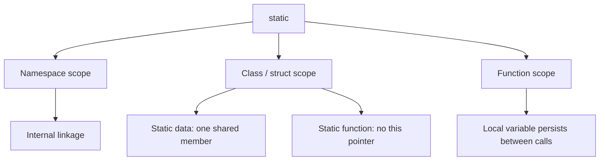
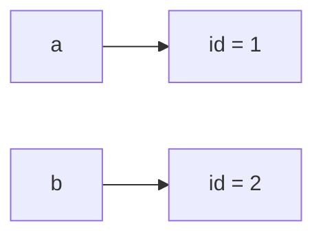
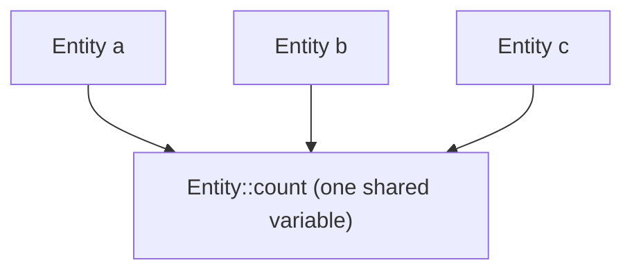
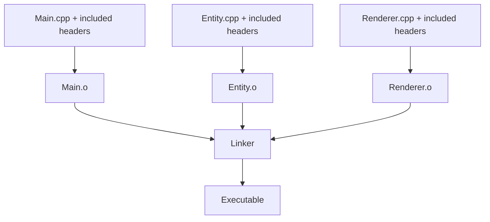
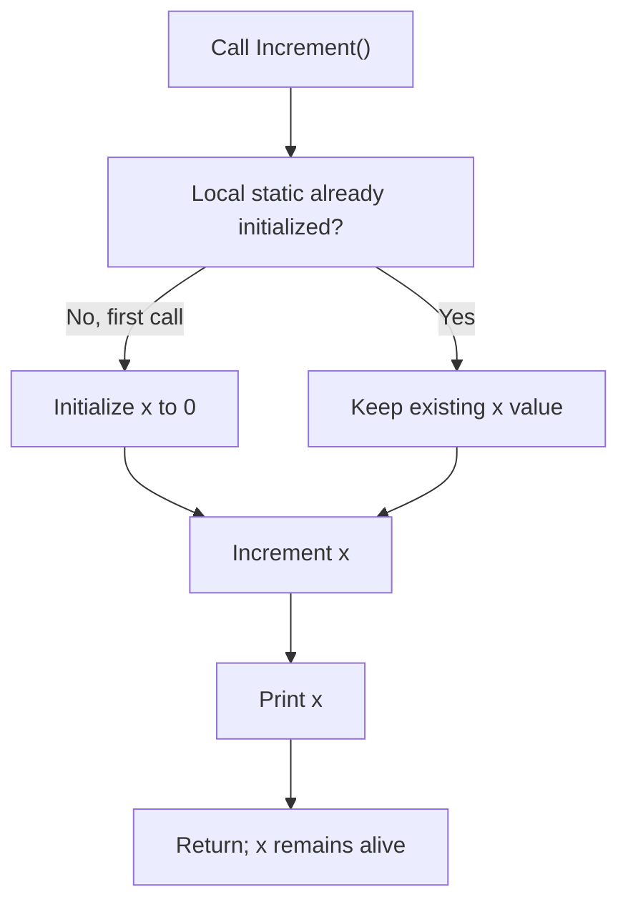

# C++ `static`

> The meaning of `static` depends on **where it appears**. Don't memorize it as one universal rule.

## The big picture



| Where `static` appears | Main idea | Ask yourself |
|---|---|---|
| At namespace/global scope | Internal linkage for the name | Can another translation unit link to this name? |
| On a class data member | One member shared by all instances | Does this data belong to each object or the class as a whole? |
| On a class member function | The function has no implicit object / `this` | Does this operation need a particular instance? |
| Inside a function, on a local variable | Static storage duration; value persists between calls | Should this local state survive after the call ends? |

These are different language rules that happen to use the same keyword.

---

## 1. Static data members: one shared variable

An ordinary data member belongs to each object:

```cpp
struct Entity {
    int id;
};

Entity a;
Entity b;

a.id = 1;
b.id = 2;
```

Conceptually, the objects contain separate `id` values:



Now make the member `static`:

```cpp
struct Entity {
    static int count;
};
```

There is **one `Entity::count`**, not one `count` inside every `Entity` object.



Both `a.count` and `b.count` are permitted syntax, but they access the same variable. Prefer `Entity::count` because it makes the class-level ownership clear.

A static data member does **not** add a separate member to each object's instance data.

### Declaration and definition

A traditional static data member is declared in the class and defined outside it:

```cpp
// Entity.h
struct Entity {
    static int count;  // declaration
};
```

```cpp
// Entity.cpp
#include "Entity.h"

int Entity::count = 0; // definition
```

The declaration tells the compiler the member exists. The definition provides the program-level definition for that variable.

### C++17: `inline static`

For a simple member defined in a header, C++17 introduced inline variables:

```cpp
struct Entity {
    inline static int count = 0;
};
```

This can replace the separate out-of-class definition. The traditional declaration-plus-definition form remains important to recognize in existing code.

### Access control still applies

`static` does not make a member public:

```cpp
class Entity {
private:
    inline static int s_count = 0;

public:
    static int GetCount() {
        return s_count;
    }
};
```

Outside code can call `Entity::GetCount()`, but cannot directly access `s_count`. A static member can therefore provide shared state while preserving encapsulation.

---

## 2. Static member functions: no `this`

A normal member function operates on a particular object:

```cpp
class Entity {
public:
    void PrintID() const {
        std::cout << id;
    }

private:
    int id = 0;
};
```

Calling `a.PrintID()` gives the function access to `a`'s state. A useful mental model is that a non-static member function has an implicit object parameter, represented in C++ by `this`.

This is a **mental model**, not literal source code:


A static member function has no `this` pointer because it is not called on one particular object:

```cpp
class Entity {
public:
    inline static int count = 0;

    static void PrintCount() {
        std::cout << count; // OK: static member
    }

    void PrintID() const {
        std::cout << id;    // OK: this object's member
    }

private:
    int id = 0;
};
```

Call it without constructing an object:

```cpp
Entity::PrintCount();
```

### What a static member function can access

- **Can** access static data members, subject to access control.
- **Can** call other static member functions.
- **Cannot** directly access a non-static data member, because there is no implicit object to identify which instance's value is wanted.
- **Can** work with an object if that object is explicitly passed as a parameter.

For example:

```cpp
class Entity {
public:
    void PrintID() const { std::cout << id; }

    static void Print(const Entity& entity) {
        std::cout << entity.id; // OK: explicit object
    }

private:
    int id = 42;
};

Entity e;
Entity::Print(e);
```

A static function still obeys class access rules, so it can access `entity.id` even though `id` is private. The function has no `this`; it uses the supplied reference `entity`.

### Choosing static or non-static

Use a non-static member function when the operation naturally acts on a particular object, such as `entity.GetPosition()`.

Use a static member function when the operation belongs to the class as a whole and does not require an implicit instance, such as `Entity::GetCount()`.

Don't make a function static merely because it happens not to use instance data today. Choose based on what the operation represents.

---

## 3. A common use case: count live objects

A shared counter can track how many objects are currently alive:

```cpp
#include <iostream>

class Entity {
public:
    inline static int count = 0;

    Entity() {
        ++count;
    }

    ~Entity() {
        --count;
    }

    static int GetCount() {
        return count;
    }
};

int main() {
    std::cout << Entity::GetCount() << '\n'; // 0

    Entity a;
    Entity b;

    std::cout << Entity::GetCount() << '\n'; // 2
}
```

The counter is shared, while each object is constructed and destroyed individually.

**Caution:** this is a teaching example, not a complete production-grade object counter. Copying or moving objects introduces additional lifecycle cases; a real counter must account for copy/move construction and assignment correctly. A simple static counter is also not automatically thread-safe for concurrent modifications.

---

## 4. Namespace-scope `static`: internal linkage

At namespace scope—outside any class and function—`static` has a different role:

```cpp
// Entity.cpp
static int helperValue = 5;

static void Helper() {
    // Implementation detail for this translation unit.
}
```

Here `static` gives the variable or function **internal linkage**. In practical terms, that name is not available as an externally linked symbol to other translation units.

A useful analogy is “private to this `.cpp` file,” but technically this is **linkage**, not class access control.

### Translation units and the linker

A translation unit is approximately a source file after preprocessing, including the headers it includes. Each `.cpp` file is typically compiled separately, then the linker combines the resulting object files.



A name with internal linkage is local to its translation unit for linkage purposes.

### External linkage and `extern`

For example, one source file can define an externally linked variable:

```cpp
// Entity.cpp
int sharedValue = 5;
```

Another source file can declare that it is defined elsewhere:

```cpp
// Main.cpp
#include <iostream>

extern int sharedValue;

int main() {
    std::cout << sharedValue << '\n';
}
```

The linker can connect the reference in `Main.cpp` to the definition in `Entity.cpp`.

Contrast:

```cpp
static int localValue = 5; // internal linkage at namespace scope
```

Declaring `extern int localValue;` in another file does **not** turn the original internal-linkage variable into an externally linked variable.

### Why internal linkage can help

If two `.cpp` files each define a namespace-scope variable named `x` with external linkage, the program can encounter a multiple-definition linker error:

```cpp
// A.cpp
int x = 5;
```

```cpp
// B.cpp
int x = 10; // another external definition of x: conflict
```

Giving one definition internal linkage means it is a different translation-unit-local name:

```cpp
// A.cpp
int x = 5;        // external linkage
```

```cpp
// B.cpp
static int x = 10; // internal linkage
```

The two can coexist because they do not provide competing definitions of the same externally linked name.

The same namespace-scope rule applies to functions:

```cpp
static void CalculateSomething() {
    // helper used only in this translation unit
}

void DoWork() {
    CalculateSomething();
}
```

**Modern note:** unnamed namespaces are also commonly used in C++ source files to give functions and variables internal linkage. Namespace-scope `const` variables have their own linkage rules, so don't assume every namespace-scope declaration behaves exactly like a non-`const` variable.

---

## 5. Function-local `static`: preserve state between calls

An ordinary local variable is initialized each time execution reaches its declaration:

```cpp
void Increment() {
    int x = 0;
    ++x;
    std::cout << x << '\n';
}
```

Calling `Increment()` three times prints `1`, `1`, `1`.

A function-local static variable persists between calls:

```cpp
void Increment() {
    static int x = 0;
    ++x;
    std::cout << x << '\n';
}
```

Three calls print `1`, `2`, `3`.



A function-local static has **static storage duration**: it lives for the duration of the program, even though its name is only in scope inside the function. Its initialization occurs the first time control passes through its declaration. Since C++11, initialization of a block-scope static variable is thread-safe; that does **not** automatically make later reads/writes to the variable thread-safe.

---

## 6. Don't confuse linkage, scope, and lifetime

These terms answer different questions:

- **Scope:** where can the name be used in source code?
- **Linkage:** can declarations in different scopes or translation units refer to the same entity?
- **Storage duration:** during what period does the object's storage exist?

For example:

```cpp
static int namespaceValue = 1; // namespace scope: internal linkage
```

```cpp
void Function() {
    static int callCount = 0;  // block scope; static storage duration
    ++callCount;
}
```

The first is mainly about **linkage**. The second is mainly about **lifetime/storage duration**. Both objects have static storage duration, but the important effect of the keyword differs by context.

---

## 7. Quick comparison

| Feature | Ordinary member | Static data member | Static member function |
|---|---|---|---|
| Associated with | Each object | Class as a whole | Class as a whole |
| Separate data per object? | Yes | No | Not applicable |
| Needs an object to call? | Normally yes | Not applicable | No |
| Has `this`? | Member function does | Not applicable | No |
| Can directly access instance members? | Yes | Not applicable | No |
| Can access static members? | Yes | Not applicable | Yes, subject to access control |

| Declaration | Main effect |
|---|---|
| `static int x;` inside a class | One shared static data member |
| `static void f();` inside a class | Static member function; no `this` |
| `static int x;` inside a function | Persistent local variable |
| `static int x;` at namespace scope | Internal linkage |

## 8. Common misconceptions

1. **“`static` always means one shared variable.”** No. At namespace scope, it primarily affects linkage.
2. **“A static class variable is stored inside every object.”** No. It is separate from each object's instance data.
3. **“A static member function can directly use any class member.”** No. It cannot directly use instance members without an object.
4. **“A static member function cannot access class data.”** It can access static members and can use instance members through an explicitly supplied object.
5. **“`extern` can expose a namespace-scope `static` variable.”** No. `extern` in another translation unit does not change the original variable's internal linkage.
6. **“Linkage and lifetime are the same thing.”** No. Linkage is about entity identity across declarations; storage duration is about how long an object exists.

## 9. Practical decision guide

When you see `static`, ask:

1. **Is it inside a class or struct?**
   - Data member → one shared class-level variable.
   - Member function → no implicit object and no `this`.
2. **Is it inside a function?**
   - Local variable → persists between calls.
3. **Is it at namespace scope?**
   - Variable or function → internal linkage.

## Key takeaways

- **Class static data:** one shared variable; prefer `ClassName::member` to show that it belongs to the class.
- **Class static function:** no `this`; it can access static members and explicitly supplied objects.
- **Namespace-scope static:** internal linkage, useful for implementation details local to a translation unit.
- **Function-local static:** retains its value between calls.
- **Always read the context before deciding what `static` means.**

## Self-check

Try answering these without looking back:

1. If `a` and `b` are two `Entity` objects, how many copies of `Entity::count` exist?
2. Why can't `Entity::Print()` directly read a non-static member `id`?
3. What is the difference between namespace-scope `static` and function-local `static`?
4. What does `extern int sharedValue;` tell the compiler?
5. Does thread-safe initialization make all later accesses to a local static variable thread-safe?

<details>
<summary>Answers</summary>

1. One shared copy.
2. A static member function has no `this` and therefore no implicit object identifying which `id` to read.
3. Namespace-scope `static` gives the name internal linkage; function-local `static` gives the local variable static storage duration so it persists between calls.
4. It declares an externally linked object defined elsewhere (assuming a matching definition exists).
5. No. Since C++11, initialization is thread-safe; concurrent modification afterward still needs appropriate synchronization.

</details>

## Related notes

- [Classes and Structs] — objects, members, encapsulation, and class design.
- [Header Files] — declarations, definitions, and organizing code across files.
- [Linker] — object files, symbol resolution, and duplicate definitions.
- [Compilation and Execution Basics] — the build pipeline.
