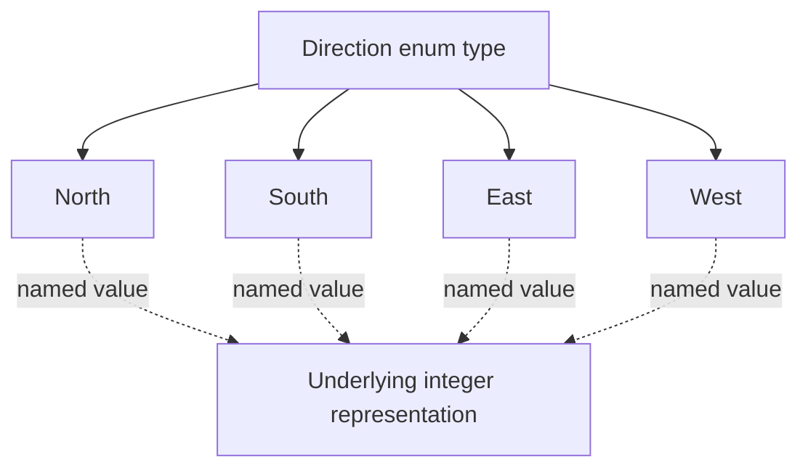
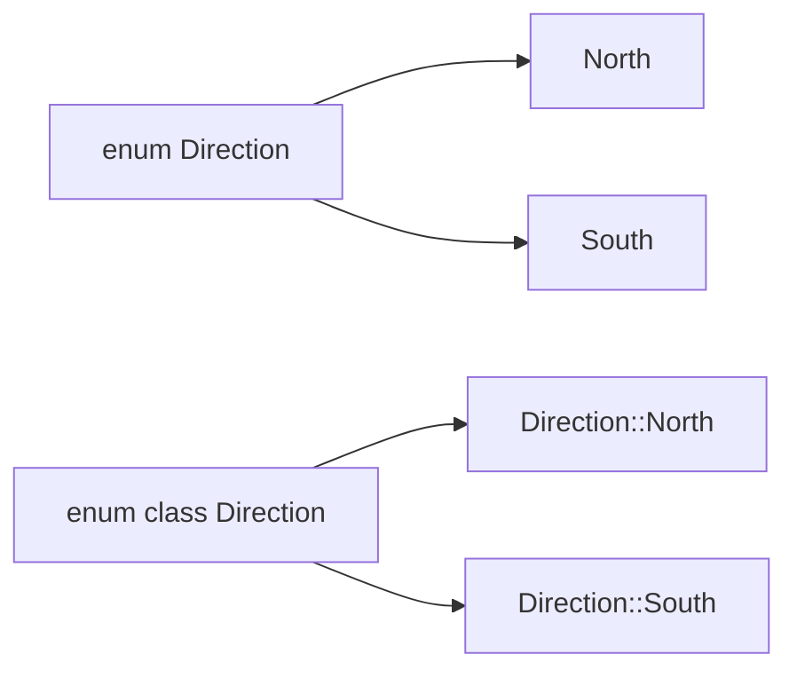

# C++ Enums

> Based on the topic of The Cherno's **“23 — ENUMS in C++”** video. These are structured study notes, not a verified transcript.

## Learning goals

- Understand why enums are useful.
- Declare and use an enumeration.
- Understand the difference between `enum` and `enum class`.
- Choose an underlying integer type when needed.
- Use enums to represent a small, fixed set of named options.

## 1. What is an enum?

An **enumeration** defines a type whose values are a set of named constants.

Instead of writing code like this:

```cpp
int direction = 2;
```

you can give the value a meaningful name:

```cpp
enum Direction {
    North,
    South,
    East,
    West
};

Direction direction = North;
```

The names make the code easier to read. Someone reading `North` does not need to remember what the number `0` or `2` means.

### The relationship



The underlying representation is an implementation detail most code should not need to manipulate directly.

## 2. Values are assigned automatically

For an ordinary unscoped enum, values start at `0` by default and increase by one:

```cpp
enum Direction {
    North, // 0
    South, // 1
    East,  // 2
    West   // 3
};
```

You can assign a value explicitly:

```cpp
enum Direction {
    North = 1,
    South,       // 2
    East = 10,
    West         // 11
};
```

After an explicitly assigned value, the next enumerator normally gets the previous value plus one.

Use explicit values when the numeric values themselves matter—for example, when matching a file format, protocol, or external API. Otherwise, prefer the default values.

## 3. A simple working program

```cpp
#include <iostream>

enum Direction {
    North,
    South,
    East,
    West
};

int main() {
    Direction playerDirection = East;

    if (playerDirection == East) {
        std::cout << "Moving east\n";
    }
}
```

Output:

```text
Moving east
```

Compile on Linux with GCC:

```bash
g++ -std=c++17 -Wall -Wextra -pedantic main.cpp -o main
./main
```

## 4. The problem with ordinary `enum`

An unscoped enum introduces its enumerator names into the surrounding scope:

```cpp
enum Direction {
    North,
    South
};

enum State {
    Idle,
    Running
};
```

Names such as `North` and `Idle` can be used directly, but this can cause naming conflicts in larger programs. Unscoped enums also convert to integers in many contexts, which can allow unintended operations.

## 5. `enum class`: scoped and safer

Modern C++ commonly uses **scoped enums**, written with `enum class`:

```cpp
enum class Direction {
    North,
    South,
    East,
    West
};

Direction direction = Direction::East;
```

The enumerators are scoped under the enum's name. You write `Direction::East`, which makes the origin of the value explicit.



Scoped enums do not implicitly convert to integers:

```cpp
enum class Direction {
    North,
    South
};

Direction d = Direction::North;

// int value = d; // Error: no implicit conversion
int value = static_cast<int>(d); // Explicit conversion
```

That extra explicitness helps catch mistakes.

### Quick comparison

| Feature | `enum` | `enum class` |
|---|---|---|
| Enumerator names | Introduced into surrounding scope | Scoped under enum name |
| Usage example | `North` | `Direction::North` |
| Implicit conversion to integer | Allowed in many contexts | Not allowed |
| Typical choice for new code | Useful in some legacy/simple cases | Often preferred for safer, clearer code |

## 6. Choosing the underlying type

Enums use an integer type to represent their values. A scoped enum can specify that type:

```cpp
#include <cstdint>

enum class PacketType : std::uint8_t {
    Connect = 1,
    Data = 2,
    Disconnect = 3
};
```

Here, `std::uint8_t` specifies the underlying type. This can be useful when interfacing with binary formats or APIs that require a particular representation.

Don't choose a small underlying type just to save a few bytes without a reason. Use it when the representation is part of a requirement.

## 7. Enums inside classes

An enum can be declared inside a class to associate the choices with that class:

```cpp
class Player {
public:
    enum class State {
        Idle,
        Walking,
        Jumping
    };

    State currentState = State::Idle;
};
```

Usage:

```cpp
Player player;
player.currentState = Player::State::Walking;
```

This groups related names and communicates that these states belong to the `Player` concept.

## 8. Use enums with `switch`

Enums work naturally with `switch` statements:

```cpp
#include <iostream>

enum class Direction {
    North,
    South,
    East,
    West
};

void PrintDirection(Direction direction) {
    switch (direction) {
        case Direction::North:
            std::cout << "North\n";
            break;
        case Direction::South:
            std::cout << "South\n";
            break;
        case Direction::East:
            std::cout << "East\n";
            break;
        case Direction::West:
            std::cout << "West\n";
            break;
    }
}
```

This is often clearer than scattering numeric comparisons throughout the program. If the enum later gains another value, revisit switches that handle all possible values.

## 9. When should you use an enum?

Use an enum when a value must represent **one option from a known set**:

- Direction: north, south, east, west.
- Player state: idle, walking, jumping.
- Menu choice: start, settings, quit.
- Packet type: connect, data, disconnect.

An enum is not a replacement for every integer. If the value represents an arbitrary quantity—such as a score, number of items, or position—use a suitable numeric type instead.

## Common mistakes

- **Using unexplained numbers:** `state = 2` hides the meaning; a named enumerator is clearer.
- **Forgetting scope:** with `enum class`, use `Direction::East`, not just `East`.
- **Assuming an enum is automatically an `int`:** scoped enums do not implicitly convert to integers.
- **Changing explicit values casually:** if values are used by files, protocols, or APIs, changing them can break compatibility.
- **Using an enum for arbitrary data:** enums model a fixed set of alternatives, not unrestricted numeric values.

## Key takeaways

- An enum gives meaningful names to a fixed set of values.
- Ordinary `enum` enumerators are unscoped and can convert to integers in many contexts.
- `enum class` scopes its enumerators and prevents implicit integer conversion.
- Explicit values and underlying types are useful when numeric representation matters.
- Enums are a natural fit for states, modes, directions, and other finite choices.

## Self-check

Try to answer before looking anything up:

1. What does `Direction::East` communicate that `2` does not?
2. What value does the third enumerator receive if no values were assigned explicitly?
3. Why might `enum class` be safer than an ordinary `enum`?
4. When would you explicitly choose an enum's underlying type?
5. Why is an enum a good fit for a player state but not a score?

## Related notes

- [Conditions and Branches] — use enum values with `if` and `switch`.
- [Classes and Structs] — organizing types and related data.
- [Static] — another C++ keyword whose meaning depends on context.
