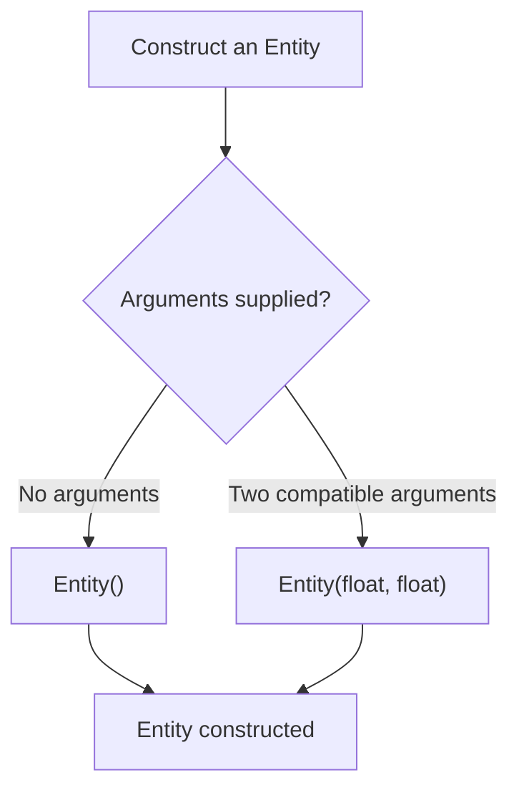
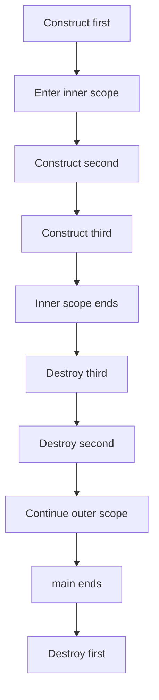

# C++ Constructors and Destructors

> **Constructors** establish an object's initial state. **Destructors** run when an object's lifetime ends, commonly to clean up resources.

These notes cover the concepts we've worked through together so far. Copy/move constructors, inheritance, and detailed RAII/resource ownership are intentionally left for later lessons.

## Learning goals

After studying this note, you should be able to:

- Explain why constructors are safer than relying on a separate initialization method.
- Write default and parameterized constructors and understand constructor overloading.
- Initialize members with member initializer lists and explain why they are preferred.
- Explain when default constructors are or aren't available.
- Describe when destructors run and what they do.
- Trace construction and destruction across multiple objects, nested scopes, and class members.
- Recognize when a custom destructor is unnecessary.

## 1. Why constructors exist

Consider a class with a separate initialization method:

```cpp
#include <iostream>

class Entity {
public:
    float x;
    float y;

    void init() {
        x = 0.0f;
        y = 0.0f;
    }
};

int main() {
    Entity e;
    e.init();

    std::cout << e.x << ", " << e.y << '\n';
}
```

This only establishes the intended state because `init()` is called before the members are read. If the caller forgets that call, `x` and `y` are not guaranteed to contain useful values. Reading an uninitialized `float` in this situation has undefined behavior.

A constructor makes initialization part of constructing the object:

```cpp
class Entity {
public:
    float x;
    float y;

    Entity() : x(0.0f), y(0.0f) {}
};
```

Now a normally constructed `Entity` starts with both coordinates initialized.

**Key idea:** constructors help make valid initialization the default rather than a separate step every caller must remember.

## 2. Constructor syntax

A constructor:

- Has the same name as its class.
- Has no return type—not even `void`.
- Runs as part of object construction.
- Can accept parameters.
- Can be overloaded, meaning the class can provide multiple constructors with different parameter lists.

```cpp
class Entity {
public:
    float x;
    float y;

    Entity() : x(0.0f), y(0.0f) {}  // Default constructor

    Entity(float xValue, float yValue)
        : x(xValue), y(yValue) {}   // Parameterized constructor
};
```

```cpp
Entity origin;       // Calls Entity()
Entity point(3, 4);  // Calls Entity(float, float)
```

The arguments determine which constructor is the best match under C++ overload-resolution rules.



## 3. Default constructors and default values

A **default constructor** is a constructor that can be called with no arguments.

```cpp
class Entity {
public:
    int id;

    Entity() : id(0) {}
};

Entity first;  // Calls Entity()
```

If you declare no constructors, the compiler can implicitly declare a default constructor. That does **not** automatically give built-in members values such as zero:

```cpp
class Example {
public:
    int value;
};

Example e; // e.value is not initialized to zero
```

Do not read `e.value` in this situation: its value is indeterminate.

### Declaring a parameterized constructor changes what is available

```cpp
class Example {
public:
    explicit Example(int number) : value(number) {}

    int value;
};

Example e(42); // OK
// Example other; // Error: no default constructor is available
```

When you declare a constructor yourself, the compiler does not also implicitly declare a default constructor. If you want both construction styles, provide both:

```cpp
class Example {
public:
    Example() : value(0) {}
    explicit Example(int number) : value(number) {}

    int value;
};

Example a;      // value = 0
Example b(42);  // value = 42
```

### `= default`, `= delete`, and in-class initializers

You can request a compiler-generated default constructor with `= default`:

```cpp
class Example {
public:
    Example() = default;
    int value = 0;
};
```

Here `value` is zero because of its **in-class member initializer**, not merely because the constructor is `= default`.

You can also forbid a particular construction form with `= delete`:

```cpp
class NoDefault {
public:
    NoDefault() = delete;
    explicit NoDefault(int number) : value(number) {}

    int value;
};

// NoDefault n; // Error
NoDefault n(7); // OK
```

A private constructor can also restrict which code is allowed to construct an object. That technique appears in some utility-class and factory designs.

## 4. Member initializer lists

The part after the colon in a constructor is its **member initializer list**:

```cpp
class Player {
public:
    int health;
    float speed;

    Player(int initialHealth, float initialSpeed)
        : health(initialHealth), speed(initialSpeed) {}
};
```

Compare it with assignment in the constructor body:

```cpp
Player(int initialHealth, float initialSpeed) {
    health = initialHealth;
    speed = initialSpeed;
}
```

For these simple `int` and `float` members, the assignment version can work. But the sequence differs:

- **Initializer list:** members are initialized directly with the specified values before the constructor body runs.
- **Assignment in body:** members have already undergone initialization; the body then assigns new values to them.

Prefer initializer lists because they express initialization directly. They are required for reference members and `const` members, and can avoid extra work for class-type members that would otherwise be default-constructed and then assigned.

### Initialization order is declaration order

Members initialize in the order they are **declared in the class**, not the order in which they appear in the initializer list.

```cpp
class Example {
public:
    int first;
    int second;

    Example() : second(2), first(1) {}
};
```

Despite the list spelling `second` first, `first` initializes before `second`. Write initializer lists in declaration order to make the behavior obvious and avoid warnings.

### Constructor body runs after member initialization

```cpp
class Example {
public:
    int a;
    int b;

    Example() : b(2), a(1) {
        b = a + b; // b becomes 3
        a = b + a; // a becomes 4
        std::cout << a << ", " << b << '\n';
    }
};
```

The members initialize first (`a = 1`, `b = 2`), then the body executes its assignments. The output is:

```text
4, 3
```

The initializer list establishes the starting values; statements in the body can subsequently modify them.

## 5. Destructors

A **destructor** is a special member function that runs when an object's lifetime ends. It is commonly used to release resources owned by the object.

```cpp
#include <iostream>

class Entity {
public:
    Entity() {
        std::cout << "Constructed\n";
    }

    ~Entity() {
        std::cout << "Destroyed\n";
    }
};

int main() {
    Entity e;
    std::cout << "Using entity\n";
}
```

Output:

```text
Constructed
Using entity
Destroyed
```

The destructor does **not** run immediately after the constructor finishes. The object continues to exist while the program uses it. Here, the destructor runs as the local object `e` is destroyed when `main()` exits.

A destructor:

- Has the class name prefixed with `~`, such as `~Entity()`.
- Has no return type.
- Takes no parameters and cannot be overloaded.
- Is called by normal object-lifetime rules when the object's lifetime ends.
- Can be explicitly defaulted or deleted where the language rules permit.

### An empty destructor is usually unnecessary

```cpp
class Character {
public:
    int health = 100;

    ~Character() {}
};
```

If the destructor does nothing, you can normally omit it. C++ provides an implicit destructor. A custom destructor becomes useful when the class needs to perform cleanup or other end-of-lifetime work.

For example, a debugging destructor might report the object's state:

```cpp
~Enemy() {
    std::cout << "Destroying Enemy with health " << health
              << " at position " << position << '\n';
}
```

Each instance prints its own member values when its destructor runs.

## 6. Object lifetime and destruction order

For ordinary local objects, construction occurs as execution reaches their declarations. Objects are destroyed in reverse order of completed construction as their lifetimes end.

```cpp
#include <iostream>

struct Item {
    const char* name;

    Item(const char* itemName) : name(itemName) {
        std::cout << "Construct " << name << '\n';
    }

    ~Item() {
        std::cout << "Destroy " << name << '\n';
    }
};

int main() {
    Item first("first");
    Item second("second");
}
```

Output:

```text
Construct first
Construct second
Destroy second
Destroy first
```

**Remember: construct in declaration order; destroy in reverse order.**

### Nested scopes shorten an object's lifetime

```cpp
int main() {
    Item first("first");

    {
        Item second("second");
        Item third("third");
    } // third is destroyed, then second

    std::cout << "Outside inner scope\n";
} // first is destroyed
```

The inner scope ending destroys `third` and `second` immediately. The program then continues executing in the outer scope. It does not wait until `main()` ends to destroy those inner-scope objects.



### What happens to members?

A class object can contain other class objects as members:

```cpp
class Part {
public:
    const char* name;

    Part(const char* name) : name(name) {
        std::cout << "Construct " << name << '\n';
    }

    ~Part() {
        std::cout << "Destroy " << name << '\n';
    }
};

class Machine {
public:
    Part first;
    Part second;

    Machine() : first("A"), second("B") {
        std::cout << "Machine constructed\n";
    }

    ~Machine() {
        std::cout << "Machine destructor body\n";
    }
};
```

For a `Machine machine;` local object, the important order is:

1. Construct member `first`.
2. Construct member `second`.
3. Execute the `Machine` constructor body.
4. Later, when `machine` is destroyed, execute the `Machine` destructor body.
5. Destroy member `second`.
6. Destroy member `first`.

**Key rule:** a class object's destructor body runs before its member objects are destroyed. Members are then destroyed in reverse declaration order.

This rule applies to fully constructed objects in ordinary use. In more advanced situations—such as a constructor that throws—lifetime rules have additional details that we can study later.

## 7. Dynamic allocation: a brief note

An object created with `new` does not get destroyed merely because a pointer variable leaves scope:

```cpp
Entity* entity = new Entity();
// Use entity...
delete entity; // Calls the destructor, then releases the allocated storage
```

If `delete` is forgotten, the dynamically allocated object is not properly destroyed and its storage is not released. In ordinary modern C++ code, prefer automatic objects or smart pointers over manually managing `new` and `delete`.

```cpp
#include <memory>

auto entity = std::make_unique<Entity>();
// The owned Entity is destroyed automatically when the unique_ptr
// releases ownership, here when entity leaves scope.
```

This is a preview of **RAII (Resource Acquisition Is Initialization)**: use object lifetime to manage resource lifetime. We'll return to RAII and smart pointers later.

## 8. Common mistakes

| Mistake | Why it is a problem | Better approach |
|---|---|---|
| Reading a built-in member before initializing it | It may have an indeterminate value; reading it can cause undefined behavior | Use an initializer list or an in-class initializer |
| Assuming `= default` zero-initializes every member | It doesn't guarantee that by itself | Give members explicit initializers where appropriate |
| Declaring only a parameterized constructor, then writing `Type object;` | No default constructor may be available | Add a default constructor if that state makes sense |
| Assigning members in the constructor body when they should be initialized | Can do extra work; some members cannot be assigned this way | Prefer member initializer lists |
| Writing initializer-list entries in a different order from member declarations | Actual initialization still follows declaration order | Match the declaration order |
| Assuming a destructor runs immediately after the constructor | The object normally continues living after construction | Track the scope/lifetime of the object |
| Assuming inner-scope objects survive until `main()` ends | Their lifetimes end at the inner scope's closing brace | Trace each object's scope |
| Writing an empty destructor without a reason | Adds unnecessary code and can complicate special-member behavior | Omit it unless custom cleanup is needed |
| Assuming a raw pointer destroys its pointee automatically | A pointer leaving scope doesn't destroy a dynamically allocated object | Prefer automatic objects or smart pointers |

## 9. Practice: predict the output

Before running this program, write down the exact order of messages.

```cpp
#include <iostream>

class Enemy {
public:
    int health;
    int position;

    Enemy() : health(100), position(0) {
        std::cout << "Construct: " << health << ", " << position << '\n';
    }

    Enemy(int initialHealth, int initialPosition)
        : health(initialHealth), position(initialPosition) {
        std::cout << "Construct: " << health << ", " << position << '\n';
    }

    ~Enemy() {
        std::cout << "Destroy: " << health << ", " << position << '\n';
    }
};

int main() {
    Enemy first;
    Enemy second(150, 4);

    {
        Enemy third(300, 10);
        std::cout << "Inside battle\n";
    }

    std::cout << "Battle continues outside\n";
}
```

Questions:

1. Which constructor does each object use?
2. Which destructor runs first, and at which scope boundary?
3. Why are `second` and `first` destroyed after `"Battle continues outside"`?
4. What would change if the destructor were removed entirely?

### Answer key

1. `first` uses the default constructor; `second` and `third` use the parameterized constructor.
2. `third` is destroyed first, at the closing brace of the inner scope.
3. Those objects belong to `main()`'s scope, so their lifetimes end when `main()` exits. They are destroyed in reverse construction order: `second`, then `first`.
4. The compiler-provided destructor would still end the objects' lifetimes and destroy their members. The visible `Destroy: ...` messages would disappear.

## Key takeaways

- Constructors establish an object's initial state; destructors perform end-of-lifetime work.
- Constructor overloading allows different ways to initialize an object.
- Member initializer lists initialize members directly, and member declaration order controls initialization order.
- A default constructor isn't always available, and default initialization does not automatically zero built-in members.
- Local objects are destroyed as their lifetimes end; nested scopes can end lifetimes before `main()` finishes.
- A containing object's destructor body runs before its members are destroyed; members are destroyed in reverse declaration order.
- Empty custom destructors are usually unnecessary.
- RAII and smart pointers build on these lifetime rules, but detailed resource management is a later topic.

## Related notes

- [[Classes-and-Structs]]
- [[Cpp-Static]]
- [[Cpp-Pointers]]

**Deferred topics:** inheritance, copy/move constructors, RAII in depth, smart-pointer ownership, and the Rule of Zero/Three/Five.
