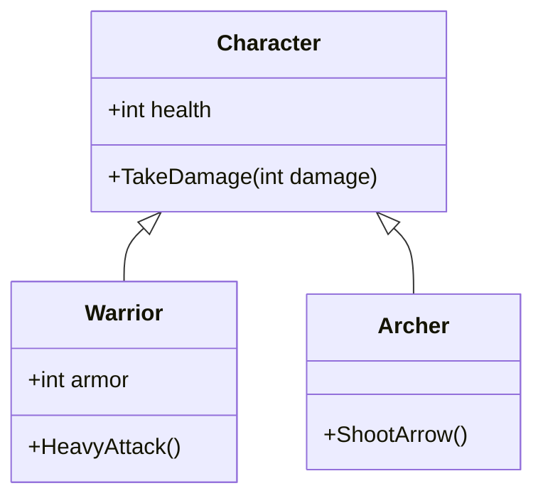
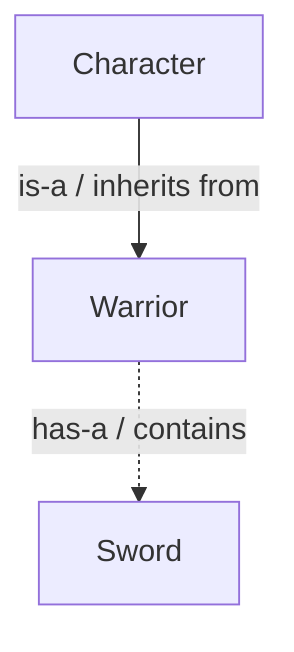
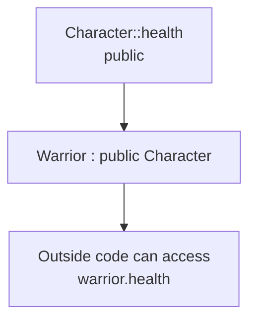
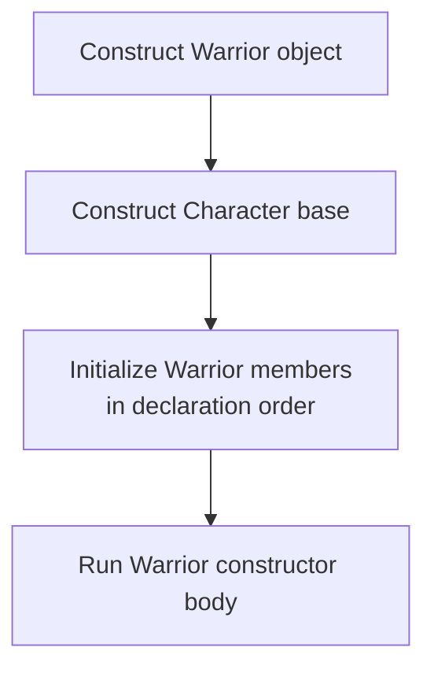
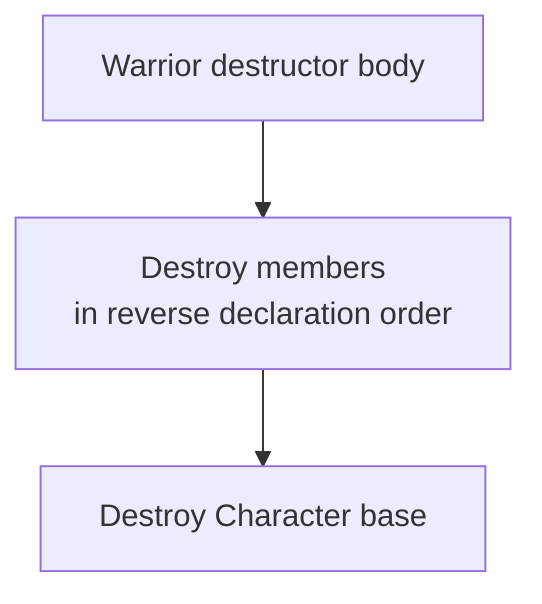
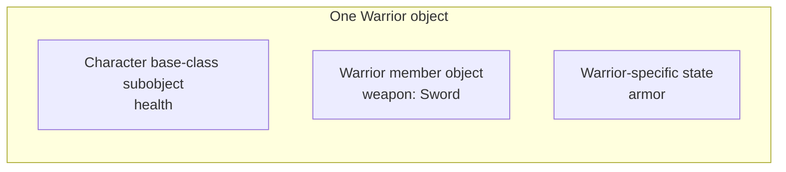

# C++ Inheritance

> **Scope:** Base and derived classes, inheritance access, composition, and object construction/destruction.  
> **Related notes:** [[Classes-and-Structs]], [[Cpp-Constructors-and-Destructors]]  
> **Next connection:** Virtual functions and polymorphism will be documented separately after studying them properly.

## Visual index

- [Inheritance hierarchy](#2-terminology-and-syntax)
- [Inheritance versus composition](#4-inheritance-versus-composition)
- [Access through public inheritance](#52-what-the-inheritance-specifier-changes)
- [Construction sequence](#6-constructors-in-an-inheritance-relationship)
- [Destruction sequence](#7-destruction-order)
- [Conceptual object structure](#8-common-misconceptions)


## 1. Why inheritance exists

Inheritance lets us define a more specific class in terms of a more general class. The derived class can reuse accessible members of the base class and add its own state and behavior.

```cpp
class Character {
public:
    int health = 100;

    void TakeDamage(int damage) {
        health -= damage;
    }
};

class Warrior : public Character {
public:
    int armor = 50;

    void HeavyAttack() {
        // Warrior-specific behavior
    }
};
```

A `Warrior` can use `health` and `TakeDamage()` from `Character`, and it also has `armor` and `HeavyAttack()`.

```cpp
Warrior alice;
Warrior bob;

alice.TakeDamage(30);

std::cout << alice.health << '\\n'; // 70
std::cout << bob.health << '\\n';   // 100
```

Each object has its own state. Inheritance does not make all instances share one `health` value.

## 2. Terminology and syntax

### Visual: a simple inheritance hierarchy



The open triangle points toward the **base class**. `Warrior` and `Archer` are derived from `Character`.


```cpp
class Derived : public Base {
    // Additional members
};
```

- **Base class:** the more general class (`Base`).
- **Derived class:** the specialized class (`Derived`).
- **Inheritance:** the relationship established by the declaration after the colon.
- **Inherited member:** a base-class member available through the derived class, subject to access rules.

A derived object contains a base-class subobject as part of its object structure. It is not merely a copy-paste of the base class's source code.

## 3. The “is-a” relationship

Public inheritance is usually appropriate when a derived type really is a kind of its base type.

- A `Warrior` **is a** `Character`.
- An `Archer` **is a** `Character`.
- A `Warrior` is not a `Sword`.

The derived class should make sense as a specialization of the base class, including what the base class promises to its users.

## 4. Inheritance versus composition

### Visual: is-a versus has-a



Read the relationships carefully: a `Warrior` **is a** `Character`, while a `Warrior` **has a** `Sword`. The first relationship is inheritance; the second is composition.


Inheritance models an **is-a** relationship. Composition models a **has-a** relationship.

```cpp
class Sword {
public:
    int damage = 25;

    void Sharpen() {
        damage += 5;
    }
};

class Character {
public:
    int health = 100;
};

class Warrior : public Character {
public:
    Sword weapon;
};
```

Here, `Warrior` publicly inherits from `Character` and contains a `Sword` member named `weapon`.

```cpp
Warrior warrior;

warrior.health = 150;
warrior.weapon.Sharpen();
```

- `warrior.health` — an inherited member.
- `warrior.weapon` — a member object.
- `warrior.weapon.Sharpen()` — a method called on that member object.

**Design guideline:** prefer composition when a type is built from components, and use public inheritance when the derived type genuinely represents a specialized base type. Inheritance is not automatically better than composition.

## 5. Access control and inheritance

Three ideas must not be confused:

1. **Member access** (`public`, `protected`, `private` inside the base class) determines which code can access a member.
2. **Inheritance access** (`public`, `protected`, `private` after the colon) determines how the base class's accessible members are exposed through the derived class.
3. A base class's `private` members remain inaccessible directly to derived-class code, regardless of the inheritance access specifier.

### 5.1 Member access in a base class

```cpp
class Character {
public:
    int health = 100;

protected:
    int level = 1;

private:
    int secret = 42;
};
```

- `public`: accessible to ordinary outside code and derived-class member functions, subject to context.
- `protected`: accessible to the declaring class and derived-class member functions, but not ordinary outside code through an object.
- `private`: accessible to the declaring class and its friends; not directly accessible by derived-class code.

A private member is not removed from the base-class subobject in a derived object. It still belongs to the base-class portion, but derived code cannot access it directly.

### 5.2 What the inheritance specifier changes

### Visual: public inheritance access



With **private inheritance**, the derived class can still use accessible base members inside its own member functions, but outside code cannot access those members through the derived type.


For members that are `public` or `protected` in the base class:

| Inheritance declaration | Base `public` becomes | Base `protected` becomes |
|---|---|---|
| `class Derived : public Base` | `public` | `protected` |
| `class Derived : protected Base` | `protected` | `protected` |
| `class Derived : private Base` | `private` | `private` |

Base-class `private` members remain inaccessible directly to the derived class in every case.

With public inheritance, public base members stay public through the derived type. This is why public inheritance is the normal starting point for a genuine “is-a” relationship.

### 5.3 Example: private inheritance

```cpp
class Character {
public:
    int health = 100;
};

class Warrior : private Character {
public:
    void TakeDamage(int damage) {
        health -= damage; // OK: accessible in Warrior's member function
    }
};

int main() {
    Warrior warrior;
    warrior.TakeDamage(20); // OK
    // warrior.health = 150; // Error: inaccessible through Warrior
}
```

Private inheritance does not stop `Warrior`'s own member functions from accessing accessible base-class members. It changes how those members are exposed to code outside `Warrior`.

### 5.4 Default inheritance access

The default depends on whether the derived type is declared with `class` or `struct`:

```cpp
class A : Base {};  // Private inheritance by default
struct B : Base {}; // Public inheritance by default
```

Prefer writing the inheritance specifier explicitly.

## 6. Constructors in an inheritance relationship

### Visual: construction sequence



The base class and members are ready before the derived constructor body starts.


A derived object constructs its base-class subobject before the derived constructor body runs.

```cpp
#include <iostream>

class Character {
public:
    Character() {
        std::cout << "Character constructed\\n";
    }
};

class Warrior : public Character {
public:
    int armor;

    Warrior() : armor(50) {
        std::cout << "Warrior constructed\\n";
    }
};

int main() {
    Warrior warrior;
}
```

Output:

```text
Character constructed
Warrior constructed
```

The relevant construction order is:

1. Base-class subobjects.
2. Non-static data members, in declaration order.
3. The derived constructor body.

The member initializer list initializes `armor` before the body of `Warrior()` executes.

### 6.1 Initializing a base class with arguments

```cpp
class Character {
public:
    int health;

    Character(int initialHealth)
        : health(initialHealth) {}
};

class Warrior : public Character {
public:
    int armor;

    Warrior()
        : Character(200), armor(50) {}
};
```

`Character(200)` initializes the base-class subobject. `armor(50)` initializes the member.

If the base class has no default constructor, the derived class must arrange to call an appropriate base constructor. Otherwise, C++ attempts to default-construct the base and compilation fails.

Remember:

- `Warrior warrior;` selects the `Warrior` default constructor.
- The `Warrior` constructor's initializer list specifies how to initialize the base.
- The compiler does not invent the argument `200`; the code explicitly supplies it.

## 7. Destruction order

### Visual: destruction sequence



Construction and destruction follow opposite directions through the major parts of the object.


For a derived object with a member object:

1. The derived destructor body runs.
2. Non-static members are destroyed in reverse declaration order.
3. Base-class subobjects are destroyed, in reverse base-construction order.

Example:

```cpp
#include <iostream>

class Character {
public:
    Character()  { std::cout << "Character constructed\\n"; }
    ~Character() { std::cout << "Character destroyed\\n"; }
};

class Sword {
public:
    Sword()  { std::cout << "Sword constructed\\n"; }
    ~Sword() { std::cout << "Sword destroyed\\n"; }
};

class Warrior : public Character {
public:
    Sword weapon;

    Warrior()  { std::cout << "Warrior constructed\\n"; }
    ~Warrior() { std::cout << "Warrior destroyed\\n"; }
};

int main() {
    Warrior warrior;
}
```

Output:

```text
Character constructed
Sword constructed
Warrior constructed
Warrior destroyed
Sword destroyed
Character destroyed
```

The `Warrior` destructor body executes while its member `weapon` and base-class subobject still exist. After the destructor body finishes, the member is destroyed, then the base class.

Members are initialized in **declaration order**, regardless of the order in which they appear in a constructor's initializer list. They are destroyed in reverse declaration order.

## 8. Common misconceptions

### Visual recap: how a `Warrior` object is organized



This is a conceptual view, not a promise about exact byte layout or memory offsets. It illustrates that a derived object includes a base-class subobject and can also contain its own members.


- **“Inheritance copies the base class's code into the derived class.”** Not as a source-code operation. A derived object includes a base-class subobject and can use accessible inherited members.
- **“Every derived object shares the same inherited state.”** No. Ordinary non-static data members belong to each object.
- **“Private inheritance means the derived class cannot use base members.”** Not generally. It changes accessibility through the derived class; accessible base members can still be used in derived-class member functions.
- **“The derived class can directly access private base members.”** No. The base class's private members are inaccessible directly to derived-class code.
- **“The derived constructor body runs before member initialization.”** No. Base classes and members are initialized first.
- **“Members initialize in the order written in the initializer list.”** No. They initialize in declaration order.
- **“Inheritance is always the best way to reuse code.”** No. Composition is often a clearer choice for a has-a relationship.

## 9. Quick self-check

Try these without immediately looking back at the explanations.

1. If `Warrior` publicly inherits from `Character`, can code that accepts a `Character&` be passed a `Warrior` object? Why?
2. If `Character::health` is public but `Warrior` privately inherits from `Character`, can a `Warrior` member function use `health`? Can outside code access `warrior.health`?
3. If `Character` has only `Character(int)`, why does a derived constructor need to initialize the base explicitly?
4. In what order are the base class, a member object, and the derived constructor body processed?
5. A `Warrior` has a `Sword`. Why is that usually composition rather than inheritance?

### Self-check answers

1. Yes. Public inheritance expresses a public “is-a” relationship, so a `Warrior` can bind to a `Character&`.
2. The member function can use the accessible base member. Outside code cannot access it through `Warrior` because private inheritance makes the base's public member private through `Warrior`.
3. If no base initializer is provided, C++ attempts to default-construct the base. There is no default constructor available, so compilation fails.
4. Base-class subobject, then non-static data members in declaration order, then the derived constructor body.
5. A warrior is not a sword; it contains or uses a sword. That is a has-a relationship.

## 10. Where this fits in the bigger picture

Inheritance lets related types share accessible state and behavior, but it does not by itself explain how a base-class reference or pointer can invoke behavior specific to a derived type. That question leads into **virtual functions and polymorphism**.

Keep that as the next topic rather than mixing its mechanics into this foundation note. Once those concepts are learned, link this note to the separate polymorphism note and update the connection with examples.

## Key takeaways

- Inheritance establishes a base/derived relationship.
- Public inheritance is usually used for a genuine “is-a” relationship.
- Composition models “has-a” relationships.
- Member access and inheritance access are separate rules.
- A derived object constructs its base first, then members, then executes its constructor body.
- Destruction reverses the major order: derived destructor body, members, then base class.
- Base constructors with required arguments are initialized through the derived class's initializer list.
- Inheritance is a design tool, not merely a code-reuse shortcut.
