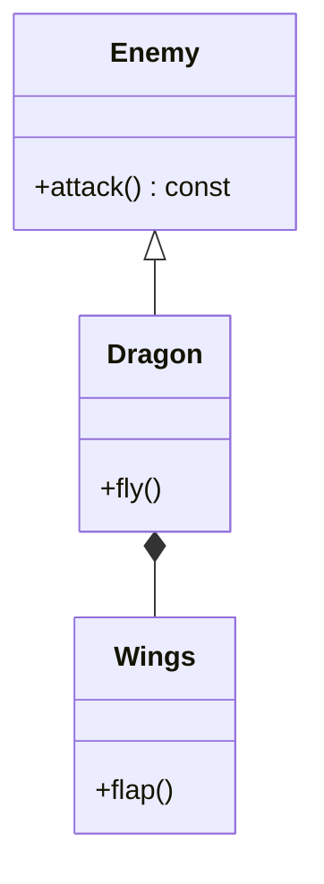
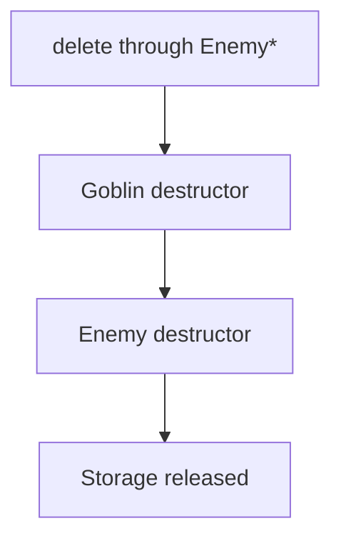
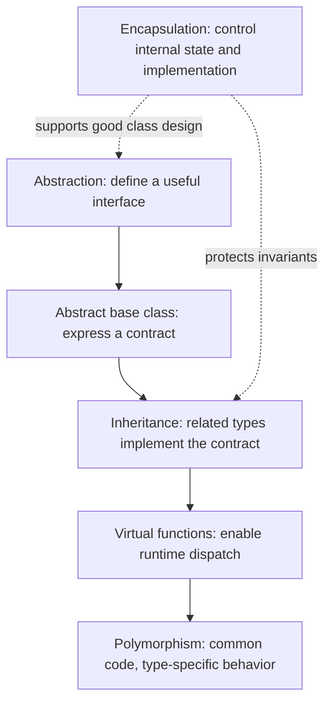

# C++ Polymorphism and Object-Oriented Design

> **Status:** Learning notes — covered through runtime polymorphism, abstract classes, object slicing, and virtual destructors.
>
> **Related notes:** [[Cpp-Inheritance-Foundations]], [[Cpp-Constructors-and-Destructors]], [[Classes-and-Structs]]
>
> **Next:** Polymorphic collections and ownership with smart pointers.

## 1. The design problem: one interface, different behavior

Imagine a game with Goblins and Dragons. Both are enemies, but each attacks differently. We want one function to work with either type without checking the exact enemy type.

```cpp
#include <iostream>

class Enemy {
public:
    virtual void attack() const {
        std::cout << "Enemy attacks!\n";
    }

    virtual ~Enemy() = default;
};

class Goblin : public Enemy {
public:
    void attack() const override {
        std::cout << "Goblin stabs with a dagger!\n";
    }
};

class Dragon : public Enemy {
public:
    void attack() const override {
        std::cout << "Dragon breathes fire!\n";
    }
};

void fight(Enemy& enemy) {
    enemy.attack();
}

int main() {
    Goblin goblin;
    Dragon dragon;

    fight(goblin);
    fight(dragon);
}
```

Output:

```text
Goblin stabs with a dagger!
Dragon breathes fire!
```

`fight` depends on the common `Enemy` interface, not on whether the object is a Goblin or Dragon. The virtual call chooses the appropriate implementation at runtime.

## 2. `.` versus `->`: accessing members

For an ordinary pointer, `->` is shorthand for dereferencing the pointer and then using `.`:

```cpp
Goblin goblin;
Enemy* target = &goblin;

target->attack();     // Equivalent to:
(*target).attack();
```

- `goblin.attack()` — access through an object.
- `target->attack()` — access through a pointer.
- `*target` — dereference the pointer to access the object it points to.

The parentheses in `(*target).attack()` matter because member access with `.` binds more tightly than unary `*`.

## 3. Static type and dynamic type

Consider:

```cpp
Goblin goblin;
Enemy* target = &goblin;
```

- The pointer's **static type** is `Enemy*`: this is the type declared in the source code.
- The pointed-to object's **dynamic type** is `Goblin`: this is the actual type of the object during execution.

The pointer does not turn the Goblin into an Enemy object. It provides access to the existing Goblin through the base-class interface.

## 4. Virtual functions and runtime polymorphism

A non-virtual member call is selected according to the expression's static type. A virtual member call uses virtual dispatch to select the final overrider for the object's dynamic type.

```cpp
class Enemy {
public:
    void report() const {
        std::cout << "Enemy\n";
    }

    virtual void attack() const {
        std::cout << "Enemy attack\n";
    }

    virtual ~Enemy() = default;
};

class Goblin : public Enemy {
public:
    void report() const {
        std::cout << "Goblin\n";
    }

    void attack() const override {
        std::cout << "Goblin attack\n";
    }
};

Goblin goblin;
Enemy& enemy = goblin;

enemy.report(); // Enemy: report() is non-virtual.
enemy.attack(); // Goblin attack: attack() is virtual.
```

### `override`

Write `override` on a derived function intended to override a virtual base function:

```cpp
void attack() const override;
```

It asks the compiler to verify that the function really overrides a virtual function. It catches mistakes such as a mismatched parameter list or missing `const`.

### The central distinction

- **Inheritance** establishes a relationship between types.
- **Virtual functions** enable runtime dispatch for selected member functions.
- **Polymorphism** lets code use a common interface while different concrete types provide different behavior.

Virtual dispatch is not automatic for every member function; the relevant base function must be virtual.

## 5. Abstraction and encapsulation

These concepts are related but answer different questions.

### Abstraction: what should a user need to know?

Abstraction presents the operations and concepts relevant to a task while leaving other details out of that interface.

```cpp
goblin.takeDamage(25);
```

The caller requests an operation without needing to coordinate every internal step involved in updating health, applying armor, or checking whether the character has died.

Abstraction is not exclusive to OOP. Functions, standard-library types such as `std::string`, modules, classes, and whole systems can all provide abstractions.

### Encapsulation: who controls access to state and implementation?

```cpp
class Character {
private:
    int health = 100;

public:
    int getHealth() const {
        return health;
    }

    void takeDamage(int amount) {
        if (amount <= 0) {
            return;
        }

        // Simplified example: this arithmetic still needs care
        // if amount could be large enough to overflow int.
        health = (amount >= health) ? 0 : health - amount;
    }
};
```

`health` is private, so ordinary outside code cannot write `character.health = -500;`. The class controls how its state is changed through its public operations.

- **Abstraction:** defines a useful interface and leaves irrelevant details out of view.
- **Encapsulation:** groups state/implementation and controls access to them.

`private` supports encapsulation, but private data alone does not guarantee a well-designed abstraction. The public interface still needs to make sense.

## 6. Abstract classes and pure virtual functions

Sometimes a base class describes a required capability rather than a concrete object we want to instantiate.

```cpp
class Enemy {
public:
    virtual void attack() const = 0;
    virtual ~Enemy() = default;
};
```

`= 0` declares a **pure virtual function**. A class with at least one pure virtual function is abstract, so an ordinary object of that class cannot be created:

```cpp
// Enemy enemy; // Error: Enemy is abstract.
```

Pointers and references to the abstract class are still allowed:

```cpp
void fight(Enemy& enemy) {
    enemy.attack();
}
```

A concrete derived class must override every inherited pure virtual function to become instantiable:

```cpp
class Goblin : public Enemy {
public:
    void attack() const override {
        std::cout << "Goblin attacks!\n";
    }
};
```

An abstract class can contain data members, constructors, and implemented functions too. An abstract class is not necessarily a pure interface.

## 7. Design around meaningful capabilities

If every `Enemy` must attack, a training dummy that only receives damage should not be forced into that interface just to reuse code.

One possible design is to separate capabilities:

```cpp
class Damageable {
public:
    virtual void takeDamage(int amount) = 0;
    virtual ~Damageable() = default;
};

class Enemy : public Damageable {
public:
    virtual void attack() const = 0;
};

class TrainingDummy : public Damageable {
public:
    void takeDamage(int amount) override {
        std::cout << "Dummy absorbs " << amount << " damage!\n";
    }
};
```

Now an `Enemy` can attack and take damage, while a `TrainingDummy` can take damage without pretending to attack.

This illustrates **interface segregation**: avoid requiring a type to implement operations that do not make sense for it. It also relates to substitutability: a derived type should honor the behavioral promises made by its base type.

These are design guidelines, not rigid rules for every game architecture.

## 8. Inheritance versus composition

- **Inheritance (“is-a”):** a Goblin is an Enemy.
- **Composition (“has-a”):** a Dragon has Wings.

```cpp
class Wings {
public:
    void flap() {
        std::cout << "Wings flap!\n";
    }
};

class Dragon : public Enemy {
private:
    Wings wings;

public:
    void attack() const override {
        std::cout << "Dragon breathes fire!\n";
    }

    void fly() {
        wings.flap();
    }
};
```



Use public inheritance when the derived type genuinely satisfies the base type's contract. Use composition to build a type from components. Inheritance is not automatically the best way to reuse code.

## 9. Object slicing

Virtual functions do not prevent object slicing.

```cpp
Goblin goblin;
Enemy enemy = goblin;
```

This creates a separate base-class object by copying the base-class subobject of `goblin`. The derived portion is not part of the new `Enemy` object. This is **object slicing**.

To access the original object polymorphically, use a pointer or reference:

```cpp
Enemy& byReference = goblin;
Enemy* byPointer = &goblin;

byReference.attack(); // Goblin implementation
byPointer->attack(); // Goblin implementation
```

| Form | Meaning |
|---|---|
| `Enemy enemy = goblin;` | New base object; slicing occurs |
| `Enemy& enemy = goblin;` | Reference to the existing Goblin |
| `Enemy* enemy = &goblin;` | Pointer to the existing Goblin |

A reference or pointer does not preserve the derived part; it accesses an object that already has its derived type.

## 10. Virtual destructors

When a derived object may be deleted through a base-class pointer, the base class should generally have a public virtual destructor.

```cpp
class Enemy {
public:
    virtual void attack() const = 0;
    virtual ~Enemy() = default;
};
```

For example:

```cpp
Enemy* enemy = new Goblin();
delete enemy;
```

With a virtual base destructor, destruction dispatches correctly for the complete derived object. The derived destructor runs first, then the base destructor.



Without a virtual destructor, deleting a derived object through a base pointer when the base destructor is non-virtual causes **undefined behavior**. Do not rely on either destructor being called correctly.

This rule concerns polymorphic destruction, not the dispatch of ordinary virtual functions. We will study ownership and modern resource management separately; prefer smart pointers over manual `new`/`delete` in ordinary modern C++ code.

## 11. How the concepts connect



These concepts are complementary, not interchangeable. Inheritance alone does not guarantee good abstraction, and polymorphism does not automatically guarantee good design.

## 12. Common mistakes and rules

- **Assuming the actual object type always decides every call:** only virtual calls use virtual dispatch.
- **Assuming `virtual` prevents slicing:** it does not; slicing is caused by copying a derived object into a base object by value.
- **Using `override` as if it creates virtual dispatch by itself:** the base function must be virtual; `override` verifies the intended override.
- **Trying to instantiate an abstract class:** abstract classes can be used through pointers and references, but not as ordinary objects.
- **Deleting a derived object through a base pointer with a non-virtual base destructor:** undefined behavior.
- **Confusing inheritance with composition:** ask whether the relationship is genuinely “is-a” or instead “has-a.”
- **Making every operation part of one interface:** separate capabilities when some types cannot meaningfully support every operation.
- **Thinking abstraction means hiding code from all inspection:** abstraction is about the interface and separation of concerns, not secrecy.

## 13. Self-checks

Try to answer before reading the short answers.

1. If `Enemy* p` points to a `Goblin`, what are the static type of `p` and the dynamic type of the pointed-to object?
2. What is the difference between `target->attack()` and `goblin.attack()`?
3. Why does `Enemy enemy = goblin;` slice the object?
4. Why can you declare `Enemy& e = goblin;` even when `Enemy` is abstract?
5. What does `override` help the compiler check?
6. Why should a polymorphic base class usually have a virtual destructor if callers may delete through base pointers?
7. Is a Dragon's Wings relationship inheritance or composition? Why?
8. What is the difference between abstraction and encapsulation?

### Answers

1. Static type: `Enemy*`. Dynamic type of the pointed-to object: `Goblin`.
2. `->` accesses a member through a pointer; `.` accesses a member through an object. If the function is virtual, dispatch depends on the actual object type.
3. A new standalone `Enemy` object is created by copying only the base-class subobject.
4. Abstract classes cannot be instantiated as ordinary objects, but references and pointers can refer to concrete derived objects.
5. It verifies that the declared derived function really overrides a virtual base function with a compatible signature.
6. It ensures deleting a derived object through a base pointer initiates correct destruction of the complete derived object.
7. Composition: a Dragon has Wings; it is not a kind of Wing.
8. Abstraction defines a useful interface and leaves irrelevant details out of view; encapsulation controls access to state and implementation.

## Key takeaways

- Use virtual functions when behavior must vary by dynamic type through a common base interface.
- Use pure virtual functions when a base class must require derived behavior.
- Use references and pointers for polymorphic access; passing derived objects by base value causes slicing.
- Make a polymorphic base destructor virtual when deletion through a base pointer is allowed.
- Design interfaces around meaningful capabilities, and use inheritance only when the derived type honors the base contract.
- Abstraction, encapsulation, inheritance, and polymorphism solve different but connected design problems.

## Next topic

**Polymorphic collections and ownership:** storing different derived types in one collection, understanding what the collection owns, and introducing `std::unique_ptr` without losing sight of object lifetime.
