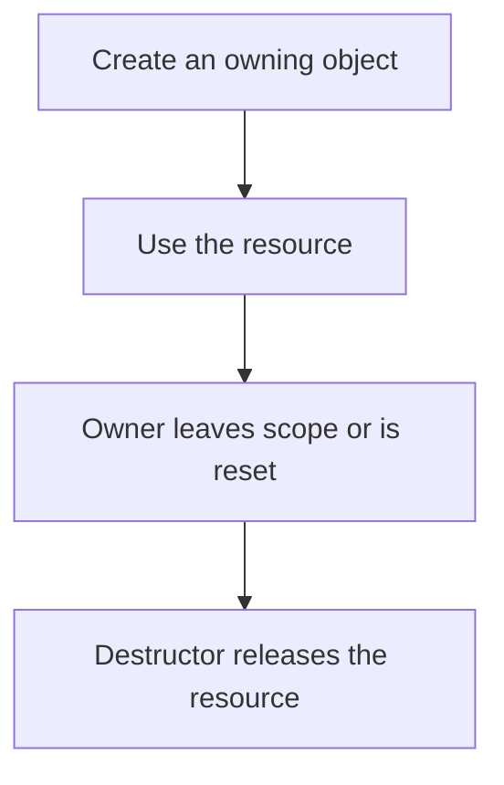
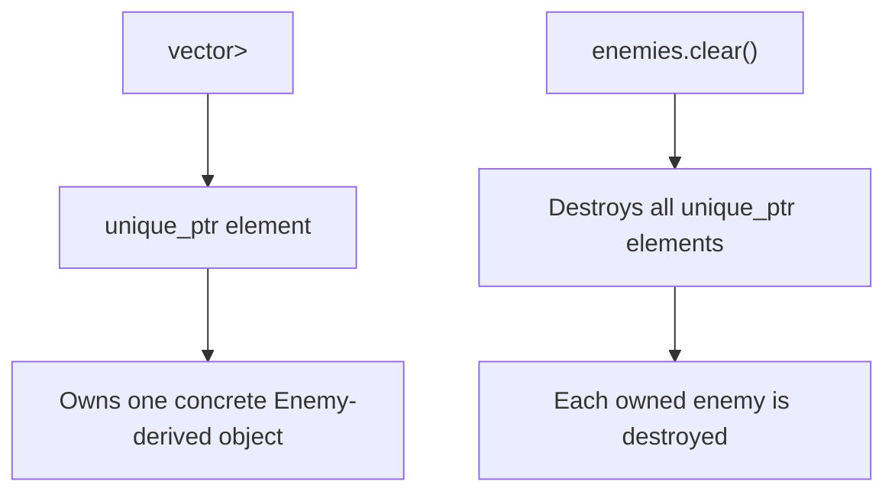

# C++ Ownership, Smart Pointers, Polymorphic Collections, and `auto`

> This note builds on pointer fundamentals and focuses on object lifetime, ownership, safe cleanup, and the first useful applications of `auto`.

## Learning map

1. Separate object lifetime from pointer lifetime.
2. Understand RAII and exclusive ownership with `std::unique_ptr`.
3. Read basic `auto` declarations.
4. Use a vector of smart pointers to own polymorphic enemies.

## 1. Ownership and object lifetime

A pointer answers **where can I access an object?** Ownership answers **who is responsible for making sure the object is destroyed?** These are related but different questions.

### A raw pointer does not automatically own its pointee

```cpp
void example() {
    Goblin goblin;       // A local object
    Goblin* observer = &goblin; // Stores its address; does not own it

    observer->attack();
} // goblin is destroyed automatically here
```

The pointer variable and the object have separate lifetimes. When `goblin` is destroyed, `observer` would become a **dangling pointer** if it remained accessible. Dereferencing a dangling pointer causes undefined behavior.

A raw pointer can point to an object without owning it, and the pointer type alone does not tell us who is responsible for cleanup. In modern C++, use raw pointers primarily for non-owning access unless an API clearly documents another ownership contract.

### Dynamic allocation and leaks

```cpp
Goblin* goblin = new Goblin();
// use goblin
// delete goblin; // needed for this manual-ownership example
```

`new Goblin()` dynamically creates an object and returns its address. A raw pointer does not destroy that object when the pointer variable goes out of scope. If the object is never released and its address is lost, the program leaks the allocation.

Raw `new` and `delete` are useful to understand, but prefer containers and smart pointers for ordinary modern C++ ownership.

### RAII: let object lifetime manage resources

**RAII** stands for *Resource Acquisition Is Initialization*. A resource is associated with an object's lifetime; when the managing object is destroyed, it releases the resource. The resource might be dynamic memory, a file handle, a lock, or something else.



RAII helps make cleanup automatic and reliable, including when a function exits early or an exception is thrown.

## 2. `std::unique_ptr`: exclusive ownership

`std::unique_ptr<T>` is a smart pointer that exclusively owns a dynamically allocated object of type `T`. When the owning `unique_ptr` is destroyed, the object it owns is destroyed automatically.

Include `<memory>` to use `std::unique_ptr` and `std::make_unique`.

```cpp
#include <memory>

auto goblin = std::make_unique<Goblin>();
```

This creates a `Goblin` and stores its ownership in `goblin`. No manual `delete` is needed.

Equivalent explicit type declaration:

```cpp
std::unique_ptr<Goblin> goblin = std::make_unique<Goblin>();
```

### What does “unique” mean?

At a time, one `unique_ptr` owns a given object. Ownership cannot be copied to another `unique_ptr`; it can be **transferred** by moving.

```cpp
auto first = std::make_unique<Goblin>();
auto second = std::move(first);
```

After this succeeds:

- `second` owns the same Goblin object.
- `first` is still a valid `unique_ptr` variable, but it is empty (`nullptr`).
- The Goblin is not copied or destroyed by the ownership transfer.

`std::move` itself does not move the object or transfer ownership on its own. It allows the move operation to be selected; the receiving operation performs the transfer.

You cannot copy a `unique_ptr`:

```cpp
auto first = std::make_unique<Goblin>();
// auto second = first; // ERROR: unique_ptr cannot be copied
```

### The pointer and the owned object are still distinct

```cpp
auto goblin = std::make_unique<Goblin>();
goblin->attack();
```

Use `->` to call a member through the smart pointer, just as with a raw pointer. A smart pointer does not change how the owned object is accessed; it adds an ownership and cleanup policy.

| Code | Meaning |
|---|---|
| `Goblin goblin;` | A local `Goblin` object; automatic lifetime |
| `Goblin* p = &goblin;` | Non-owning raw pointer to that local object |
| `auto p = std::make_unique<Goblin>();` | Owning smart pointer to a dynamically allocated `Goblin` |
| `p->attack()` | Access a member through a pointer-like object |
| `*p` | Access the object owned/pointed to by `p` |

## 3. A short introduction to `auto`

`auto` asks the compiler to deduce a variable's type from its initializer. It is **compile-time type deduction**, not dynamic typing: once deduced, the variable has that type.

```cpp
#include <memory>
#include <string>

auto count = 3;                       // int
auto price = 2.5;                     // double
auto name = std::string("Goblin");   // std::string
auto goblin = std::make_unique<Goblin>(); // std::unique_ptr<Goblin>
```

For `auto goblin = std::make_unique<Goblin>();`, the compiler determines the return type of `make_unique<Goblin>()` and uses it as the type of `goblin`.

These are effectively equivalent in type:

```cpp
auto goblin = std::make_unique<Goblin>();
std::unique_ptr<Goblin> goblin = std::make_unique<Goblin>();
```

Use `auto` when the type is clear from the initializer or when writing the full type would be repetitive. Spell the type out when that makes the code easier to understand.

### A few useful rules

- `auto x = expression;` usually deduces a value type from the expression; top-level `const` and references are generally not retained in plain `auto` deduction.
- `const auto x = expression;` makes the resulting variable const.
- `auto& x = existingObject;` deduces a reference when the initializer is an lvalue.
- `auto` requires an initializer in ordinary variable declarations because the compiler needs something from which to deduce the type.

Do not worry about every deduction edge case yet. For now, read `auto` as **“compiler, infer this variable's type from this initializer.”**

## 4. Polymorphic collections with smart pointers

A `std::vector<Enemy>` stores `Enemy` objects by value. It cannot be used when `Enemy` is abstract, and storing derived objects by base value in a concrete base type would cause **object slicing**. A vector of owning pointers solves the storage problem while preserving the concrete derived objects.

```cpp
#include <memory>
#include <vector>

std::vector<std::unique_ptr<Enemy>> enemies;
enemies.push_back(std::make_unique<Goblin>());
enemies.push_back(std::make_unique<Dragon>());
```

This is possible when `Goblin` and `Dragon` derive publicly from `Enemy` and `Enemy` has the needed interface. The `unique_ptr<Goblin>` and `unique_ptr<Dragon>` values can transfer ownership into `unique_ptr<Enemy>` elements. The objects remain Goblins and Dragons; they are not sliced.

The polymorphic base class must have a **public virtual destructor** if its derived objects are to be destroyed through `Enemy` ownership. For example:

```cpp
class Enemy {
public:
    virtual void attack() const = 0;
    virtual ~Enemy() = default;
};
```

Call virtual behavior through the smart pointer:

```cpp
for (const auto& enemy : enemies) {
    enemy->attack();
}
```

Here, `const auto&` binds to each `unique_ptr` element without copying it. The `unique_ptr` still provides access to the enemy, and virtual dispatch invokes the correct overridden `attack()` for each concrete object.

### What happens when the roster is cleared?

```cpp
enemies.clear();
```

`clear()` destroys the vector's elements. Each element is a `unique_ptr`, so its destruction destroys the enemy it owns. The vector itself remains alive but empty. Do not rely on a particular order in which the elements are destroyed.



### Removing one enemy

For example, `enemies.erase(enemies.begin())` removes the first element, destroys its `unique_ptr`, and therefore destroys the enemy it owns. The remaining elements and their enemies stay in the vector. Only do this when the vector is not empty, because `begin()` is not a valid element to erase from an empty vector.

## 5. Common mistakes and safety rules

- **Thinking a raw pointer owns its pointee:** ownership is not implied by the raw pointer type.
- **Dereferencing a dangling pointer:** the pointed-to object must still be alive.
- **Assuming `vector<Enemy*>` destroys pointed-to objects:** it destroys only its pointer elements, not the objects they point to.
- **Assuming `vector<unique_ptr<Enemy>>` copies enemies:** `unique_ptr` is non-copyable; elements own objects and can be moved.
- **Copying a `unique_ptr`:** transfer ownership with a move operation instead.
- **Thinking `std::move` itself transfers ownership:** it enables moving; the receiving operation performs the transfer.
- **Deleting a derived object through a base pointer without a virtual base destructor:** this causes undefined behavior.
- **Treating `auto` as dynamic typing:** its type is deduced at compile time and then remains fixed.
- **Relying on destruction order from `vector::clear()`:** all elements are destroyed, but code should not depend on their relative destruction order.

## 6. Self-checks

Try to answer these before looking at the short answers.

1. What is the difference between a pointer's address and the lifetime of the object at that address?
2. Why does `std::vector<Enemy*>` not destroy its enemies when `clear()` is called?
3. What is the responsibility of `std::unique_ptr<Goblin>`?
4. After `auto second = std::move(first);`, what does `first` own?
5. What type does `auto p = std::make_unique<Goblin>();` deduce for `p`?
6. Why can `std::vector<std::unique_ptr<Enemy>>` contain both Goblins and Dragons without slicing?
7. Why does `Enemy` need a virtual destructor for this ownership design?
8. What does `enemies.clear()` do to a vector of `std::unique_ptr<Enemy>`?

### Short answers

1. A pointer stores an address; it does not keep the object alive. Once the object's lifetime ends, a pointer to it can dangle.
2. The vector stores raw pointer values, which do not own or destroy their pointees.
3. It exclusively owns the dynamically allocated Goblin and automatically destroys it when ownership ends.
4. Nothing; `first` remains a valid but empty `unique_ptr` after a successful transfer.
5. `std::unique_ptr<Goblin>`.
6. The vector stores smart pointers, not base-class enemy objects by value. Each pointer owns a complete derived object.
7. So destroying a derived object through its base-class owner correctly invokes derived and base destruction.
8. It destroys the smart-pointer elements, which in turn destroy the enemies they own. The vector remains alive and empty.

## Key takeaways

- A pointer gives access; ownership determines who manages lifetime.
- A dangling pointer refers to an object whose lifetime has ended; dereferencing it is undefined behavior.
- RAII ties resource cleanup to object lifetime.
- `std::unique_ptr<T>` expresses exclusive ownership and cleans up automatically.
- Ownership can be transferred with a move operation; `unique_ptr` cannot be copied.
- `auto` deduces a variable's type from its initializer at compile time.
- `std::vector<std::unique_ptr<Base>>` is a common way to own a changing collection of polymorphic derived objects.
- A polymorphic base used for deletion through a base owner needs a virtual destructor.

## Related topics

- Pointers, addresses, dereferencing, and dangling pointers.
- Object lifetime, constructors, destructors, and RAII.
- Inheritance, virtual functions, polymorphism, and object slicing.
- Containers, iteration, and ownership transfer.
- The Combat Arena enemy roster exercise.
