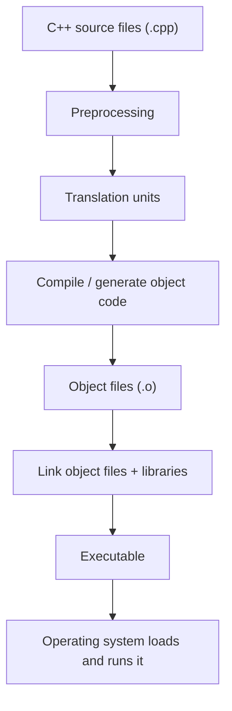
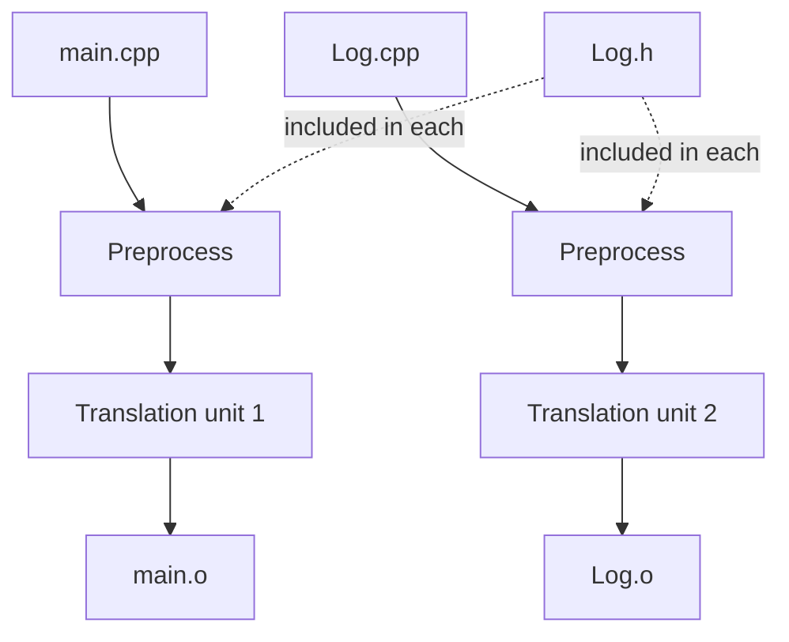
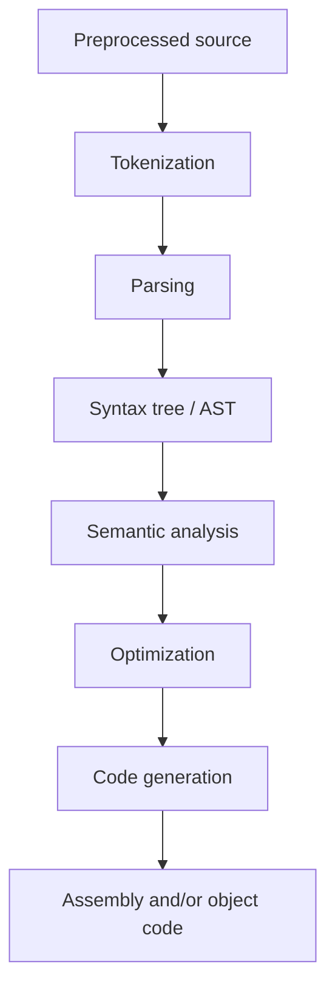
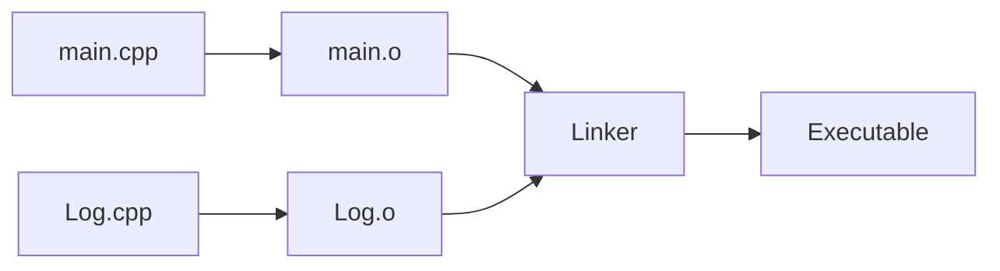
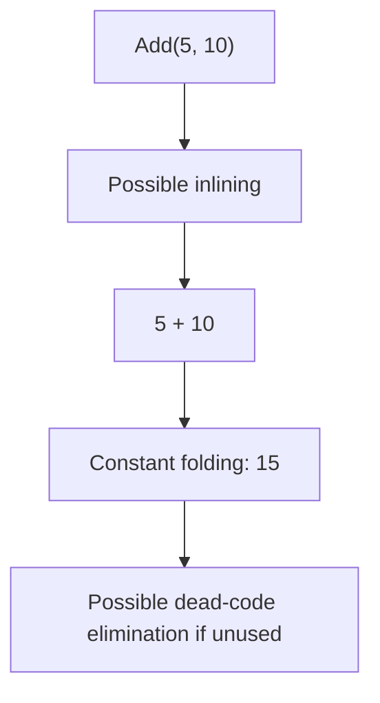
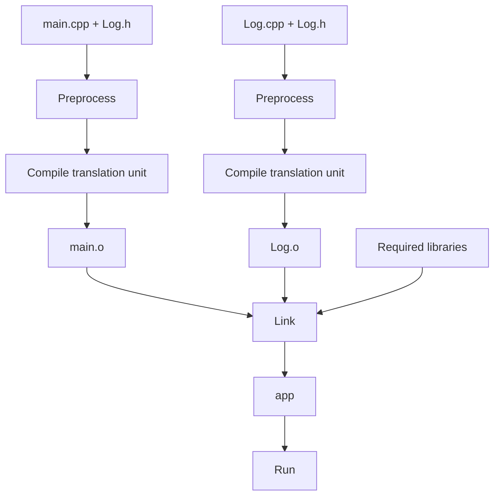

# How the C++ Compiler Works

These notes explain the journey from C++ source code to a runnable program, using a Linux/GCC workflow. The central distinction is:

- **Compilation** translates each translation unit into an object file.
- **Linking** combines object files and libraries into an executable or another library.

Related notes: [[Cpp-Header-Files]], [[Cpp-Linker]], [[Cpp-Debugging-GDB]], [[Cpp-Functions]].

---

## 1. The build pipeline

A useful high-level model is:



A compiler driver such as `g++` coordinates the stages for you. Depending on the command, it may invoke preprocessing, compilation, assembly, and linking without requiring you to run each tool manually.

### Compilation versus linking

| Stage | Typical input | Typical output | Main job |
|---|---|---|---|
| Preprocessing | Source and directives | Preprocessed source | Process `#include`, macros, and conditional compilation |
| Compilation | A translation unit | Assembly or object-code output, depending on the stage/tool | Parse, check, optimize, and translate C++ |
| Assembly | Assembly text | Object file (`.o`) | Encode instructions and produce object-file metadata |
| Linking | Object files and libraries | Executable or library | Resolve symbol references and combine program pieces |

On Linux, GCC/Clang object files commonly use `.o`; MSVC commonly uses `.obj`. Extensions are conventions used by tools, not the essence of the language.

---

## 2. Preprocessing: directives before C++ analysis

The preprocessor handles directives such as:

```cpp
#include <iostream>
#define DEFAULT_PORT 8080

#if defined(DEBUG)
    // Debug-only source
#endif
```

It does not perform normal C++ type checking or understand classes and functions in the way the C++ compiler does. It performs preprocessing operations such as including files, expanding macros, and selecting conditional source.

### `#include` is textual inclusion

Suppose `Log.h` contains:

```cpp
#pragma once

void Log(const char* message);
```

And `main.cpp` contains:

```cpp
#include "Log.h"

int main()
{
    Log("Hello");
}
```

Conceptually, preprocessing makes the declaration from `Log.h` available at the include site. It does **not** compile `Log.cpp` or link the function implementation.

Think:

> “Make the header's contents part of this translation unit.”

Not:

> “Connect this header to its implementation.”

The actual preprocessed output includes line markers and other details, but the model is useful.

### Why headers affect build time

A standard header such as `<iostream>` can include many other headers. Each source file that includes a header may need to process much of that header content during its own preprocessing and compilation.

In a large project, repeated header processing contributes to build time. Techniques that help manage this include:

- Include guards or `#pragma once`
- Forward declarations, when valid
- Precompiled headers
- C++ modules

### Macros are not C++ variables

```cpp
#define INTEGER int

INTEGER main()
{
    return 0;
}
```

The preprocessor substitutes the token `INTEGER` with `int` before ordinary C++ compilation. By contrast:

```cpp
int x = 10;
```

declares a C++ variable. Macros are textual preprocessing mechanisms and do not obey C++ scope or type rules.

Prefer constants and language features over macros when those features can express the same intent safely.

### Conditional compilation

```cpp
#if 0
    This source is removed before C++ parsing.
#endif

#ifdef DEBUG
    // Included only when DEBUG is defined.
#endif
```

This differs from a C++ condition:

```cpp
if (false) {
    // The compiler still has to parse and type-check this code.
}
```

With `#if 0`, the enclosed source is excluded during preprocessing. With `if (false)`, it remains part of the C++ program, although an optimizer may later remove unreachable work.

Platform macros can select platform-specific code, for example:

```cpp
#ifdef __linux__
    // Linux-specific implementation
#endif
```

Use platform checks deliberately; build-system feature checks are often more robust than assuming a platform macro implies every particular capability.

---

## 3. Translation units

A **translation unit** is the source file after preprocessing, including the effects of its included headers and macro expansion.

Given:

```text
Project/
├── main.cpp
├── Log.cpp
└── Log.h
```

and both `.cpp` files include `Log.h`, the compiler processes two separate translation units:



The header's declarations are seen in both translation units, but the two `.cpp` files are still compiled independently.

This is why saying “a `.cpp` file is compiled separately” is a useful shortcut, while the more precise statement is:

> Each source file is preprocessed into a translation unit, and each translation unit is compiled independently.

The `.cpp` extension is a convention. Toolchains can be explicitly instructed to treat other filenames as C++ source.

---

## 4. What happens during compilation?

The exact internal pipeline varies between compilers, but this is a useful mental model:



### Tokenization

For:

```cpp
int x = 10;
```

the compiler recognizes tokens such as `int`, `x`, `=`, `10`, and `;`. Tokens have grammatical roles; they are not merely arbitrary characters.

### Parsing and the abstract syntax tree

Parsing determines how tokens fit the grammar of C++. For example:

```cpp
int result = a + b * 10;
```

The expression groups as `a + (b * 10)` because multiplication has higher precedence than addition.

A compiler may represent the structure using an **abstract syntax tree (AST)** or related internal representations. A conceptual sketch:

```text
Variable declaration: result
├── Type: int
└── Initializer: addition
    ├── a
    └── multiplication
        ├── b
        └── 10
```

The exact tree and compiler internals vary.

### Syntax versus semantics

Syntax asks whether the code follows the language grammar. Semantics includes whether its constructs make sense under C++ rules.

```cpp
int x = 10;       // Valid declaration
int y = "Hello";  // Recognizable structure, but incompatible types
```

A compiler does more than check punctuation: it performs type checking, name lookup, overload resolution, and other semantic analysis.

### Code generation

The compiler eventually generates lower-level instructions. For example:

```cpp
int Add(int a, int b)
{
    return a + b;
}
```

might compile to a small sequence of machine instructions, but the exact output depends on the CPU architecture, compiler and version, optimization level, calling convention, and other build settings.

Assembly is a human-readable representation of instructions for a particular architecture. The processor executes encoded machine instructions, not C++ source or assembly text.

---

## 5. Object files and unresolved references

An object file is the output of compiling a translation unit. It is not necessarily a complete executable.

An object file may contain:

- Machine code and data
- Symbol information
- Relocation information
- Debugging information, if requested

Consider a declaration in `main.cpp`:

```cpp
void Log();

int main()
{
    Log();
}
```

The compiler knows the declaration of `Log`, so it can compile the call. But the definition must be provided somewhere for the final program to link.

`Log.cpp` could provide it:

```cpp
void Log()
{
    // Implementation
}
```

The build then produces `main.o` and `Log.o`; the linker combines them and resolves the reference to `Log()`.



### Compilation errors versus linker errors

- **Compilation error:** a translation unit has invalid syntax or violates a compile-time language rule.
- **Linker error:** the compiled object files cannot be combined as requested, often because a referenced definition is missing or multiple conflicting definitions exist.

For example, a missing `Log()` definition can lead to a Linux linker message such as `undefined reference to 'Log()'`.

When debugging, first identify **which stage failed**. A linker error usually will not be fixed by changing unrelated syntax in a source file.

---

## 6. The linker’s role

The linker combines object files and libraries, resolves symbol references, and produces an executable or library. It is a distinct stage from compiling an individual translation unit.

A header normally supplies declarations and type definitions needed during compilation. It does not, by itself, provide a separately compiled implementation. Definitions may be in `.cpp` files or, for cases such as templates and many `inline` functions, in headers.

Keep the [linker notes](Cpp-Linker-Visual) nearby for symbol names, missing definitions, the One Definition Rule, and duplicate-definition errors.

---

## 7. Optimization: generated code need not resemble the source

The compiler is not required to preserve the exact sequence of source-level operations. It must preserve the program's **observable behavior**, subject to the C++ language rules.

### Constant folding

```cpp
int x = 5 * 2;
```

Because both operands are known at compile time, the compiler may calculate `10` during compilation rather than emit a runtime multiplication.

### Constant propagation

```cpp
const int x = 10;
int y = x + 5;
```

The compiler may use the known value of `x` when optimizing the expression for `y`.

### Dead-code elimination

If a computation has no observable effect and its result is never used, the compiler may remove it. For example, an unused local calculation may disappear entirely.

A function that is never called may also be removed when the compiler or linker can establish that it is not needed. Whether this happens depends on visibility, optimization, linking options, and other details.

### Inlining

```cpp
int Add(int a, int b)
{
    return a + b;
}

int main()
{
    int result = Add(5, 10);
}
```

The compiler may replace the call with the function body, then fold `5 + 10` into `15`, then remove the calculation if `result` is unused and nothing observable depends on it.



This is conceptual, not a promise about a specific compiler's exact sequence of optimization passes.

### Why this matters for debugging

Source code is not a direct instruction-by-instruction recipe. Variables may be kept in registers, merged, optimized away, or never materialize in memory as expected. In optimized builds, stepping through source can therefore look surprising.

---

## 8. Debug and optimized builds with GCC

A debug-friendly GCC build commonly includes debug information and uses little or no optimization:

```bash
g++ -std=c++20 -Wall -Wextra -Wpedantic -g -O0 main.cpp Log.cpp -o app
```

- `-g`: include debugging information.
- `-O0`: disable most optimization.
- `-Wall -Wextra -Wpedantic`: enable useful warnings.
- `-std=c++20`: select the C++20 language mode.

An optimized build might use:

```bash
g++ -std=c++20 -Wall -Wextra -Wpedantic -O2 main.cpp Log.cpp -o app
```

`Debug` and `Release` are configuration names commonly used by IDEs and build systems, not special C++ language modes. Their actual compiler flags depend on the build setup.

Use a debug-friendly build to learn and investigate behavior; also test optimized builds because optimization can expose assumptions and bugs in programs, particularly where the code has undefined behavior.

---

## 9. Inspecting the pipeline with GCC

You can inspect intermediate stages rather than treating the compiler as a black box.

### Stop after preprocessing

```bash
g++ -E main.cpp -o main.i
```

`-E` preprocesses the source and stops. Open `main.i` to inspect the result. Standard library headers can make this output very large.

### Generate assembly

```bash
g++ -S -O0 main.cpp -o main-O0.s
g++ -S -O2 main.cpp -o main-O2.s
```

`-S` stops after producing assembly. Compare the files to see how optimization changes the output.

### Compile one source file to an object file

```bash
g++ -std=c++20 -Wall -Wextra -Wpedantic -g -c main.cpp -o main.o
g++ -std=c++20 -Wall -Wextra -Wpedantic -g -c Log.cpp -o Log.o
```

`-c` compiles without performing the final link.

### Link the object files

```bash
g++ main.o Log.o -o app
```

Then run the executable:

```bash
./app
```

The `g++` driver normally orchestrates the necessary stages when given source files directly:

```bash
g++ -std=c++20 -Wall -Wextra -Wpedantic -g main.cpp Log.cpp -o app
```

For larger projects, a build system such as CMake manages these commands and their dependencies.

---

## 10. Why C++ builds can be slow

If many `.cpp` files include a large shared header, each translation unit may repeatedly process the same header content. A change to a widely included header can also trigger recompilation of many source files.

Useful techniques include:

- Avoid including headers a file does not need.
- Use forward declarations where they are valid and appropriate.
- Keep headers focused and avoid unnecessary include chains.
- Use include guards or `#pragma once` to prevent repeated inclusion within one translation unit.
- Consider precompiled headers or C++ modules when appropriate for the project.

`#pragma once` is widely supported and convenient, though it is not a standard C++ preprocessor directive. Include guards use standard preprocessor directives:

```cpp
#ifndef LOG_H
#define LOG_H

void Log(const char* message);

#endif
```

Both techniques prevent a header's contents from being processed repeatedly within the same translation unit. They do not prevent the header from being processed independently for different translation units.

---

## 11. Practical build model

For a small project:

```text
Project/
├── main.cpp
├── Log.cpp
└── Log.h
```

A normal build flow is:

1. Preprocess `main.cpp` and `Log.cpp` separately.
2. Compile each resulting translation unit.
3. Produce `main.o` and `Log.o`.
4. Link those object files and required libraries.
5. Run the resulting executable.



The diagram is simplified: real toolchains have additional stages and metadata, and libraries can be static or shared.

---

## 12. Key takeaways

- **Preprocessing** handles includes, macros, and conditional compilation.
- A **translation unit** is the source after preprocessing.
- Each source file is typically compiled independently into an object file.
- The compiler parses and checks C++ semantics; it does not merely translate each line literally.
- An object file can contain unresolved references.
- The **linker** combines object files and libraries and resolves those references.
- Optimization can fold constants, propagate values, inline functions, and remove unnecessary work.
- Debug information (`-g`) and optimization (`-O0`, `-O2`, etc.) are separate concerns.
- The `g++` driver can orchestrate the full build, while flags such as `-E`, `-S`, and `-c` let you inspect or stop at particular stages.

## Self-check

Try answering these without looking back:

1. What is the difference between a source file and a translation unit?
2. Why can a source file compile successfully even if a called function has no definition?
3. What does `#include` do, and what does it *not* do?
4. How do `#if 0` and `if (false)` differ?
5. What is stored in an object file, and why might it not be a complete program?
6. What do `-E`, `-S`, and `-c` ask GCC to do?
7. Why might a variable be difficult to inspect in an optimized build?
8. Why can a widely included header slow down a large build?

## Related notes

- [[Cpp-Header-Files]] — declarations, definitions, and header organization
- [[Cpp-Linker]] — symbols, unresolved references, ODR, and linker errors
- [[Cpp-Debugging-GDB]] — debugging with GCC/GDB and VS Code
- [[Cpp-Functions]] — function declarations, definitions, and calls
