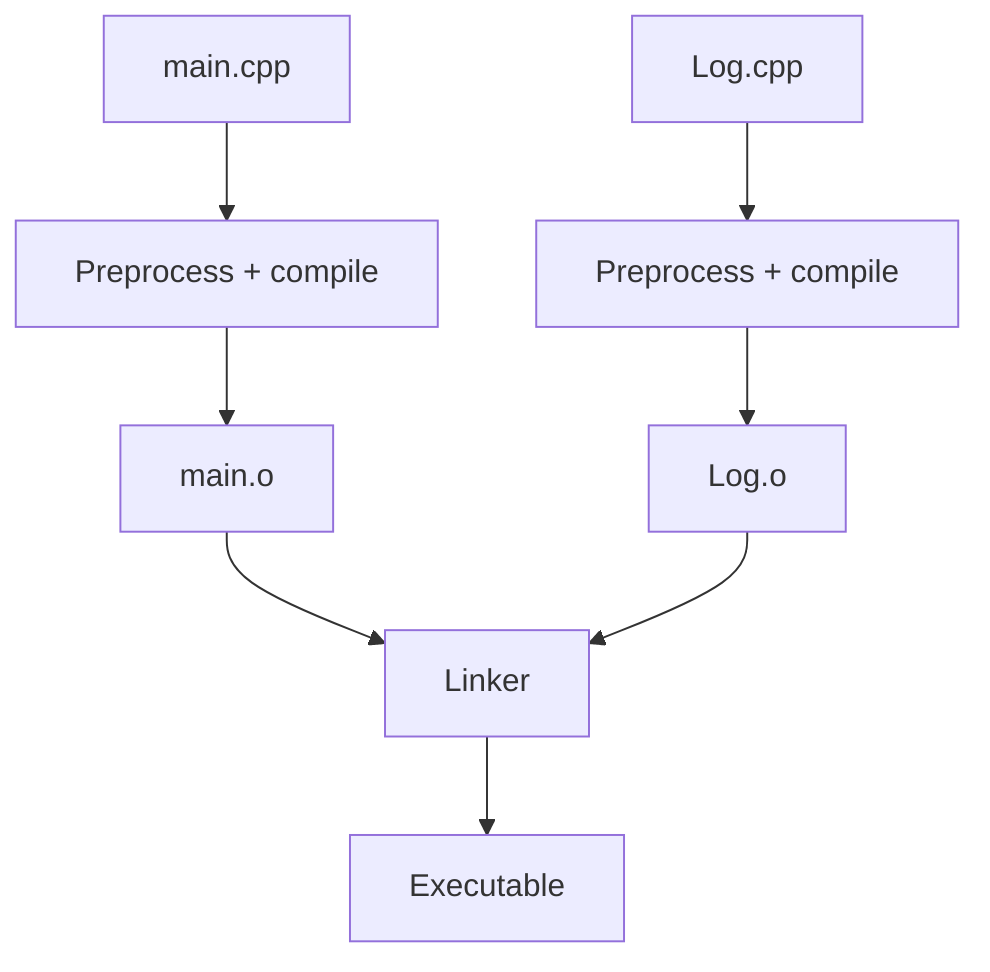
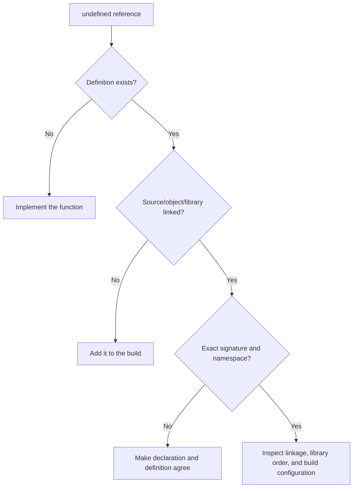

# How the C++ Linker Works

> A practical guide to compilation, object files, symbol resolution, and diagnosing common linker errors. Examples use GCC on Linux.

## 1. The big picture

C++ projects are commonly built in stages. Each `.cpp` file is preprocessed and compiled as its own **translation unit**, producing an object file. The linker combines object files and libraries, resolving references between them.



**Mental model:** the compiler creates the pieces; the linker connects them.

## 2. Why the linker is needed

Suppose `main.cpp` calls a function declared in another file:

```cpp
// main.cpp
void Log();

int main()
{
    Log();
}
```

The declaration tells the compiler that `Log()` exists and has this signature. The compiler can compile the call without seeing the function body. But some compiled object file or library must eventually provide a matching definition.

```cpp
// Log.cpp
void Log()
{
    // Implementation
}
```

The linker resolves the reference from `main.o` to the definition provided by `Log.o`.

## 3. Declaration, definition, and symbol

A **declaration** introduces a name and its interface:

```cpp
void Log(const char* message);
```

A **definition** provides the implementation:

```cpp
void Log(const char* message)
{
    // Implementation
}
```

A **symbol** is a name represented in object-file metadata, such as a function or global variable, that the linker can use when resolving references. The exact symbol representation is toolchain/ABI-dependent.

C++ supports overloading, so `Log(int)` and `Log(float)` are different functions. Compilers typically use **name mangling** to encode information needed to distinguish C++ entities in symbols. Do not memorize a particular mangled spelling; it varies by ABI and compiler.

## 4. Compilation and linking are different stages

| Stage | Main question | Typical failure |
|---|---|---|
| Compilation | Is this translation unit valid, and can it be compiled? | Syntax/type error |
| Linking | Can the required symbols be resolved into a final binary? | Undefined reference, duplicate definition |

A source file can compile successfully and still fail during linking. For example, `void Log();` allows a call to compile, but if no matching definition is linked into the program, the linker cannot complete the executable.

## 5. A working multi-file example

Project layout:

```text
Project/
├── main.cpp
├── Log.h
└── Log.cpp
```

**`Log.h`**

```cpp
#pragma once

void Log(const char* message);
```

**`Log.cpp`**

```cpp
#include <iostream>
#include "Log.h"

void Log(const char* message)
{
    std::cout << message << '\n';
}
```

**`main.cpp`**

```cpp
#include "Log.h"

int main()
{
    Log("Hello World");
}
```

Compile each translation unit, then link:

```bash
g++ -std=c++20 -Wall -Wextra -Wpedantic -c main.cpp -o main.o
g++ -std=c++20 -Wall -Wextra -Wpedantic -c Log.cpp -o Log.o
g++ main.o Log.o -o main
./main
```

Output:

```text
Hello World
```

You can also let GCC compile and link both files in one command:

```bash
g++ -std=c++20 -Wall -Wextra -Wpedantic main.cpp Log.cpp -o main
```

The `-c` option means “compile/assemble to an object file, but do not link.”

## 6. Common linker error: undefined reference

Example diagnostic from GCC/Clang:

```text
undefined reference to `Log()'
```

The code may have a valid declaration and call, but the linker cannot find a matching definition among the object files and libraries it was given.

Check systematically:

1. **Is there a definition?** Find the function body, not just its declaration.
2. **Is its `.cpp` file included in the build?** `g++ main.cpp -o main` does not compile `Log.cpp`.
3. **Does the signature match?** `Log(const char*)` is different from `Log(const char*, int)`.
4. **Does the namespace match?** `Engine::Log()` is different from a global `Log()`.
5. **Is the relevant library linked?** Installing a library does not automatically make the linker use it.
6. **Does linkage/calling convention match?** This can matter when interfacing with C or platform APIs.

A classic cause is simply forgetting a source file:

```bash
# Missing Log.cpp: likely undefined reference
g++ main.cpp -o main

# Correct: compile and link both
g++ main.cpp Log.cpp -o main
```

## 7. Common linker error: multiple definitions

Example diagnostic:

```text
multiple definition of `Log()'
```

This can happen when the same ordinary externally linked function is defined in two `.cpp` files, or when a non-`inline` function definition is placed in a header included by multiple translation units.

```cpp
// Log.h — problematic if included by multiple .cpp files
#pragma once

void Log()
{
}
```

`#pragma once` prevents repeated processing of the header **within one translation unit**. It does not stop `Log()` from being defined separately in `main.cpp`'s translation unit and `Player.cpp`'s translation unit.

For an ordinary non-template function, the common solution is:

```cpp
// Log.h
#pragma once
void Log();
```

```cpp
// Log.cpp
#include "Log.h"

void Log()
{
}
```

### When a definition belongs in a header

There are legitimate exceptions:

- **`inline` functions:** may have matching definitions in multiple translation units when One Definition Rule (ODR) requirements are satisfied.
- **Templates:** their definitions commonly need to be visible where the compiler instantiates them.
- **`static` functions at namespace scope:** have internal linkage, so each translation unit gets its own distinct function. This is sometimes useful for small private helpers, but it is not equivalent to one shared function and may duplicate code.

`inline` does **not** guarantee that the compiler will replace a call with the function body. It has important language-level ODR/linkage semantics as well as its historical association with optimization.

## 8. The One Definition Rule (ODR)

The ODR governs how entities may be defined across a C++ program. As a beginner's practical rule:

- A normal non-`inline` externally linked function should generally have one definition in the program.
- `inline` functions and templates have special rules that permit definitions to appear in multiple translation units, provided the relevant ODR requirements are met.
- Include guards and `#pragma once` address repeated inclusion inside a translation unit; they do not by themselves solve cross-translation-unit duplicate definitions.

## 9. Libraries and the final executable

The linker can use your object files and libraries to resolve references.

- A Linux **static library** commonly has an `.a` extension and is an archive of object files.
- A Linux **shared library** commonly has an `.so` extension and can remain a separate object loaded at runtime.

The exact process depends on the platform, build configuration, and library type. Build systems must specify the libraries and object files needed by the program.

Even a single `.cpp` file usually relies on startup/runtime code and libraries. For a normal hosted C++ application, `main()` is the standard entry point; platform startup code initializes the program before calling it. Missing-entry-point diagnostics depend on the platform and build configuration.

## 10. A practical debugging checklist

### If you see `undefined reference`



Ask:

- Is the function declared?
- Is it defined?
- Is the defining `.cpp` compiled?
- Is the resulting object file included in the link?
- Do the signature, namespace, and linkage agree?

### If you see `multiple definition`

Ask:

- Did I define the same ordinary function in multiple source files?
- Did I put a non-`inline` function or global variable definition in a header?
- Did I accidentally link the same object file twice?
- Should the definition live in one `.cpp`, or is a valid `inline`/template pattern appropriate?

## 11. Three common problems, summarized

| Problem | What it means | First thing to check |
|---|---|---|
| Missing definition | Nothing linked provides the requested symbol | Was the defining `.cpp` or library included? |
| Mismatched definition | The provided symbol does not match the requested one | Signature, namespace, linkage |
| Multiple definitions | More than one conflicting definition is present | Header definitions and duplicate source/object inputs |

The linker checks whether compiled references can be connected. It does not check whether your program's logic expresses your intention. A function that accidentally subtracts instead of adds can link perfectly if its declaration and definition agree.

## 12. Key takeaways

- Each `.cpp` file is generally compiled as a separate translation unit.
- The compiler checks and compiles each translation unit; the linker resolves symbols across object files and libraries.
- A declaration is enough to compile a call, but a matching definition must be available at link time.
- Missing source files, signature mismatches, and missing libraries are common causes of undefined references.
- Duplicate definitions often come from defining ordinary functions in headers or defining the same function in multiple source files.
- `#pragma once` does not prevent duplicate definitions across translation units.
- `inline`, `static`, and separate `.cpp` definitions have different meanings—choose deliberately.

## Self-check

1. Why can a call compile even when the function's body is missing?
2. What does `g++ -c main.cpp -o main.o` do, and what does it not do?
3. Why does including a non-`inline` function definition from a header in two `.cpp` files risk a multiple-definition error?
4. What is the difference between an undefined reference and a multiple-definition error?
5. Does `inline` guarantee a function call is optimized away or expanded inline?
6. Why might a function with the right name still fail to resolve?

## Related notes

- [[Cpp-Header-Files]]
- [[Cpp-Functions]]
- [[Cpp-Variables-and-Data-Types]]
- [[Cpp-Debugging-GDB]]
