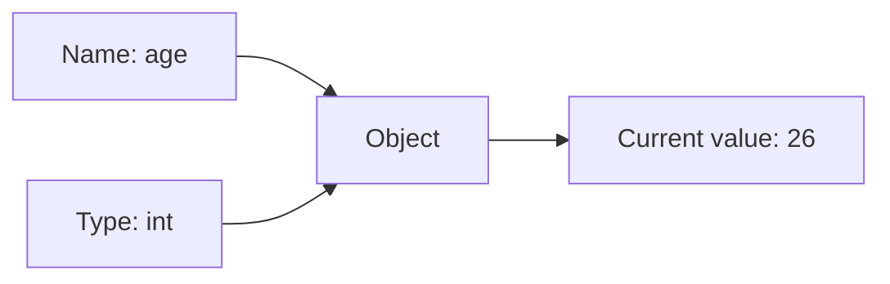
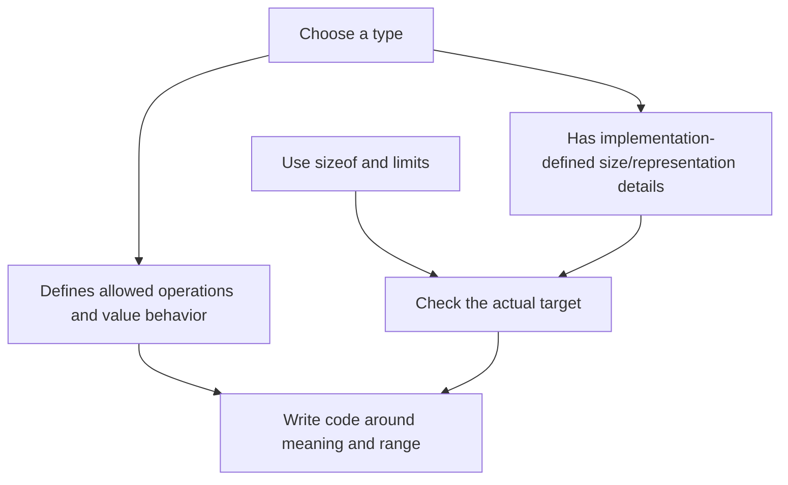

# C++ Variables and Data Types

> Understand what a variable represents, how types affect interpretation and operations, and why you should check platform details instead of guessing.

## 1. Variables and objects

A variable gives a name to an object or value that your code can work with.

```cpp
int age = 25;
age = 26;
```

The declaration says that `age` has type `int` and is initialized to `25`. Later assignment changes its value.



The type matters: it influences the object's representation, size/alignment requirements, valid operations, and how expressions involving it behave. The compiler may optimize storage away when the abstract behavior of the program allows it, so “every variable always occupies a visible memory slot” is not a reliable low-level rule.

## 2. Fundamental types

Common built-in types include:

```cpp
char
short
int
long
long long

float
double
bool
```

They represent different kinds of values and support different operations. The size of a type is not universally fixed across all C++ implementations.

## 3. `sizeof` and bytes

Use `sizeof` to ask the implementation how many **C++ bytes** an object or type occupies:

```cpp
#include <iostream>

int main()
{
    std::cout << sizeof(char) << '\n';
    std::cout << sizeof(int) << '\n';
    std::cout << sizeof(long) << '\n';
}
```

`sizeof` returns a value of type `std::size_t`. A C++ byte is the size of a `char` and is exactly 8 bits only on implementations where `CHAR_BIT == 8`—which is true on mainstream desktop systems.

Typical sizes on common systems:

| Type | Typical size |
|---|---:|
| `char` | 1 byte (guaranteed) |
| `short` | often 2 bytes |
| `int` | often 4 bytes |
| `long` | 4 or 8 bytes, depending on data model |
| `long long` | often 8 bytes |
| `float` | often 4 bytes |
| `double` | often 8 bytes |
| `bool` | often 1 byte |

Treat these as common observations, not universal promises.

## 4. Why `long` differs on Windows and Linux

Typical 64-bit platforms use different data models:

| Type | Windows x64 (LLP64) | Linux x86-64 (LP64) |
|---|---:|---:|
| `int` | 4 bytes | 4 bytes |
| `long` | 4 bytes | 8 bytes |
| `long long` | 8 bytes | 8 bytes |
| pointer | 8 bytes | 8 bytes |

This is why a Windows tutorial may show `sizeof(long) == 4`, while your 64-bit Linux build commonly reports `8`. Check your own compiler and target instead of memorizing one machine's output.

## 5. Integer types and signedness

Integer types represent whole-number values. `int` is a good general-purpose choice for ordinary integer arithmetic.

- `signed` integer types can represent negative and positive values.
- `unsigned` integer types represent non-negative values and have modulo arithmetic.

For a typical 32-bit `int`, the range is −2,147,483,648 to 2,147,483,647. A typical 32-bit `unsigned int` ranges from 0 to 4,294,967,295.

```cpp
unsigned int count = 0;
--count; // wraps to the maximum unsigned value
```

Unsigned arithmetic wraps modulo \(2^N\), where \(N\) is the number of value bits. This can be useful, but it can also cause bugs—for example, when subtracting from zero or mixing signed and unsigned values.

**Signed overflow is different:** if a signed arithmetic operation produces a value outside the representable range, the behavior is undefined in C++. Do not rely on it wrapping around.

## 6. `char` is an integer type too

```cpp
char letter = 'A';
```

`char` occupies exactly one C++ byte and is commonly used for character data. On ASCII-compatible systems, `'A'` has numeric value 65, but C++ does not require every execution character encoding to be ASCII.

`std::cout` treats a `char` as character output, while it treats an `int` as integer output:

```cpp
std::cout << char{65} << '\n'; // commonly: A
std::cout << 65 << '\n';       // 65
```

The type and selected stream overload affect how the value is displayed.

## 7. Floating-point types and precision

Use `float` and `double` for approximate real-number values.

```cpp
float speed = 12.5f; // f suffix: float literal
double distance = 12.5; // unsuffixed floating literal: double
```

Floating-point values have finite precision. Many decimal fractions cannot be represented exactly in binary, so calculations may produce results such as `0.30000000000000004` rather than exactly `0.3`.

```cpp
double result = 0.1 + 0.2;
std::cout << result << '\n';
```

For many numerical comparisons, compare the difference against an appropriate tolerance rather than assuming two independently calculated floating-point values must be exactly equal. The right tolerance depends on the scale and problem.

## 8. `bool`

A `bool` represents logical `true` or `false`.

```cpp
bool isAlive = true;

if (isAlive)
{
    // ...
}
```

In conditions, values can undergo contextual conversion to `bool`: zero is false and nonzero arithmetic values are true; a null pointer is false and a non-null pointer is true. A non-null pointer is not necessarily valid to dereference—truthiness does not prove that the pointed-to object is alive or accessible.

## 9. Fixed-width integer types

When the exact width matters, use the optional fixed-width types from `<cstdint>` where available:

```cpp
#include <cstdint>

std::int32_t packetId;
std::uint64_t timestamp;
```

The exact-width typedefs such as `std::int32_t` are provided only when the implementation has a suitable integer type of exactly that width. They are useful for binary formats, serialization, protocols, and other places where a specified width matters.

For ordinary application counters and arithmetic, choose types based on semantics and range requirements rather than assuming every variable needs a fixed-width type.

## 10. A practical example

```cpp
#include <cstdint>
#include <iostream>

int main()
{
    int health = 100;
    float speed = 5.5f;
    bool alive = health > 0;
    std::int32_t score = 2500;

    std::cout << "Health: " << health << '\n';
    std::cout << "Speed: " << speed << '\n';
    std::cout << "Alive: " << alive << '\n'; // prints 1 or 0 by default
    std::cout << "Score: " << score << '\n';
    std::cout << "sizeof(long): " << sizeof(long) << '\n';
}
```

The types communicate intent: health and score are integers, speed is fractional, and `alive` is a logical state.

## Mental model



## Key takeaways

- A variable's type affects how its value is interpreted and which operations are valid.
- `sizeof` reports size in C++ bytes; do not assume every type has a universal size.
- `long` commonly differs between 64-bit Windows and Linux because their data models differ.
- Unsigned arithmetic wraps; signed overflow is undefined behavior.
- Floating-point types have finite precision.
- Use fixed-width integers when an exact bit width is part of the requirement.

## Self-check

1. What does `sizeof(long)` tell you, and why might it differ across systems?
2. Why does `std::cout << char{65}` commonly print `A`, while `std::cout << 65` prints `65`?
3. What is the difference between unsigned wraparound and signed overflow?
4. Why can `0.1 + 0.2` fail an exact equality comparison with `0.3`?
5. When is `std::int32_t` more appropriate than `int`?

## Related notes

- [[Cpp-Pointers]]
- [[Cpp-References]]
- [[Cpp-Conditions-and-Branches]]
- [[Cpp-Header-Files]]
