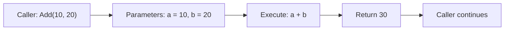
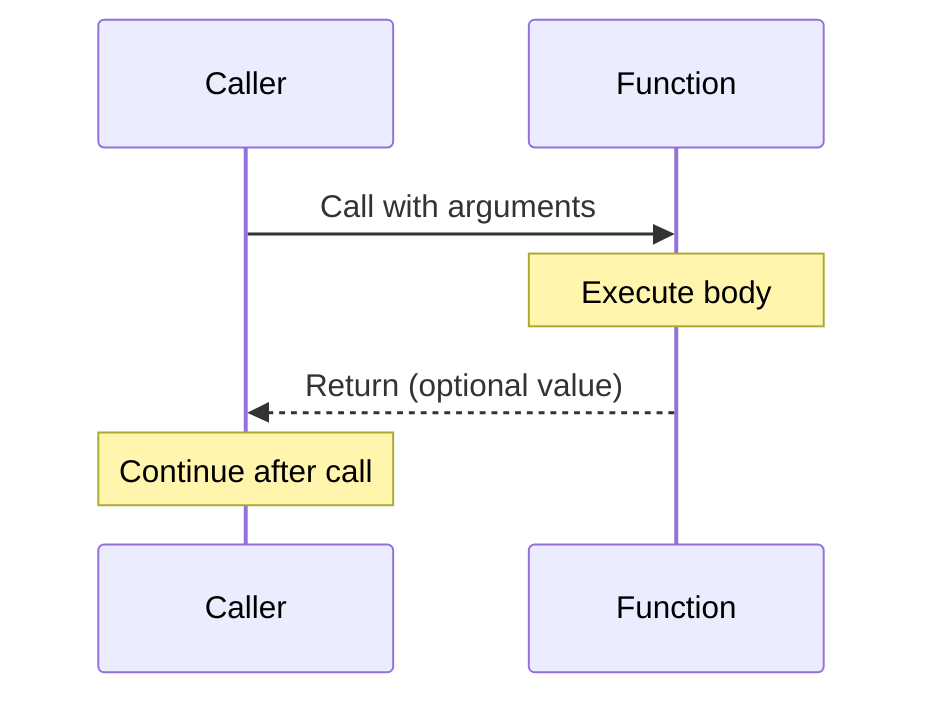
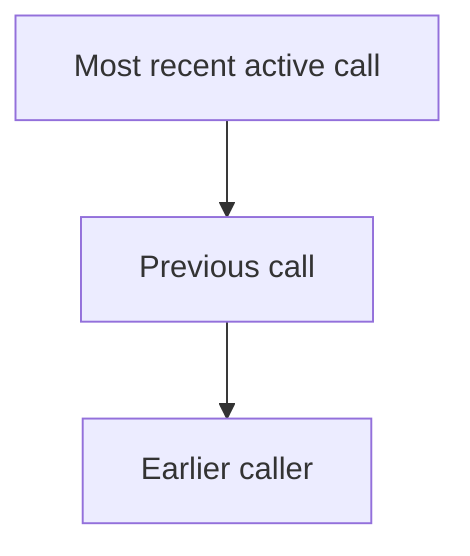

# Functions in C++

> A practical reference to function interfaces, parameters, return values, abstraction, and the runtime model of a function call.

## 1. What is a function?

A **function** is a named unit of code that performs an operation. It can accept inputs (parameters) and optionally return a result.

```cpp
int Add(int a, int b)
{
    return a + b;
}

int main()
{
    int result = Add(10, 20); // result is 30
}
```



A function associated with a class is commonly called a **member function** or **method**.

## 2. Why use functions?

Functions help you:

- **Avoid duplication:** implement repeated behavior once.
- **Improve readability:** name an operation instead of exposing every implementation detail.
- **Maintain code:** change behavior in one place.
- **Create abstraction:** callers use an operation through its interface without needing to know its internals.

```cpp
int main()
{
    Initialize();
    ProcessData();
    SaveResults();
}
```

The sequence communicates the program's high-level structure. Good functions have meaningful responsibilities; avoid both arbitrarily tiny functions and enormous functions that do everything.

## 3. Anatomy of a function

```cpp
int Add(int a, int b)
{
    return a + b;
}
```

- `int`: return type
- `Add`: function name
- `int a, int b`: parameters
- `{ ... }`: function body
- `return a + b;`: sends a result to the caller and ends this invocation

### Parameters vs. arguments

```cpp
void PrintNumber(int number) // number is a parameter
{
    std::cout << number << '\n';
}

PrintNumber(50); // 50 is an argument
```

The **parameter** is part of the function declaration/definition. The **argument** is the value or expression supplied by a call.

## 4. Return types and `return`

A return type describes the type of result the function produces.

```cpp
int GetAnswer()
{
    return 42;
}

double GetPi()
{
    return 3.14159;
}

bool IsEven(int value)
{
    return value % 2 == 0;
}

void PrintHello()
{
    std::cout << "Hello!\n";
}
```

A `void` function does not return a value, but it can still perform useful work or cause a **side effect** (printing, modifying an object through a reference, writing a file, and so on).

```cpp
void ResetScore(int& score)
{
    score = 0;
}
```

For a non-`void` function, ensure every reachable path that completes normally returns an appropriate value. Reaching the end of `main` is equivalent to returning `0`; do not generalize that special rule to ordinary non-`void` functions.

## 5. Calls and expressions

A function call can be used wherever an expression of its return type is appropriate:

```cpp
int result = Add(10, 20);
int doubled = Add(10, 20) * 2;
```

The second line is conceptually equivalent to calculating `30 * 2`, then storing `60`.

Defining a function does not execute it. Its body runs when control reaches a call (or when it is invoked through another language mechanism, such as a callback).

## 6. Declarations and definitions

A declaration makes a function's interface known:

```cpp
int Add(int a, int b);
```

A definition provides its body:

```cpp
int Add(int a, int b)
{
    return a + b;
}
```

The declaration can be placed in a header and the definition in a `.cpp` file. See [[Cpp-Header-Files-Visual]] for the full header/source workflow.

## 7. What happens during a function call?

At the machine level, a call transfers execution to the function and eventually returns to the caller. The platform's calling convention and generated code determine how arguments are passed, which registers are used, and whether stack storage is needed.



### The call stack and stack frames

A **call stack** commonly tracks active function invocations. A stack frame may hold local variables, saved registers, return information, or other data, depending on the compiler and calling convention.



This is a conceptual model, not a promise that every local variable lives on the stack. Optimizers may keep values in registers, remove them entirely, inline functions, or transform the code.

A **return address** represents where execution should continue after a call. Its exact representation is architecture-dependent.

## 8. Is calling a function expensive?

Calls can have overhead—such as control transfer, argument handling, and saving/restoring state—but it is misleading to assume every call is expensive. Optimizing compilers can inline functions and eliminate unnecessary work.

**Practical rule:** first choose function boundaries for clarity and maintainability. Measure performance before redesigning code to avoid hypothetical call overhead.

## 9. Designing useful functions

A good function usually has:

- A clear, meaningful name.
- One coherent responsibility.
- Inputs that express what it needs.
- A clear return value or documented side effect.
- A manageable amount of implementation detail.

Compare a vague function such as `DoEverything()` with a sequence of meaningful operations such as `LoadConfig()`, `ConnectToServer()`, and `StartSession()`. The right amount of decomposition depends on context; the goal is understandable code, not the maximum possible number of functions.

## 10. A complete example

```cpp
#include <iostream>

bool IsEven(int value)
{
    return value % 2 == 0;
}

void PrintParity(int value)
{
    if (IsEven(value))
        std::cout << value << " is even\n";
    else
        std::cout << value << " is odd\n";
}

int main()
{
    PrintParity(7);
    PrintParity(12);
}
```

`PrintParity` reuses `IsEven`, illustrating how small, meaningful functions can build on one another.

## Quick reference

| Term | Meaning |
|---|---|
| Function | Named unit of behavior |
| Parameter | Input variable in a function signature |
| Argument | Value/expression supplied by the caller |
| Return type | Type of result produced |
| `return` | Ends the current function invocation; may provide a value |
| `void` | No return value |
| Side effect | Observable action beyond producing a return value |
| Declaration | Announces the interface |
| Definition | Provides the implementation |
| Stack frame | Runtime bookkeeping for an active call |

## Key takeaways

- Functions reduce duplication and provide abstraction.
- Parameters make behavior reusable across different inputs.
- Return values communicate results; `void` functions can still have side effects.
- Calls transfer control, but compiler optimizations make simplistic performance assumptions unreliable.
- Choose function boundaries for clear responsibilities and maintainable interfaces.

## Self-check

1. In `int Multiply(int x, int y)`, which parts are the return type and parameters?
2. What is the difference between a parameter and an argument?
3. Can a `void` function change a value? How?
4. Why is “every function call is expensive” an unreliable rule?
5. What is the relationship between a declaration in a header and a definition in a source file?

## Related notes

- [[Cpp-Header-Files]]
- [[Classes-and-Structs]]
- [[Cpp-References]]
- [[Cpp-Control-Flow]]
