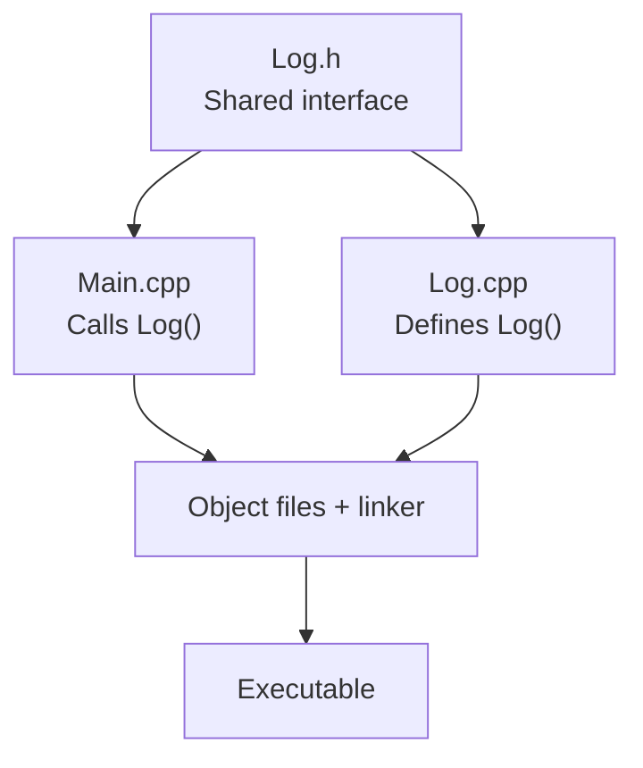
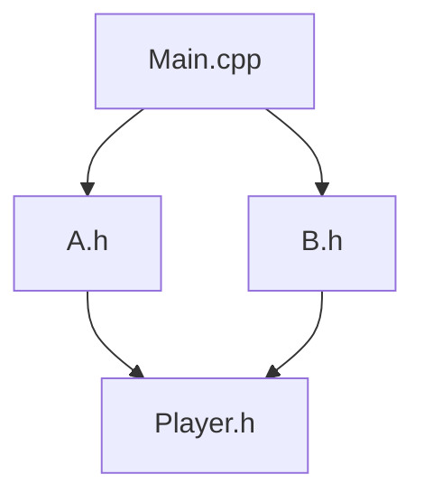
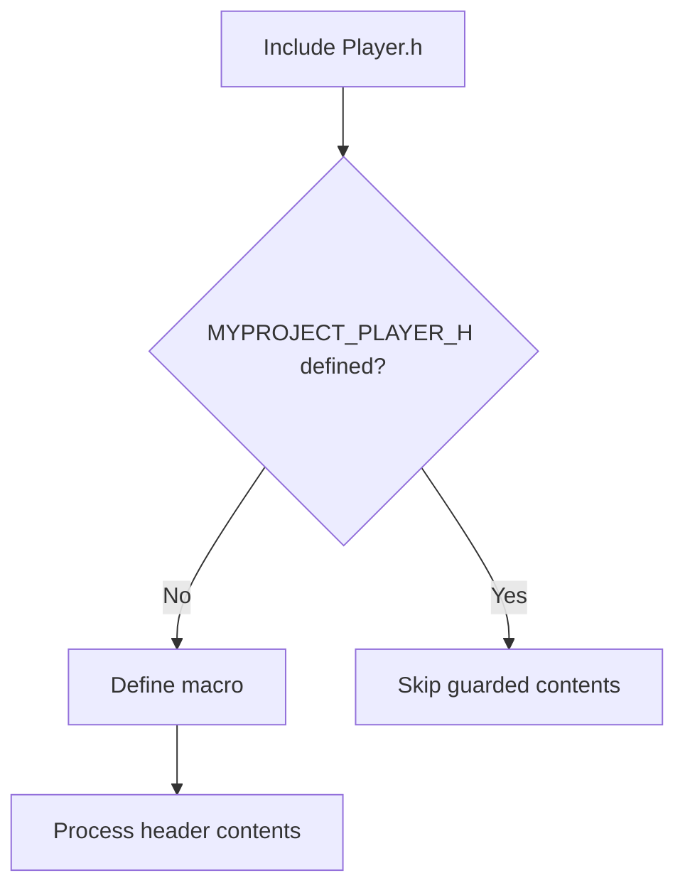

# C++ Header Files

> Based on The Cherno's *C++ Header Files* lesson. These notes focus on the practical mental model for headers, declarations, inclusion, and include guards.

## 1. The purpose of a header

A **header file** (`.h` or `.hpp`) shares declarations and other information that multiple source files need. It commonly describes a component's **interface**; a `.cpp` file commonly contains its implementation.

```cpp
// Log.h
#pragma once

void InitLog();
void Log(const char* message);
```

```cpp
// Log.cpp
#include "Log.h"

void InitLog()
{
    // Implementation goes here.
}

void Log(const char* message)
{
    // Implementation goes here.
}
```

```cpp
// Main.cpp
#include "Log.h"

int main()
{
    InitLog();
    Log("Hello");
}
```

The header lets `Main.cpp` know that `Log` and `InitLog` exist and what their signatures are. The implementation lives in `Log.cpp`.



The diagram is conceptual: including a header makes declarations visible during compilation; it does not itself link the implementation.

## 2. Declaration vs. definition

A **declaration** introduces a name and tells the compiler how it can be used:

```cpp
void Log(const char* message);
```

A **definition** provides the function body:

```cpp
void Log(const char* message)
{
    // Do something with message.
}
```

A declaration ends with a semicolon; a function definition has a body. A class definition is also a definition, even when member functions are only declared inside it.

## 3. What `#include` actually does

`#include` is a **preprocessor directive**, not a runtime link. Conceptually, the preprocessor inserts the included file's contents at that location before ordinary compilation.

```cpp
#include "Log.h"
```

This makes the declarations from `Log.h` visible in that translation unit. The `.cpp` files are compiled separately, and the linker later connects references to definitions.

## 4. Why repeated inclusion is a problem

A header can be included directly more than once or indirectly through other headers:



Without protection, the contents of `Player.h` may be processed twice in the same translation unit. Repeating a class definition this way can cause a redefinition error.

## 5. Prevent repeated inclusion

### Common modern approach: `#pragma once`

```cpp
// Player.h
#pragma once

struct Player
{
    int x;
    int y;
};
```

This asks the implementation to process the header only once per translation unit. It is widely supported by modern compilers, though it is not a traditional standard preprocessor directive.

### Traditional approach: include guards

```cpp
#ifndef MYPROJECT_PLAYER_H
#define MYPROJECT_PLAYER_H

struct Player
{
    int x;
    int y;
};

#endif
```

How the guard works:



The macro name must match in `#ifndef` and `#define`, and should be unique enough to avoid collisions. `#endif` closes the conditional section.

For a small project, `#pragma once` is usually convenient. Include guards remain a portable, explicit alternative. Follow the convention already used by a project.

## 6. Quotes vs. angle brackets

```cpp
#include "Player.h"   // Commonly project/local headers
#include <iostream>   // Commonly standard or external headers
```

- `"file"` generally searches the including file's directory first, then configured include paths according to the implementation's rules.
- `<file>` generally searches configured system/include paths.

These are conventions and search rules—not a guarantee based solely on who owns the file.

## 7. C headers and C++ standard-library headers

Common C-style names include:

```cpp
#include <stdio.h>
#include <stdlib.h>
#include <string.h>
```

C++ standard-library headers commonly omit `.h`:

```cpp
#include <iostream>
#include <string>
#include <vector>
```

The absence of `.h` does not mean a file is not a header. In C++, the C library also has corresponding headers such as `<cstdio>` and `<cstring>`; prefer the appropriate C++ header style in modern C++ code when suitable.

## 8. Headers can contain more than function declarations

Headers may contain class and struct definitions, enums, type aliases, templates, inline functions, constants, and macros—anything that needs to be visible to including code.

```cpp
// Player.h
#pragma once

class Player
{
public:
    void Move();

private:
    int x = 0;
    int y = 0;
};
```

The class definition must be visible wherever code needs to know the class's size, members, or interface. The out-of-line implementation of `Player::Move()` can live in a `.cpp` file.

Avoid putting ordinary non-`inline` function definitions or global variable definitions in headers that are included by many `.cpp` files: that can create multiple-definition linker errors. Templates and some `inline` definitions are common exceptions because their definitions generally need to be visible at the point of use.

## 9. A typical project layout

```text
Project/
├── Main.cpp
├── Log.h
└── Log.cpp
```

A reliable pattern is:

1. Put the shared interface in `Log.h`.
2. Include `Log.h` in `Log.cpp` as well as in callers.
3. Put non-inline function definitions in `Log.cpp`.
4. Compile both `.cpp` files and link their object files into the executable.

Including the header in its own implementation file helps the compiler check that the definition agrees with the declaration.

## Quick reference

| Concept | Remember |
|---|---|
| Header | Shares declarations and other information |
| Declaration | Says a name/signature exists |
| Definition | Provides the entity's definition |
| `#include` | Preprocessor inclusion, not runtime linking |
| `#pragma once` | Common protection against repeated inclusion |
| Include guard | `#ifndef` + `#define` + `#endif` |
| `"Header.h"` | Common for project headers |
| `<header>` | Common for standard/external headers |

## Key takeaways

- Headers help source files share interfaces.
- A header is processed as part of each translation unit that includes it.
- Include protection prevents repeated processing in one translation unit.
- A header is not limited to declarations, but definitions in headers must be chosen carefully.
- The linker connects compiled references to definitions; `#include` does not do that job.

## Self-check

1. Why can `Main.cpp` call `Log()` when it includes `Log.h`, even though the body is in `Log.cpp`?
2. What is the difference between `#include` and linking?
3. Why can including `Player.h` through both `A.h` and `B.h` cause a problem?
4. What is the purpose of an include guard?
5. Why can putting a normal function definition in a header cause a linker error?

## Related notes

- [[Cpp-Functions]]
- [[Cpp-Classes-and-Structs]]
- [[Cpp-Variables-and-Data-Types]]
- [[Cpp-Pointers]]
