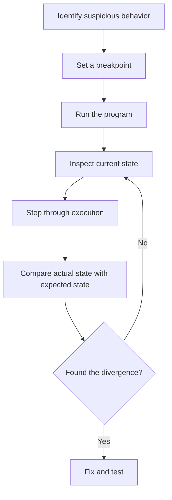

# Debugging C++ on Linux with GDB

> **Purpose:** Learn a repeatable debugging workflow: pause execution, step through code, inspect state and memory, and find where actual behavior diverges from expected behavior.
>
> The source lesson demonstrates Visual Studio/MSVC. These notes focus on the concepts that transfer to Linux, using **GDB** and GCC/Clang. VS-specific UI details and MSVC debug-memory patterns are kept separate.

## 1. What debugging is

**Debugging** is the process of investigating program behavior to find and fix bugs. Bugs can come from incorrect logic, assumptions, unexpected values, memory misuse, control flow, or interactions between components.

A program can compile successfully and still be wrong:

```cpp
int a = 5;
int b = 10;

int result = a - b; // Compiles, but perhaps addition was intended.
```

A useful mindset is: **assume the program is doing what the code asks it to do, then investigate why.** Follow the evidence instead of guessing.

Debugging helps answer questions such as:
- What line is executing now?
- What values do variables have?
- Which function calls led here?
- When did the state stop matching my expectations?
- What bytes are stored at a particular address?

## 2. Build for debugging

Compile with debug information and disable optimization while learning or investigating a tricky bug:

```bash
g++ -g -O0 main.cpp -o program
```

For multiple source files:

```bash
g++ -g -O0 main.cpp Log.cpp -o program
```

- `-g` asks the compiler to include debugging information so GDB can relate machine instructions to source code, variables, and functions.
- `-O0` disables optimization. It often makes stepping and variable inspection easier.

These flags do different jobs. Debug information can also be included in optimized builds, but optimization may inline functions, remove or transform variables, reorder operations, and make source-level stepping less intuitive.

## 3. The basic GDB workflow

Start GDB:

```bash
gdb ./program
```

Then a typical session looks like:

```text
(gdb) break main
(gdb) run
(gdb) next
(gdb) print variable
(gdb) continue
```



A **breakpoint** tells the debugger to pause execution when a chosen location is reached. For example:

```text
(gdb) break main
(gdb) break main.cpp:10
(gdb) run
```

Breakpoints should correspond to executable code. A comment does not represent an instruction that can execute.

## 4. Stepping commands

The core commands are:

| Action | GDB command | Meaning |
|---|---|---|
| Run | `run` / `r` | Start the program |
| Continue | `continue` / `c` | Resume until another breakpoint or program termination |
| Step over | `next` / `n` | Execute the current source line without entering called functions |
| Step into | `step` / `s` | Enter a function called on the current line when possible |
| Step out | `finish` | Run until the current function returns |
| Set breakpoint | `break` / `b` | Pause at a function or source location |

Example:

```cpp
int Add(int a, int b)
{
    int result = a + b;
    return result;
}

int main()
{
    int x = 10;
    int y = 20;
    int result = Add(x, y);
    return 0;
}
```

If execution stops on `int result = Add(x, y);`:
- `next` runs the call and stops at the next source line in `main`.
- `step` enters `Add` so you can inspect its parameters and body.
- `finish`, when inside `Add`, runs until the function returns to its caller.

The current highlighted source line generally represents the next statement to execute, not necessarily one that has already completed. Exact presentation depends on the debugger and source mapping.

## 5. Inspect variables and expressions

Use `print` (or `p`) to inspect values:

```text
(gdb) print x
(gdb) print y
(gdb) print result
(gdb) print x + y
```

You can also inspect an address:

```text
(gdb) print &x
```

GDB prints results with convenience-variable labels such as `$1`, `$2`, and so on. These labels are GDB's result history, not variables in your C++ program.

To automatically display an expression each time execution stops:

```text
(gdb) display x
```

To list active automatic displays:

```text
(gdb) info display
```

To remove one, use its display number:

```text
(gdb) undisplay 1
```

The display number is the number GDB assigned to that display expression.

## 6. Inspecting memory

C++ concepts such as pointers, addresses, arrays, and dynamic allocation become easier to investigate when you can inspect raw memory.

```cpp
int a = 10;
```

- `a` refers to the variable's value.
- `&a` obtains its address.

Use GDB's `x` command to **examine memory**. Its general form is:

```text
x/nfu address
```

where:
- `n` is the number of units to examine,
- `f` is the display format,
- `u` is the unit size,
- `address` is the location to inspect.

For example:

```text
(gdb) print &a
(gdb) x/4xb &a
```

`x/4xb &a` examines four **bytes**, displayed in hexadecimal, starting at the address of `a`.

Another example:

```text
(gdb) x/4xw &a
```

This examines four units of size `w` (GDB's word unit) in hexadecimal. The exact amount of memory read depends on the count and unit size.

Useful format/size letters include:
- Formats: `x` hexadecimal, `d` decimal, `t` binary, `c` character, `s` string, `i` machine instruction.
- Sizes: `b` byte, `h` halfword, `w` word, `g` giant word.

Use memory examination only on addresses that are meaningful to inspect. An address is not automatically safe to read just because you can print it.

## 7. Uninitialized variables and debug memory patterns

Consider:

```cpp
int a; // Automatic local variable, not initialized.
```

Do **not** assume `a` contains zero or any particular value. Reading an uninitialized automatic `int` can cause undefined behavior. Initialize variables when appropriate:

```cpp
int a = 0;
```

The source video discusses the byte pattern `0xCC` (for example, `CC CC CC CC`) seen in some MSVC debug configurations. This is an **implementation/debug-runtime detail**, not a rule of C++ and not something to expect from GCC/Clang on Linux.

Debug runtimes may use recognizable patterns or guard regions to help diagnose memory errors. Such diagnostics vary by toolchain and configuration. Never write program logic that relies on a debug memory pattern.

### Buffer overflows

Writing outside an array's bounds can corrupt unrelated memory:

```cpp
char buffer[8];
// buffer[20] = 'A'; // Out-of-bounds write: undefined behavior.
```

Conceptually, a diagnostic runtime may surround a region with guard data:

```text
[ guard ][ buffer ][ guard ]
                    ^
             out-of-bounds write
```

If the guard changes, a tool may detect the corruption. This is only a conceptual model: whether such checks exist depends on the tools and build configuration.

## 8. Debugging vs. release builds

| Debug-oriented build | Optimized/release-oriented build |
|---|---|
| Commonly built with `-g -O0` while learning | Commonly built with optimization such as `-O2` |
| Usually easier to step through | May inline functions or transform control flow |
| Variables and source lines are often easier to inspect | Some variables may be optimized away or not match source-level expectations |
| Can still expose bugs | Bugs may appear differently under optimization |

Debug and release builds can behave differently when the program contains undefined behavior. Optimization is not itself the bug; it can reveal that the code depended on behavior C++ does not guarantee.

## 9. A small hands-on exercise

Save as `main.cpp`:

```cpp
#include <iostream>

int Add(int a, int b)
{
    int result = a + b;
    return result;
}

int main()
{
    int x = 10;
    int y = 20;
    int result = Add(x, y);

    std::cout << result << '\n';
    return 0;
}
```

Compile and launch:

```bash
g++ -g -O0 main.cpp -o program
gdb ./program
```

Try this sequence:

```text
(gdb) break main
(gdb) run
(gdb) next
(gdb) print x
(gdb) print y
(gdb) step
(gdb) print a
(gdb) print b
(gdb) next
(gdb) print result
(gdb) finish
(gdb) print result
(gdb) continue
```

Observe exactly when each variable becomes available and how stepping changes the current function. If a command doesn't behave as expected, inspect the current source line and use `help <command>` in GDB.

## 10. Using GDB through VS Code

VS Code is an editor that can provide a graphical interface to a debugger; it does not replace the underlying debugger. On Linux, a VS Code C++ debugging extension can use GDB to provide breakpoints, stepping, variable inspection, and a call stack.

The concepts remain the same whether you type GDB commands in a terminal or use the extension's UI. Knowing the command-line workflow is valuable because it makes the debugger's actions easier to understand and helps when working on remote machines or outside the editor.

## 11. Quick reference

| Goal | GDB command |
|---|---|
| Break at `main` | `break main` |
| Break at a source line | `break main.cpp:10` |
| Start | `run` |
| Continue | `continue` |
| Step over | `next` |
| Step into | `step` |
| Finish current function | `finish` |
| Print value/expression | `print expression` |
| Print address | `print &variable` |
| Auto-display expression | `display expression` |
| Examine memory | `x/nfu address` |
| Disassemble function | `disassemble main` |
| Get command help | `help command` |

## Self-check

1. What does `-g` do, and how is it different from `-O0`?
2. When would you use `next` rather than `step`?
3. What does `finish` do when you're inside a function?
4. How is `print &a` different from `print a`?
5. What does `x/4xb &a` ask GDB to display?
6. Why should you not expect `0xCCCCCCCC` in an uninitialized variable on Linux?
7. Why can debugging optimized code be harder?

## Related notes

- [[Cpp-Pointers-Visual]] — pointers, addresses, and memory
- [[Cpp-References]] — references and object access
- [[Cpp-Conditions-and-Branches-Visual]] — conditions and control flow
- [[Cpp-Loops-Visual]] — loop execution and stepping through iterations
