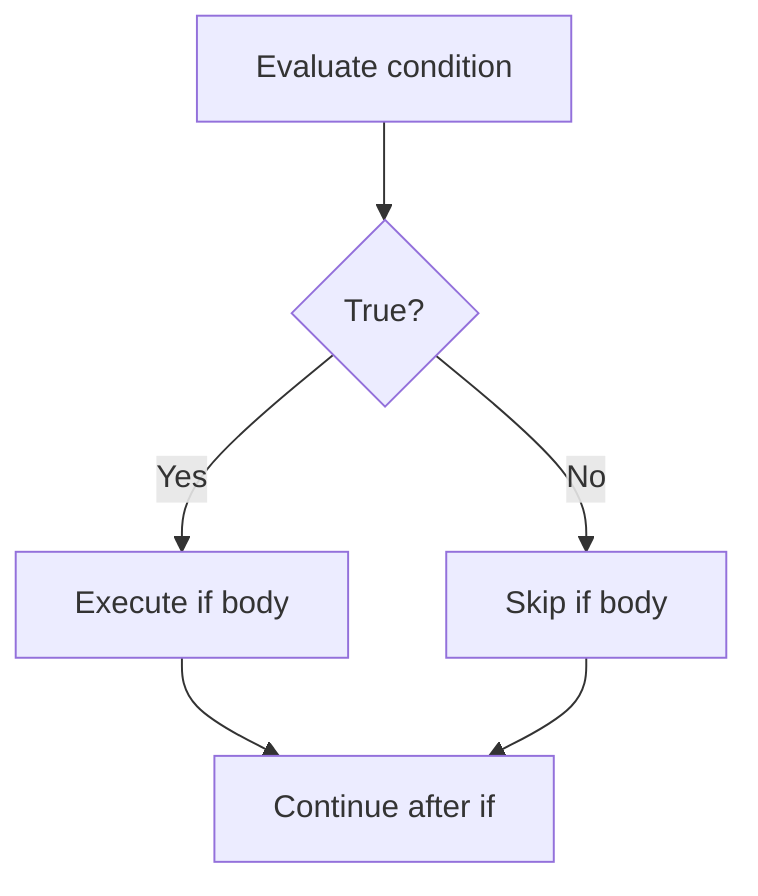
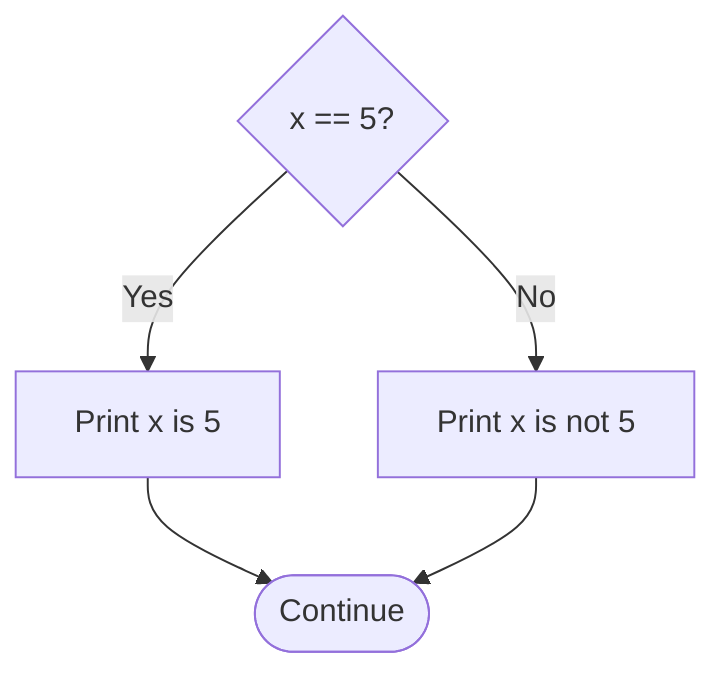
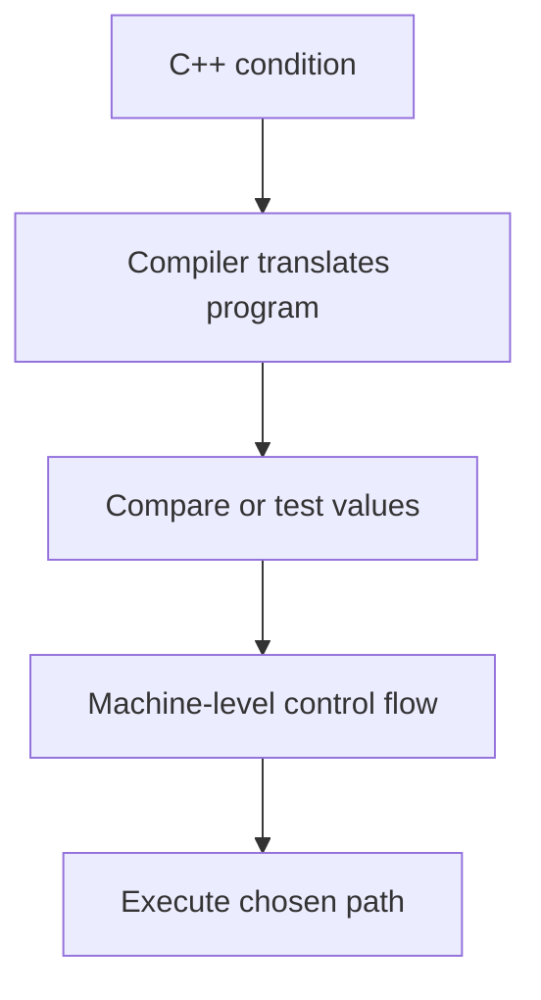

# C++ Conditions and Branches

> **Goal:** Understand how C++ conditions choose which code runs, how values are interpreted in a Boolean context, and how the compiler may implement branches.

## 1. Evaluation vs. branching

An `if` statement involves two related ideas:

1. **Evaluation:** evaluate the condition.
2. **Branching:** use the result to choose the execution path.

```cpp
int x = 10;

if (x > 5)
{
    std::cout << "Greater than 5\n";
}
```

Here, `x > 5` evaluates to `true`, so the body executes. If it evaluates to `false`, the body is skipped.



This changes the program's **control flow**: execution does not simply proceed through every statement in source order.

## 2. Comparison operators

| Operator | Meaning | Example |
|---|---|---|
| `==` | Equal to | `x == 5` |
| `!=` | Not equal to | `x != 5` |
| `<` | Less than | `x < 5` |
| `>` | Greater than | `x > 5` |
| `<=` | Less than or equal to | `x <= 5` |
| `>=` | Greater than or equal to | `x >= 5` |

### `=` versus `==`

These operators do different jobs:

```cpp
x = 5;   // Assign 5 to x
x == 5;  // Evaluate whether x equals 5
```

A comparison produces a Boolean result:

```cpp
int x = 10;
bool result = (x == 10); // true
```

## 3. Boolean values and conditions

C++ has the built-in type `bool`, whose logical values are `true` and `false`.

```cpp
bool isRunning = true;
bool finished = false;

if (isRunning)
{
    // Runs when isRunning is true.
}

if (!finished)
{
    // Runs when finished is false.
}
```

A condition does **not** have to be written as a comparison or as `someBool == true`. If the expression can be used in a Boolean context, it can be an `if` condition.

### Integer-to-Boolean conversion

For integer values:

- `0` converts to `false`.
- Any non-zero integer converts to `true`.

```cpp
if (0)    { /* does not run */ }
if (1)    { /* runs */ }
if (-5)   { /* runs */ }
if (100)  { /* runs */ }
```

This can be useful to understand, but in ordinary application code a named Boolean or a meaningful comparison often communicates intent more clearly than `if (42)`.

The C++ language specifies the logical behavior; do not assume every implementation uses the same physical representation for a `bool`. A `bool` commonly occupies one byte, but its exact size is implementation-dependent.

## 4. `if`, `else`, and `else if`

### `if`

Executes a statement when its condition is true:

```cpp
if (score >= 50)
{
    std::cout << "Passed\n";
}
```

### `else`

Provides an alternative when the `if` condition is false. Exactly one of these two bodies executes:

```cpp
if (x == 5)
{
    std::cout << "x is 5\n";
}
else
{
    std::cout << "x is not 5\n";
}
```



### `else if`

An `else if` chain checks conditions in order. Once a condition matches, its body runs and the remaining chain is skipped.

```cpp
if (x == 1)
{
    std::cout << "One\n";
}
else if (x == 2)
{
    std::cout << "Two\n";
}
else if (x == 3)
{
    std::cout << "Three\n";
}
else
{
    std::cout << "Something else\n";
}
```

`else if` is not a separate multiword keyword. Grammatically, it is an `else` whose controlled statement is another `if`:

```cpp
if (condition1)
{
    // A
}
else
{
    if (condition2)
    {
        // B
    }
}
```

The compact `else if` spelling is easier to read for a chain. Braces also make nested control flow clearer and help avoid mistakes involving which `if` an `else` belongs to.

## 5. Pointer conditions

Pointers can be used as conditions:

```cpp
const char* ptr = "Hello";

if (ptr)
{
    // ptr is not a null pointer.
}
```

A pointer condition is true when the pointer is non-null and false when it is null. These forms express the same intended check:

```cpp
if (ptr)
{
    // ...
}

if (ptr != nullptr)
{
    // ...
}
```

`if (ptr)` is concise and idiomatic; `if (ptr != nullptr)` makes the comparison explicit. Modern C++ generally prefers `nullptr` to the older `NULL`.

**Important distinction:** non-null does not automatically mean the pointer is valid to dereference. A dangling pointer can be non-null. A pointer check only tests for nullness; it does not prove that the pointed-to object still exists or that access is safe.

## 6. From C++ conditions to machine code

At a conceptual level, a condition influences which instructions execute:



On x86/x86-64, instructions commonly involved in this process include:

- `CMP`: compares operands by updating CPU status flags; it does not normally store a subtraction result in an ordinary variable.
- `TEST`: performs a bitwise-AND-style test for the purpose of setting flags, often used for zero or bit checks.
- `JE`: jump if equal.
- `JNE`: jump if not equal.

Conceptually:

```text
compare/test
    ↓
CPU status flags
    ↓
conditional jump
    ↓
chosen instruction path
```

This is a model, not a promise about exact output. The compiler, target architecture, optimization level, surrounding code, and compiler version can all change the generated instructions. The compiler may also implement a condition without the exact `CMP`/jump sequence you expect.

## 7. Branch prediction and branchless code

Modern processors use branch prediction to guess which way a conditional branch will go. Correct predictions help execution proceed efficiently; incorrect predictions can require discarding speculative work and redirecting execution.

That does **not** mean you should avoid ordinary `if` statements. Predictable branches are common and often efficient. Branchless techniques may help in specific performance-sensitive situations, but they can also make code harder to understand or fail to improve performance. Prefer clear code first, then measure before optimizing.

## 8. Compiler optimizations

### Constant folding

If the compiler can determine an expression's value at compile time, it can evaluate it early.

```cpp
if (6 == 5)
{
    std::cout << "Impossible\n";
}
```

The condition is always false, so the compiler can know the body will not execute.

### Dead code elimination

The compiler may remove code it can prove cannot execute:

```cpp
if (false)
{
    // This body can be eliminated.
}
```

Related optimizations may simplify conditions, remove unnecessary variables, inline functions, or reorder instructions while preserving the program's required behavior.

### Debug vs. optimized builds

A debug build often prioritizes debuggability; an optimized build may transform the code substantially. Therefore, disassembly from a debug build may look very different from disassembly from an optimized build even when both implement the same source-level behavior.

## 9. Inspecting generated assembly on Linux

You can explore the compiler's output yourself. Given a file named `main.cpp`:

```bash
# Generate assembly with optimizations disabled
g++ -O0 -S main.cpp -o main-O0.s

# Generate assembly with optimizations enabled
g++ -O2 -S main.cpp -o main-O2.s

# Build a debug-friendly executable
g++ -g -O0 main.cpp -o program

# Inspect a function using GDB
gdb ./program
```

Inside GDB:

```text
disassemble main
```

Compare the two assembly files and look for differences. Keep the experiment small, and remember that assembly is the compiler's implementation of the C++ program—not a one-to-one textual translation.

## 10. Common mental models

### Source-level decision

```text
evaluate condition
        ↓
    true or false
        ↓
execute one path / skip it
```

### Lower-level intuition

```text
C++ source
    ↓
compiler
    ↓
machine instructions
    ↓
control flow follows the condition
```

The second diagram is intentionally simplified. The compiler is free to use different instructions or optimizations as long as the program follows the C++ rules.

## Quick revision

| Concept | Remember |
|---|---|
| Condition evaluation | Determines the condition's value |
| Branching | Selects which path executes |
| `=` vs `==` | Assignment vs equality comparison |
| Integer in Boolean context | Zero is false; non-zero is true |
| Pointer in Boolean context | Null is false; non-null is true |
| `else if` | An `else` controlling another `if` |
| `CMP` | Updates CPU flags based on comparison |
| `TEST` | Updates CPU flags based on a bitwise test |
| Constant folding | Evaluates known expressions at compile time |
| Dead code elimination | Removes code proven unnecessary/unreachable |
| Branch prediction | CPU guesses a branch's likely direction |

## Self-check

1. What are the two conceptual steps involved in an `if` statement?
2. How does `x = 5` differ from `x == 5`?
3. Why does `if (value)` execute for a non-zero integer?
4. What does `if (ptr)` test—and what does it **not** prove?
5. Why might debug and optimized builds show different assembly?
6. Why should you measure performance before trying to remove branches?

## Related notes

- [[Control-Flow]] — `break`, `continue`, and `return`
- [[Cpp-Loops]] — repetition and loop conditions
- [[Cpp-Pointers]] — pointer values and `nullptr`
- [[Cpp-References]] — references and object access
