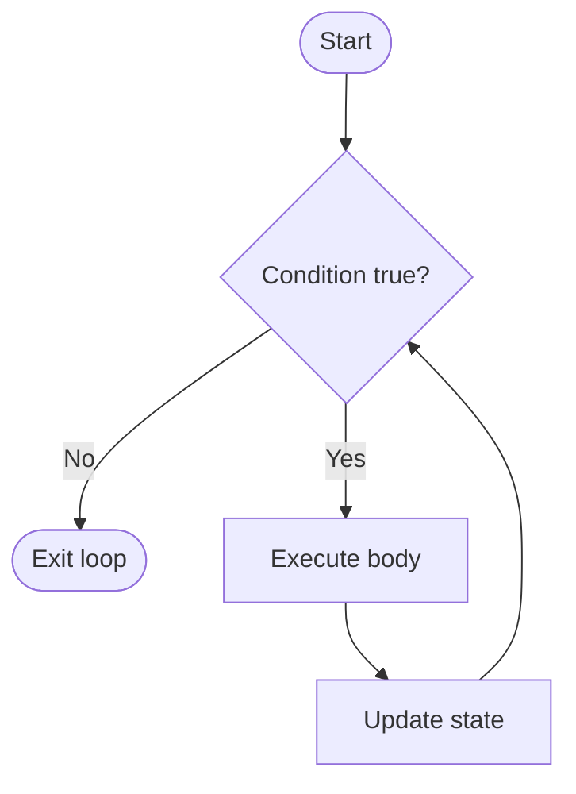
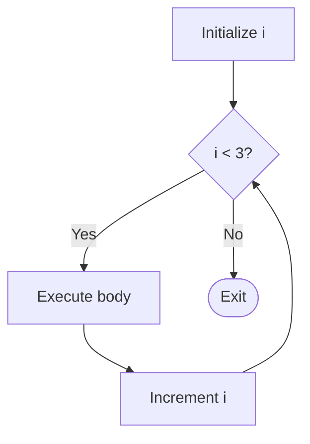
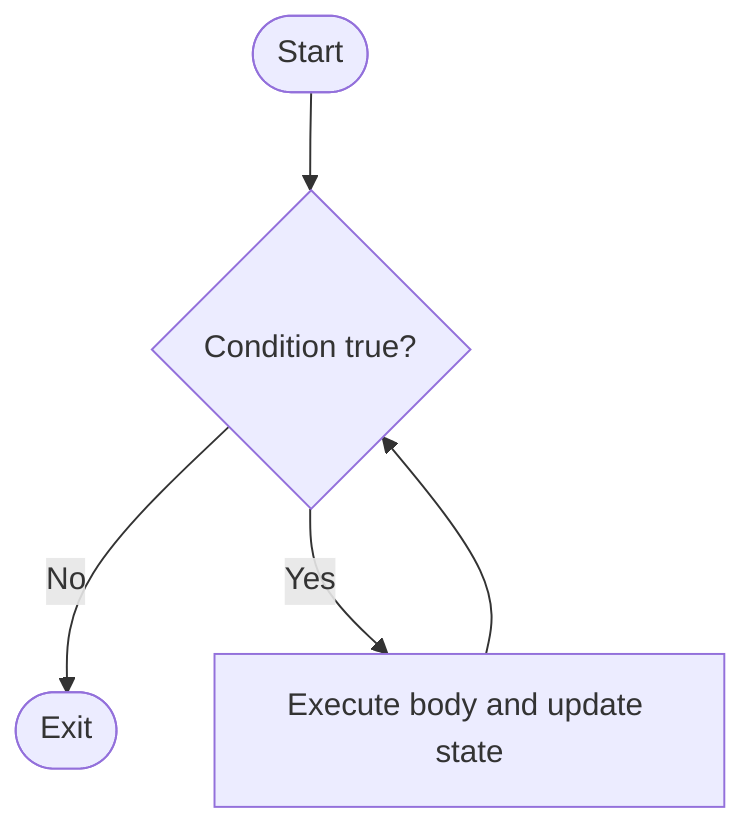
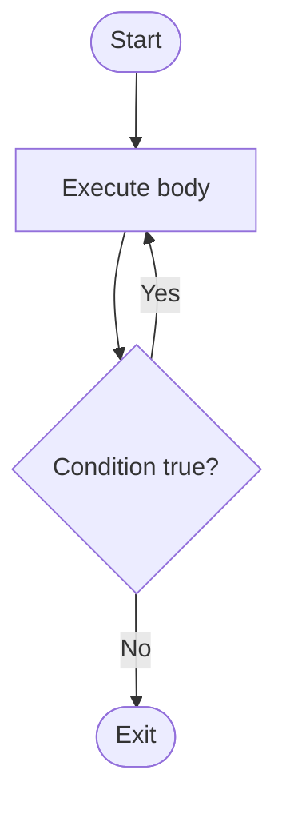
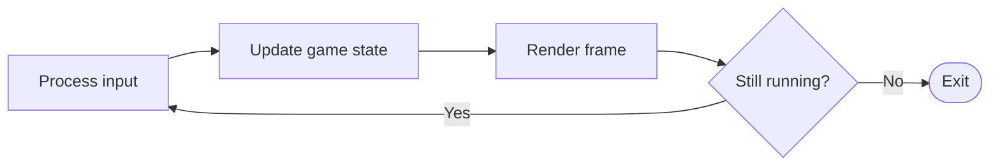

# Loops in C++

> **Purpose:** Understand how `for`, `while`, and `do-while` loops repeat work, how their control flow differs, and how to avoid common loop bugs.

## 1. The idea behind loops

A **loop** repeatedly executes a block of code. Loops are useful whenever an operation needs to happen multiple times: counting, traversing a sequence, waiting for a state change, or repeatedly updating a game.

Without a loop, printing the numbers 1–5 requires repeated statements:

```cpp
std::cout << 1 << '\n';
std::cout << 2 << '\n';
std::cout << 3 << '\n';
std::cout << 4 << '\n';
std::cout << 5 << '\n';
```

With a loop:

```cpp
for (int i = 1; i <= 5; ++i)
{
    std::cout << i << '\n';
}
```

The loop expresses the pattern once instead of copying the same operation.

### General control flow



The exact order depends on the loop type. `for` and `while` check before the body; `do-while` checks after it.

## 2. The `for` loop

Use `for` when the iteration pattern is naturally expressed with initialization, a condition, and an update—often when counting or traversing a sequence.

```cpp
for (initialization; condition; update)
{
    // loop body
}
```

Example:

```cpp
for (int i = 0; i < 5; ++i)
{
    std::cout << i << '\n';
}
```

Output:

```text
0
1
2
3
4
```

### The three expressions

| Part | When it runs | Purpose |
|---|---|---|
| Initialization | Once, before the first condition check | Establish initial state, often `int i = 0` |
| Condition | Before every iteration | If `true`, enter the body; if `false`, exit |
| Update | After the body, before the next condition check | Advance the state, often `++i` |

The body runs between the condition and update.

### Execution trace

For `for (int i = 0; i < 3; ++i)`:

| Step | Value of `i` | Check `i < 3` | Action |
|---|---:|---|---|
| 1 | 0 | `true` | Print `0`, then increment |
| 2 | 1 | `true` | Print `1`, then increment |
| 3 | 2 | `true` | Print `2`, then increment |
| 4 | 3 | `false` | Exit; body does not run |



### Updating the loop variable

The update expression need not be `i++`.

```cpp
for (int i = 0; i < 10; i += 2)
{
    std::cout << i << '\n';
}
// 0, 2, 4, 6, 8
```

```cpp
for (int i = 5; i > 0; --i)
{
    std::cout << i << '\n';
}
// 5, 4, 3, 2, 1
```

`++i`, `i++`, `--i`, `i--`, and compound assignments can all be used where appropriate. In a simple counter update, `++i` and `i++` both advance `i` by one; their expression values differ, but that difference is not used here.

### Optional expressions and infinite loops

The initialization, condition, and update expressions can be omitted. The semicolons remain:

```cpp
int i = 0;

for (; i < 5; )
{
    std::cout << i << '\n';
    ++i;
}
```

An omitted condition means the condition is treated as always true:

```cpp
for (;;)
{
    // Repeated work
    if (shouldStop)
        break;
}
```

An infinite loop can be intentional—for example, a continuously running application—but it needs a sensible way to stop or otherwise make progress.

## 3. The `while` loop

A `while` loop is useful when repetition is mainly controlled by a condition or state, rather than by a counter with a clear endpoint.

```cpp
while (condition)
{
    // loop body
}
```

Example:

```cpp
int i = 0;

while (i < 5)
{
    std::cout << i << '\n';
    ++i;
}
```

A `while` loop checks its condition **before** entering the body. If the condition is initially false, the body executes zero times.

```cpp
int i = 10;

while (i < 5)
{
    std::cout << i << '\n'; // Never executes
}
```

### Control flow



**Important:** Make sure the loop can eventually stop. If the condition depends on a variable that never changes, the loop may run forever:

```cpp
int i = 0;

while (i < 5)
{
    std::cout << i << '\n';
    // Bug: i never changes, so i < 5 stays true.
}
```

Fix it by updating the state:

```cpp
while (i < 5)
{
    std::cout << i << '\n';
    ++i;
}
```

## 4. The `do-while` loop

A `do-while` loop checks its condition **after** executing the body. Therefore, its body runs **at least once**, even if the condition is initially false.

```cpp
do
{
    // loop body
}
while (condition); // Note the required semicolon
```

Example:

```cpp
int i = 10;

do
{
    std::cout << "Hello\n";
}
while (i < 5);
```

Output:

```text
Hello
```

The condition is false, but it is checked only after the first execution.



A menu that must appear at least once is a natural example:

```cpp
int choice = 0;

do
{
    std::cout << "1. Play\n";
    std::cout << "2. Settings\n";
    std::cout << "3. Quit\n";
    std::cin >> choice;
}
while (choice != 3);
```

This illustrates the loop structure; real input handling should also account for invalid input and stream failure.

## 5. Choosing the right loop

| Property | `for` | `while` | `do-while` |
|---|---|---|---|
| Condition checked | Before body | Before body | After body |
| Minimum body executions | 0 | 0 | 1 |
| Initialization/update built into syntax | Yes (both may be omitted) | No | No |
| Common fit | Counting, index-based iteration | State- or condition-controlled repetition | Work that must happen once before deciding to repeat |
| Can run indefinitely? | Yes | Yes | Yes |

A simple `for` loop and an equivalent `while` loop can express essentially the same control flow:

```cpp
for (int i = 0; i < 5; ++i)
{
    std::cout << i << '\n';
}
```

is conceptually equivalent to:

```cpp
int i = 0;

while (i < 5)
{
    std::cout << i << '\n';
    ++i;
}
```

The practical distinction is usually **clarity of intent**, not a fundamental performance difference. Prefer the form that makes the stopping condition and state changes easiest to understand.

- Choose **`for`** when initialization, continuation, and progression belong together.
- Choose **`while`** when the condition/state is the main idea.
- Choose **`do-while`** when the body must run before the first condition check.

## 6. Loops in real programs

Interactive programs often repeat work while they are running. A game loop, for example, may process input, update the game state, and render a frame:

```cpp
bool running = true;

while (running)
{
    // Process input
    // Update game state
    // Render frame
}
```



This is a conceptual example, not a complete game loop: production programs also need to handle timing, events, and other platform-specific concerns.

## 7. Common mistakes

### Forgetting to update state

```cpp
int i = 0;
while (i < 5)
{
    std::cout << i << '\n';
    // Missing ++i: condition never becomes false.
}
```

Check every loop for a clear path toward termination, unless it is intentionally infinite.

### Off-by-one errors

```cpp
for (int i = 0; i < 5; ++i)  // 0, 1, 2, 3, 4
{
}
```

```cpp
for (int i = 0; i <= 5; ++i) // 0, 1, 2, 3, 4, 5
{
}
```

For a sequence of five elements indexed from zero, valid indices are normally `0` through `4`, so `i < 5` is the appropriate bound. For general code, use the actual sequence size rather than hard-coding a number.

### Confusing pre-test and post-test loops

- `for` and `while`: check first, so the body may run zero times.
- `do-while`: run first, check afterward, so the body runs at least once.

### Forgetting the `do-while` semicolon

```cpp
do
{
    // ...
}
while (condition); // The semicolon is required.
```

### Accidentally writing an infinite loop

Ask:
1. What state makes the condition change?
2. Where is that state updated?
3. Is there a reachable path to termination?
4. If the loop is intentionally infinite, how is it controlled or exited?

## 8. Quick reference

```cpp
// Counter / structured iteration
for (int i = 0; i < count; ++i)
{
    // ...
}

// Repeat while a condition remains true
while (isRunning)
{
    // ...
}

// Execute once before checking whether to repeat
do
{
    // ...
}
while (shouldRepeat);
```

Mental models:

- **`for`** — initialize, check, execute, update, repeat.
- **`while`** — while this condition is true, keep doing this.
- **`do-while`** — do this once, then repeat while the condition is true.

## 9. Self-check

Try answering these without looking back:

1. In what order do initialization, condition, body, and update run in a `for` loop?
2. Why can a `while` body execute zero times?
3. What guarantees that a `do-while` body executes at least once?
4. What does `for (;;)` mean?
5. What is the difference between `i < 5` and `i <= 5` when `i` starts at zero and increases by one?
6. What should you inspect first when a loop does not terminate as expected?

## Related notes

- [[Control-Flow]] — `break`, `continue`, and `return`
- [[Arrays]] — index-based iteration and valid bounds
- [[References]] — range-based loops and references, if covered in your notes
